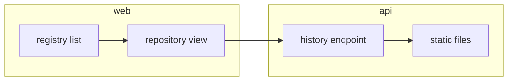

# FORMAT — the spec file contract

This file is the written contract between the files a spec-driven repository carries and the one parser that reads
them, `core/`. It documents what the parser accepts **as implemented**, not as wished; where the implementation is
still a stub, the section says so and names the task that fills it.

- **The files are the truth.** Stage, progress, drift and every number on the dashboard are derived from the files on
  every read. The app's own database never holds a copy of a spec.
- **One parser.** Only `core/` reads this format; the server, the web app and the later plugin import it
  (`bun run check:single-core`). A parser change updates this file in the same task (`core/CLAUDE.md`).
- **What the app never writes.** Nothing in a registered repository: no spec text, no master, no git object, no
  index, no lock file, not `.git/`. Spec 002's light writes are the only exceptions: the reviewed mark with its one
  `events.jsonl` line (ISC-24) and a single task checkbox (ISC-25), each guarded by a sha256 compare-and-swap and the
  lock sources below.
- **Checked.** `bun run check:format-doc` asserts one section per file kind of `core/src/files.ts` (`FILE_KINDS`), in
  that order, each naming its path and holding an example. Every example introduced by a line `From \`path\`:` is
  compared with that file and must occur in it verbatim.

## Glossary

The words this contract uses, one row per term: the Spectant term, the term an issue tracker uses for the same thing,
the German term and a one-sentence definition. Spectant keeps its own words; the common term is a pointer, never a
rename. `core/src/glossary.ts` exports the same rows as `GLOSSARY` through the browser-safe barrel, and
`core/tests/glossary.test.ts` compares each row with its line in this table verbatim, so neither side can change alone.
The app's Help page will render them from that export (a later task of the web lane). The last five rows are the
item states of § The state table (spec 040).

| Spectant term | Common term | German | Definition |
|---------------|-------------|--------|------------|
| Feature | Epic | Feature | A block `### F<n>` of the master that owns claims. |
| Spec | Story | Spec | A numbered folder `specs/NNN-slug/` with a `spec.md`. |
| Claim | Acceptance criterion | Claim | One falsifiable line `- [ ] ISC-<n>:` that closes on its probe. |
| Task | Sub-task | Task | One atomic step of `tasks.md`, hanging on exactly one claim. |
| Milestone | Fix version | Meilenstein | A release named in the master's `## Milestones` block. |
| Idea | Backlog item | Idee | A story file under `specs/ideas/`, the stage before a spec. |
| Stage | Status | Stage | Where a spec stands in its workflow. |
| Workflow | Workflow | Workflow | The ordered stages a spec type runs through, from `specs/workflow.md` or the default. |
| Gate | Quality gate | Gate | A condition a transition needs; two are fixed in every workflow: review before build, and every claim closed before done. |
| Probe | Test | Probe | The command a claim closes on. |
| Actor | Assignee | Akteur | The neutral id in a file, `u:<8 hex>` for a person or `a:<kind>:<id>` for an agent. |
| Agent | Bot | Agent | A Claude Code session or sub-agent working a task, recorded as an `a:` actor. |
| Chore | Chore | Chore | The seventh spec type: `spec.md` only, review then build then done, no code review. |
| Open | To do | offen | The item state in which the next command lies with the user, given with its reason. |
| Waiting | Blocked | wartet | The item state in which the item hangs on another item, given as what it waits on. |
| Running | In progress | läuft | The item state while a run is open on the item and younger than the abort age; the run locks the item. |
| Aborted | Stalled | abgebrochen | The item state of a run without end that is older than the abort age; it locks nothing. |
| Done | Done | fertig | The item state of a finished item; a dropped claim or a struck task is done with that as its detail. |

## Where the files live

A repository root holds the master `ISA.md` (untracked in a public repository) and a `specs/` folder:
`specs/constitution.md`, optionally `specs/tldr.md` and `specs/tech.md`, one folder per spec `specs/NNN-slug/`, and closed specs under
`specs/archive/NNN-slug/`. A spec folder name is three digits, a hyphen and a slug (`^\d{3}-.+$`); other names are
ignored, and symbolic links are not followed. A folder without `spec.md` is not a spec: it gets a diagnostic, no row.
Where `specs/` is tracked in git, a spec with its own worktree is read from that worktree's copy instead (§ Worktrees).
Which of these files, and of a spec folder's `.design/`, the Library lists is "The library catalog" below.

A ref names exactly one folder or nothing (`resolve.ts`): `002`, `002-web-console` or `web-console`, active and
archived folders alike; no match or more than one match is `not_found`, never another spec.

## The thirteen file kinds

Paths are relative to the spec folder, as `FILE_KINDS` holds them. Legend: **R** required (no spec without it),
**S** the stage table stops at this file until it exists, **S3** the same from three claims on, **G** a gate the stage
table waits on until it is fresh, **O** optional, read when present, **—** not part of the type: no stage waits on it
and the type's workflow never asks for it. A spec with an unknown or missing `spec_type` needs neither plan nor tasks.

| Kind | Path | Read as | feature | project | infra | refactor | bug | spike | chore |
|------|------|---------|---------|---------|-------|----------|-----|-------|-------|
| `spec` | `spec.md` | frontmatter, claims, sections | R | R | R | R | R | R | R |
| `plan` | `plan.md` | existence, mermaid fence, hash | S | S | S | O | O | O | — |
| `tasks` | `tasks.md` | task lines, hash | S3 | S3 | O | S3 | O | O | — |
| `context` | `context.md` | goal lock, rounds, questions | O | O | O | O | O | O | O |
| `design` | `design.md` | Markdown, rendered | O | O | O | O | O | O | — |
| `constitution` | `../constitution.md` | frontmatter, lanes | O | O | O | O | O | O | O |
| `rounds` | `rounds.jsonl` | one JSON line per round | O | O | O | O | O | O | O |
| `events` | `events.jsonl` | one JSON line per transition | O | O | O | O | O | O | O |
| `gateReviewed` | `.gates/reviewed.json` | JSON mark | G | G | G | G | G | G | G |
| `gateCodeReviewed` | `.gates/code-reviewed.json` | JSON mark | G | G | G | G | G | G | — |
| `artifacts` | `artifacts/` | directory listing | O | O | O | O | O | O | O |
| `evidence` | `.evidence/` | directory listing | O | O | O | O | O | O | O |
| `master` | `../../ISA.md` | frontmatter, claims, fog | O | O | O | O | O | O | O |

The seven types are `feature`, `project`, `infra`, `refactor`, `bug`, `spike` and `chore`. A **chore** is a small fix
that is its own small spec, never a task collected in a sidelane spec: it carries `spec.md` only and runs review →
build → done. Its claims wait on a fresh reviewed mark like every type's, and once every claim is closed it is done
without a code-reviewed mark and without an edit to `phase: complete` (row 7 of the stage table, below).
`frontmatter.ts` reads `spec_type: chore` like the other six types (spec 008, T38).

Diagrams: a `feature`, `infra` or `project` spec needs a fence whose info string is exactly `mermaid` in both
`spec.md` and `plan.md` (dashboard warning `diagrams`); a `refactor` only warns without one in `spec.md`; a complete
spec is never held to it (`diagrams.ts`).

Beside the thirteen, `FILE_KINDS` holds the repository kinds `idea`, the story files under `specs/ideas/`, and
`workflow`, the one table `specs/workflow.md` (both spec 008, T37), `tokens`, the one measurement
`specs/tokens.jsonl` (spec 009, T1), and `backlog`, the one feature ranking `specs/backlog.md`, with
`backlogEvents`, its log `specs/backlog.events.jsonl` (both spec 036), each documented in its section below. None belongs to a spec folder, so the
table above has no row for them; like `constitution` and `master` they carry `scope: repo` and a path from the
repository root (`repoFilePath`) beside the path relative to an active spec folder.

## `spec` — `spec.md`

The what: frontmatter, goal, Test Strategy, claims with stable IDs and `(after: …)` edges, decisions.

**Frontmatter** (`frontmatter.ts`). The file starts with a `---` line (a BOM is skipped) and a later `---` line
closes the block; an unclosed block is an error and the file reads as having none. Inside, one flat `key: value` per
line, key `[\w-]+`. A value in single or double quotes runs to the closing quote (`\"` unescapes in double quotes); an
unquoted value drops a trailing ` # comment`. Blank lines and `#` lines are skipped; an indented line is ignored with
a warning (nested YAML is not part of the format); a repeated key warns and the last value wins. Typed keys:

| Key | Value | Used for |
|-----|-------|----------|
| `task` | text | the row title (else the folder slug without its number) |
| `slug`, `isa_master`, `isa_feature`, `constitution`, `context_log`, `migrated_from` | text | `isa_feature`'s first word names the master block for `missing_in_spec` |
| `spec_type` | `feature`, `bug`, `refactor`, `spike`, `infra`, `project`, `chore` | the type router; anything else warns `frontmatter-spec-type` and reads as none |
| `phase` | text | `complete` decides stage `done`; otherwise a tooltip only |
| `progress` | `M/N`, M ≤ N | compared with the recount (`progress_mismatch`) |
| `started`, `updated` | ISO 8601 as written | `updated` against the TL;DR's `generated` |
| `principal_stated_goal`, `…_source`, `…_locked` | text | a goal makes `anchors_missing_at_complete` apply |
| `principal_stated_goal_signal` | number | — |
| `context_sufficient`, `interview_invoked` | `true` or `false` | — |
| `archived_reason`, `archived` | text, `YYYY-MM-DD` | the archive listing |
| `milestone` | text | matched by name against the master's `## Milestones` entries (`master`, below); a name no entry carries warns `spec-milestone-unknown` and the spec still parses; a name other than the `Milestone:` line of the spec's main feature (the first word of `isa_feature`) warns `milestone-mismatch` on the spec (`master`, below); without the key the spec belongs to no milestone |
| `priority` | `P1`, `P2`, `P3` or `P4` | the urgency, shown on the dashboard row, the spec head and the breadcrumb; a missing key reads as `P3` without a diagnostic, any other value is a `frontmatter-priority` warning and the file still parses; a story's frontmatter takes the same key (Ideas, below); read from spec 008, T39 on (`SpecFrontmatter.priority`, `SpecHead.priority`), on the dashboard row from T67 (`DashboardSpecRow.priority`, the head's value) |
| `stage` | a stage of the spec type's workflow (`specs/workflow.md`, below, or the default) | the explicit stage: when present it wins over the derived stage and must equal the last `to` of `events.jsonl`, except where the files have overtaken it, not a step back (spec 040, below); a value outside the type's workflow, or one the last event contradicts, is a `stage-mismatch` diagnostic and the derived stage applies; without the key the stage derives from the files as before and is marked derived (`stageSource`, ISC-36); spec 008, T40 reads the key as text (`SpecFrontmatter.stage`, unvalidated) and T47 applies it (`explicitStageOf` in `stage.ts`): a value that is a stage of the type's row and equals the last event's `to` replaces the stage, and the dashboard row and the spec head carry `stageSource: explicit`; the next command and its reason stay the stage table's, since they say what the files still need; `blocked` and `close-pending`, which no row lists, never apply explicitly; T48 adds the diagnostic (`stageMismatchOf` in `stage.ts`): a value outside the type's row, or one the last event's `to` contradicts (a file without any event included, since nothing enters the value), is exactly one `warning` `stage-mismatch` on `spec.md`, at the key's line, `subject` the value as written; spec 040 (T68, ISC-221.2) adds the exception overtaken, not a step back: a value the last event confirms yields to the derived stage when that stage lies further along the type's row (`blocked` counts as `build`, `close-pending` just past it) and the last event is no step back, its `to` not before its `from` in the row; the allocation (`from: null`) is no step back; the derived stage then applies, `stageSource: derived`, without a `stage-mismatch`, so the allocation's `plan` and a forward move that `plan.md`, `tasks.md` or a mark has since overtaken show the stage the files give, while a deliberate step back on the board holds (`StageInput.lastEventFrom`, the last line's `from`) |

Every other key is kept as written (`rest`) and read by nobody.

**A transition writes `stage:`.** A `/spec` command and a drop on the board go through the same transition: it sets or
replaces the `stage:` line of `spec.md`, leaves the rest of the file byte-identical, and appends exactly one line to
`events.jsonl`, so the key and the last event agree. `planTransition` in `core/src/transition.ts` plans the move in
memory and writes nothing (spec 008, T71 for ISC-121, T72 for ISC-31); `server/src/writes.ts` writes the plan. `from` is
the spec's stage as above, explicit or derived, with the spec edges the dashboard row reads (spec 025: a claim an open
spec edge holds is not takeable, and a spec whose open work all waits on open spec edges stands on `blocked`), so a
move starts from the stage the row shows. The move must be one the type's row lists (§ workflow, Derived), or,
under `code_review: feature`, the entry into `close-pending` in place of `code-review`; then the fixed gates apply: a
stage past `review` in the row, and either detour, needs a fresh reviewed mark; `done`, `close` and `close-pending`
need no open claim; `close-pending` needs an open sibling of the spec's main feature, and `code-review` under
`code_review: feature` (or out of `close-pending`) needs none. An accepted plan carries the new text, the last `stage:`
line of the block replaced or, without one, a `stage:` line inserted as the block's last key, each with its
neighbour's line ending, and one event `{ts, from, to, command, actor}` that passes `validateEventLine`, its `command`
the stage table's command for `from` (`/spec-review NNN` for `review → build`). A refused plan carries
`{from, to, reason, command}` and neither text nor event: the reason names what the move needs and, where one fits,
ends in the stage table's phrase (`build needs a fresh reviewed mark: the reviewed mark is stale`); the command is the
stage table's next command for the spec as it stands. Until spec 008, T49 brings `close-pending` into the stage
table's rules and the event vocabulary, a move into `close-pending` that passes every gate is still refused, since its
event line would not validate. A spec without the key derives its stage as before.

**Body.** The goal is the first prose paragraph under `## Goal` (or `## Ziel`); fences, comments and tables are
skipped. The claim section is the first of `## Features`, `## Claims`, `## Criteria`, `## ISC Criteria`,
`## IDEAL STATE CRITERIA` or `### Criteria`; it ends at the next level-two heading **or at a `---` line**. Lines
inside a fenced block are neither claims nor headings.

- A feature block opens with `### F<n>[.<m>] · <name>` (`·`, `:`, `—`, `–` or `-`, or no separator) and may carry one
  `Why:` line before its first claim; in the master, one `Milestone: <name>` line directly under `Why:` assigns the
  feature to a milestone (`master`, below). Another heading of level three or less ends the block; level four does not.
- A claim line is `- [ ] <ID>: <text>`, checked as `[x]` or `[X]`, indented for a nested leaf. The ID is
  `ISC-<n>[.<m>…]`, a domain form (`H-AVAIL`) or a short form (`C4`, `EQ-12`); the separator after it may be `:`,
  `—`, `–`, `-` or nothing. Trailing marks `⟨?: …⟩` / `⟨resolved: …⟩` are lifted off first, then one trailing
  `(after: A, B)` (comma or space separated, a final `.` allowed); code spans never count. A token of exactly three
  digits in that group is a **spec edge** (`afterSpecs`, below), never a claim edge. A leading
  `[DROPPED …]` is a tombstone whose words are its note, and `[DROPPED` anywhere marks the claim dropped. After the
  tombstone, `Anti:` or `Antecedent:` sets the claim's kind. A checkbox without an ID warns and is invisible.
- `## Not yet specified` holds `- fog: <text>` lines, trailing marks lifted.
- `## Test Strategy` rows are positional: `isc | type | check | threshold | tool | anchors_to | severity`. A row whose
  first cell is `isc` or a dash rule is skipped, `\|` is a literal pipe, missing cells read as empty.
- `## Verification` holds `- <ID>: <evidence>` lines (the ID may be followed by `(…)`).
- `## Decisions` is prose: rendered, not parsed.

Progress is recounted from the boxes: closed over live claims, a tombstone leaves both. Edge checks warn on a
duplicate ID, a self edge, an unknown ID and the first cycle.

From `core/fixtures/harbor/specs/002-web-console/spec.md`:

```markdown
---
task: "Show every sync run and its failures in a small web console"
slug: 002-web-console
spec_type: feature
isa_master: ../../ISA.md
isa_feature: F2
milestone: Harbor 1.0
priority: P2
stage: build
constitution: ../constitution.md
phase: building
progress: 25/30
started: 2026-03-03T10:00:00Z
updated: 2026-03-08T16:45:00Z
context_sufficient: true
interview_invoked: false
context_log: context.md
---
```

From `core/fixtures/harbor/specs/002-web-console/spec.md`:

```markdown
## Features

### F2 · Web console
Why: a teammate who never touches the CLI can see what was mirrored, when, and what failed.

- [x] ISC-51: The registry list renders from the API with no console error.
```

From `core/fixtures/harbor/specs/002-web-console/spec.md`:

```markdown
| isc | type | check | threshold | tool | anchors_to | severity |
|-----|------|-------|-----------|------|------------|----------|
| ISC-51 | e2e | registry-list: renders | 0 console errors | `bun run e2e -- registry-list -g render` | derived: console-usable | high |
```

From `core/fixtures/harbor/specs/005-config-format-choice/spec.md`, fog lines and an antecedent claim:

```markdown
## Not yet specified

- fog: whether includes are resolved relative to the including file or to the working directory — needs one real multi-repository config
- fog: whether a comment-preserving writer is required at all — depends on whether the console ever edits the config

## Claims

- [ ] ISC-94: Antecedent: the config format for version 2 is chosen and recorded as a decision.
```

**Derived:** the row's title, type, stage and next command, the progress fraction, the takeable claims, the fog count,
the goal line, the drift and diagram gates, and the warnings `review`, `diagrams`, `closed` (every claim closed,
phase not complete) and `fog`.

## `plan` — `plan.md`

The how: approach, affected files, interfaces, risks, open points. `core/` reads only whether it exists (the stage
table), whether it carries a `mermaid` fence (the diagram rule) and its normalised hash (the reviewed mark). Its
frontmatter is not read. The Docs tab renders it as Markdown (spec 002).

From `core/fixtures/harbor/specs/002-web-console/plan.md`:

````markdown
## Approach

Serve a static Angular build from the API and read everything through one history endpoint. A separate console server would be one more process to run and secure.


````

## `tasks` — `tasks.md`

Atomic task lines, each anchored to one claim, plus the probe mapping. A line `- [ ] T<n>`, `- [x] T<n>` or
`- [X] T<n>` (indent allowed, outside code fences) is a task, checked as landed; this is the task fraction on the
dashboard and in the archive listing. `tasks.ts` (`parseTaskLines`) reads the full grammar:

`- [ ] T<n> · <claim ID> · [flags · ] <lane> — <text> [(after: T<a>, T<b>)] · <paths>`

- the head, up to the first ` — ` outside code spans, is the claim ID (every form `claims.ts` takes: `ISC-60.1`,
  `H-AVAIL`, `C4`), the flags, then the lane token;
- flags `[P]` (may share a round) and `[seam]` (the contract between two lanes; runs alone, its fan-out waits), in
  either order;
- the lane is the token as written, checked against the first column of the constitution's `## Lanes` table; a token
  outside the table is kept with a warning; `operator` is always valid, is the principal's own step and is never
  dispatched;
- `(after: …)` names tasks, not claims (`T3–T5` ranges expand), may stand anywhere in the text and is removed from it;
  a token of exactly three digits in it is a spec edge (`afterSpecs`, see **Spec edges** below), not a task edge;
- the text runs to the last ` · ` outside code spans and may itself hold ` · `, inside or outside code spans;
- `<paths>` follow that last ` · `, split on `, ` outside code spans and parentheses: a code span (or a bare token with
  a `/` or `.`) is one path; a parenthesised item such as `(probe only)` is a path note, not a path; a tail with
  anything else is no path column and stays in the text;
- a struck task is a plain bullet, `- ~~T<n> · …~~ — struck <date>: <reason>`; it is no checkbox and counts in no
  fraction; the Tasks tab shows it as `struck` with its note;
- a malformed task line stays a task (the box count holds) and carries a warning; headers, prose, table rows and
  bullets without a `T<n>` are no tasks;
- `## Probe Mapping` is a table `Task | Claim | Probe`, the first cell listing one or more task IDs or ranges; `\|`
  in a cell is a pipe. Warnings: a mapped id no task line carries, a struck task mapped, a claim that differs from the
  task line's, a task without a row.

The Tasks tab's state per task is the newest `rounds.jsonl` result card of the same task (same id and text): open,
dispatched, held, question, concerns, fail, done or closed; without one the checkbox decides, and a checked box
outranks a round that left the task unfinished. An open spec edge on an open task, or on its claim, makes that task
`held` with the reason `waits on NNN` over an open, dispatched or held state; fail, question and concerns keep theirs.

The frontmatter is not read; the reviewed hash ignores checkbox states and `~~`.

From `core/fixtures/harbor/specs/002-web-console/tasks.md`:

```markdown
- [x] T1 · ISC-51 · [seam] · api — history endpoint contract: run, repository, digest, failure · `api/src/history.contract.ts`
- [x] T2 · ISC-51 · web — registry-list: renders (ISC-51) (after: T1) · `web/src/app/registry-list/`
```

From `core/fixtures/harbor/specs/002-web-console/tasks.md`:

```markdown
- [x] T30 · ISC-77 · [P] · operator — set up the screen-reader profile on the test device · `tests/manual/screen-reader-setup.md`
- [ ] T31 · ISC-77 · operator — screen-reader pass over the sync history (ISC-77) (after: T1, T30) · `tests/manual/screen-reader.md`
```

**Spec edges** (spec 025). A token of exactly three digits in the `(after: …)` of a task in `tasks.md` or of a claim
in `spec.md` names the whole spec with that number, active (`specs/NNN-slug/`) or archived (`specs/archive/NNN-slug/`).
It may share one group with task or claim edges; the parser reads it apart from them into `afterSpecs` (on `Claim`,
`ClaimView` and the task row), in written order, each number once, and `edges` keeps only the `T…` or `ISC-…` ids. A
spec number is no malformed task edge and no unknown claim ID, so it raises neither warning. A group inside a code
span is no edge, as for every edge. A number that no spec folder carries is still read as a spec edge; whether it names a spec is a question for
resolution, not for the parser.

From `core/fixtures/edges/specs/003-route-map/tasks.md`:

```markdown
- [ ] T2 · ISC-5 · web — reuse the stop search for map taps (after: T1, 002) · `src/app/stops/search.ts`
```

From `core/fixtures/edges/specs/003-route-map/spec.md`:

```markdown
- [ ] ISC-6: A stop on the map opens the search result for it. (after: ISC-5, 002)
- [ ] ISC-7: Routes from the imported timetable carry their colour. (after: 001)
```

`T2` waits on `T1` and on spec `002`; `ISC-7` waits on the archived `001`. An edge on a number no spec carries and a
cycle over spec edges are each one `spec-edge` warning on the dashboard row of the spec that carries the edge (ISC-162.4);
the overlap of two specs without an edge is the `spec-overlap` warning (see `constitution`). The build tooling that predates spec 025
does not know spec edges. Until a dispatcher that reads `afterSpecs` builds the specs of a repository, its `tasks.md`
files carry no spec edge.

**Derived:** the task fraction, the lanes on the spec page, the takeable set of the next round (`takeable.ts`: claim
takeable, which needs a fresh reviewed mark, task edges done, no file shared within the round, width 1 for bug, spike
and infra, else 4) and the cards of
the live frame.

## `context` — `context.md`

The context log: the goal lock, question rounds and dated decisions. A record, not an authority; nothing gates on it.
The timeline (`timeline.ts`) reads it in `##`/`###` blocks, headings inside a fence ignored:

- `## Goal — confirmed <ts>` is one decision entry with the goal lock, its body the goal.
- `## Round <n> — <title>, <ts>` opens a round; `<ts>` is the last comma-separated token and must start with a date
  (`2026-09-24` or a full ISO time). A round header without a time yields no entries.
- Each `### Q<n> · <question>` (or `### Q · …`, numbered by position) under a timed round is one decision entry,
  ref `R<round>.Q<n>`, timed by its round. A `- From: <who>` line in it is the entry's actor; `Offered:`, `Chosen:`
  and `Landed in:` lines stay in the body as written.
- Any other `##` heading (`## Still open`, `## Code review — …`) ends the round: its `###` blocks are not events.
  Prose rounds without Q blocks yield nothing. The frontmatter is not read.

From `core/fixtures/leadgen/specs/022-chat-turn-status-and-bulk-delete/context.md`:

```markdown
## Round 3 — during build, 2026-09-27T23:33:05Z

- Solo run: the parent builds the tasks itself in the main tree, serially, no dispatch and no worktrees; the lock protocol does not apply to a solo run.
- second look: off (default)

### Q1 · When should the cited row scroll into view, given that the shortlist is one column beside the docked chat below about 2300px?

- From: T1 (ISC-479), lane `web`
- Offered: as soon as the list is on screen beside the detail — at once on a wide screen, else when the chat closes (recommended) | only while it is on screen at the click | fold the chat's rail on a citation click instead (a new claim)
- Chosen: as soon as the list is on screen
- Landed in: ISC-479's Test Strategy row (refined master-first), master and spec `## Decisions` 2026-09-28
```

**Derived:** the decision entries of the timeline and the Decisions tab of the Docs area.

## `design` — `design.md`

The design pass per viewport for a UI spec: `## Mobile (390)`, `## Tablet (820)`, `## Desktop (1440)` with `### Ist`
and `### Soll`, then the cross-viewport rules. It holds no acceptance criterion. `core/` does not parse it; the Docs
tab renders it as Markdown with a table of contents (spec 002, `markdown-docs.ts`). Its frontmatter is not read.

From `core/fixtures/spectant-001/specs/001-app-skeleton/design.md`:

```markdown
---
spec: 001-app-skeleton
type: feature
design_track: app
viewports: [390, 820, 1440]
updated: 2026-09-28T12:40:00Z
---
```

## `constitution` — `../constitution.md`

The repository constitution shared by every spec: binding rules, gates, lanes, conformance baseline. The dashboard
reads `specs/constitution.md` at a fixed place (the frontmatter key `constitution:` is not used to find it). Its
frontmatter parses like a spec's; `dev_services: <port>=<label>, …` names the local services on the live indicator.
A service whose process runs in a worktree carries `worktree: true`, and one in the spec worktree `.worktrees/NNN-slug`
also `spec`, that spec's number `NNN` (spec 027, ISC-177).
The `## Lanes` table maps path prefixes to lanes for the task grammar (spec 002, T23). The Docs tab renders the rest.

`shared_files: [<path or glob>, …]` names the files every spec may change without the specs waiting on each other,
such as a message catalogue or the lockfile (spec 025, ISC-164). The dashboard compares the paths of every open spec
(not `phase: complete`, not archived): the code spans in the first column of the plan's `## Affected Files and
Modules` table and the task path column of `tasks.md`. Two open specs that change the same file, with no spec edge
between them in either direction, get exactly one `spec-overlap` warning, on the spec that waits: the one at the
earlier stage, then the one with the lower claim progress, then the higher number; it offers the edge
`(after: NNN)` on the other. Paths match after normalising (forward slashes, no leading `./`): equal paths, a folder
written with a trailing `/` covers every path under it, and a path with `*` or `?` is a glob (`*` and `?` within one
folder, `**` across folders). A common path that an entry of `shared_files:` covers, by the same rules, does not
count. Without the key every path counts.

From `core/fixtures/edges/specs/constitution.md`:

```markdown
shared_files: [src/i18n/*.json, bun.lock]
```

From `core/fixtures/harbor/specs/constitution.md`:

```markdown
---
repo: harbor
derived: 2026-03-02T08:00:00Z
standards_version: 1.0.0
design_track: app
viewports: [390, 820, 1440]
dev_services: 4200=Web dev, 8080=API
stack: [bun, typescript, angular]
---
```

From `core/fixtures/harbor/specs/constitution.md`:

```markdown
| Lane | Path prefixes | Context a worker loads | Lane probe |
|------|---------------|------------------------|------------|
| cli | `cli/` | `cli/CLAUDE.md` | `bun test cli/` |
| api | `api/`, `tests/` | `api/CLAUDE.md` | `bun test api/` |
| web | `web/` | `web/CLAUDE.md` | `bun run --cwd web test` |
```

## `rounds` — `rounds.jsonl`

One JSON object per line, one line per implementation round: the whole board after that round. Blank lines are
skipped; a line that is not JSON, or has no parseable `ts`, is skipped with a diagnostic.

| Field | Shape | Read by |
|-------|-------|---------|
| `v` | `1` | nobody yet (not checked) |
| `round` | number | timeline (ref, title); a line without it is no timeline entry |
| `ts` | ISO 8601 | timeline; the newest is the row's `lastRound` and makes a TL;DR stale |
| `mode`, `width` | `"agent"`, number | frames (spec 002) |
| `dispatched` | task IDs | timeline count; a task's `builder` counts as actor only when dispatched |
| `tasks[]` | `{id, claim, lane, seam, parallel, text, paths, state, reason, note?, builder?, reader?, verdict?}` | timeline counts `state: "held"`; frames read the rest |
| `claims` | `{closed, open, closed_this_round}` | timeline counts `closed_this_round` |
| `progress` | `"M/N"` | frames |
| `stop` | text, only when the round stopped early | timeline title and body |

Task states in the fixtures: `held`, `dispatched`, `question`, `concerns`, `fail`, `done`, `closed`. Lines are several
kilobytes; the examples quote one task object and one line's end.

From `core/fixtures/harbor/specs/002-web-console/rounds.jsonl`, a task of round 3:

```json
{"id":"T29","claim":"ISC-76","lane":"web","seam":false,"parallel":false,"text":"empty-state: keyboard reach and focus ring (ISC-76)","paths":["web/src/app/empty-state/"],"state":"question","reason":"claim takeable, edges closed","note":"question: should the empty state link to the sync docs or to the settings page?","builder":"Engineer"}
```

From `core/fixtures/harbor/specs/002-web-console/rounds.jsonl`, the end of round 3:

```json
"progress":"25/30","stop":"a decision only the principal can make"}
```

**Derived:** the round entries of the timeline, the row's last-round time, the scrubber frames of the round board,
and from those frames the Matrix: one row per task id that ever had a card (by lane, `operator` last), one column per
frame plus a re-cut column where tasks.md changed between two lines, each cell the card's state, empty before the
task's first card and absent (dashed) after its last.

**Derived: the re-cut** (spec 002, T18, `recut.ts`, ISC-91). A task is its id together with its text. Between two
consecutive lines, an id with the same text is the same task and carries its card, tries and note; an id with another
text is `changed`; an id gone is `struck`; a new id is `added`, also when it carries a text an old id had (a
renumbering: the old id is struck or changed, and the new id inherits no tries, state or history). Any of the three
sets the `recut` of the dispatch frame that follows (`struck` in the old line's order, `added` and `changed` in the
new one's) and puts a re-cut marker on the scrubber before it, with both round numbers. A struck task has no card from
then on; the live frame shows it `absent` with its strike note while `tasks.md` lists it struck and the last board
held it.

## `events` — `events.jsonl`

One JSON object per line, one line per recorded stage transition: `{ts, from, to, command, actor}`, every field a
string, `ts` ISO 8601. When the file exists its transitions win in the timeline; without it the timeline shows the
stage derived from the files, marked as derived (ISC-36). `from` and `to` are the workflow's stage names (below, one
vocabulary for timeline and stage: the stage table's, `close-pending` among them, and a story's `idea`, spec 008,
T62; `EVENT_STAGES` in `events.ts`); `from` is null only on the creation, the file's first line.
The last line's `from` and `to` decide whether an explicit `stage:` holds against files that have overtaken it: only a
step back (`to` before `from` in the type's row) does (spec 040, ISC-221.2; § `spec`, the `stage` key).

From `core/fixtures/harbor/specs/archive/001-manifest-sync/events.jsonl`, the whole chain of a complete spec:

```json
{"ts":"2026-03-02T09:00:00Z","from":null,"to":"plan","command":"/spec-feature manifest-sync","actor":"u:3f9c0a7d"}
{"ts":"2026-03-02T09:40:00Z","from":"plan","to":"tasks","command":"/spec-plan 001","actor":"u:3f9c0a7d"}
{"ts":"2026-03-02T10:20:00Z","from":"tasks","to":"review","command":"/spec-tasks 001","actor":"u:3f9c0a7d"}
{"ts":"2026-03-02T11:00:00Z","from":"review","to":"build","command":"/spec-review 001","actor":"u:3f9c0a7d"}
{"ts":"2026-03-05T12:10:00Z","from":"build","to":"code-review","command":"/spec-implement 001","actor":"a:claude:sess-7"}
{"ts":"2026-03-05T14:30:00Z","from":"code-review","to":"close","command":"/spec-code-review 001","actor":"u:3f9c0a7d"}
{"ts":"2026-03-05T15:00:00Z","from":"close","to":"done","command":"/spec-complete 001","actor":"u:3f9c0a7d"}
```

A single line in the schema, the transition "Mark reviewed" records (ISC-24):

```json
{"ts":"2026-03-07T15:30:00Z","from":"review","to":"build","command":"/spec-review 002","actor":"u:3f9c0a7d"}
```

**The actor grammar** (spec 008, ISC-119). Every `actor` a file of this contract carries — an `events.jsonl` line,
either gate mark, and the `session` of an activity line or a frontier lock (Activity and lock lines, below) — is a
neutral id, never a name or an e-mail address:

| Form | Pattern | Example | Names |
|------|---------|---------|-------|
| person | `u:[0-9a-f]{8}` | `u:3f9a0c7e` | a person: the first eight hex digits of sha256 over the trimmed, lower-cased git `user.email` of the repository |
| agent | `a:<kind>:<id>` | `a:claude:sess-7` | an agent session of the given kind |
| sub-agent | `a:<kind>:<id>/<task>` | `a:claude:sess-7/T12` | a sub-agent of that session working one task |

`<kind>` and `<id>` are each `[a-z0-9][a-z0-9_-]*` (lower case, so neither can hold a `:` or `/`), `<task>` is a task
id `T[0-9]+` as in `tasks.md`, and the whole value must match with nothing around it.

The person id is unsalted, so two machines with the same `user.email` agree on one person without any exchange.
`core/` derives the `u:` id from the repository's git configuration (spec 008, T59 for the derivation, T77 for reading
`user.email`): `actorIdOf` in `core/src/actor-id.ts` trims and lower-cases the address and hashes it with sha256; an
optional salt is prepended to the normalised address, and no caller passes one. The app maps an id to a display name
and its git identities in its own data directory, never in a file of the repository, and shows an id without a
mapping as the id itself. Any other value is **legacy**: it is read, marked `legacy` and never rejected. The harbor
fixture carries the new forms only (spec 008, T28); the legacy case is `lantern/`'s `specs/002-duplicate-links/events.jsonl`
(T33, actor `principal` on both lines) and the frontier-lock example below. The grammar is read by `parseActor` in
`core/src/actor.ts` (T59), which keeps the raw value and returns the form, the id (`a:<kind>:<id>` for an agent and
its sub-agent) and the task of a sub-agent.

A file that carries at least one legacy actor gets exactly one `warning` diagnostic `actor-legacy` (spec 008, T60), never
one per value: `legacyActorWarning` in `actor.ts`, shared by every reader, names the first legacy value (in the message
and as `subject`), its line when the file has lines, and how many legacy values the file holds. The events reader
(T61) runs every accepted line's `actor` through `parseActor` and carries the result on the event as `actorRef`
(`{raw, kind, id, task?, legacy}`); a legacy actor is accepted, and `parseEvents` adds the file's `actor-legacy` after
the line diagnostics. Only `event-empty` rejects an actor, and a rejected line's actor is not counted. `actorRef` is
read side only: a written line carries the five keys and nothing else (`event-extra-key`). The dashboard lists every
diagnostic of an open spec's `events.jsonl` under that file.

**Validated** (`events.ts`, T16, ISC-32). `parseEvents` reads the file line by line, skips blank lines and keeps file
order; `validateEventLine` checks one line and never throws. A line is rejected with one diagnostic (severity
`error`, its line number, the first rule it breaks) and is not an event: `event-json` (not JSON), `event-not-object`,
`event-missing-key` and `event-extra-key` (exactly the five keys), `event-type` (every value a string, `from` also
null, `to` never), `event-ts` (an ISO 8601 date-time with `Z` or `±hh:mm` on a real calendar day; a date alone is
not an event time), `event-empty` (blank `command` or `actor`), `event-stage` (`from` or `to` is neither a stage name
nor an old word below), `event-same-stage` (`from` equals `to`), `event-null-from` (a null `from` after the first
event). The valid lines are the recorded transitions; a file with no valid line counts as absent.

The older lifecycle words (ISC-24's wording, written by the old skill) are read and normalised to the stage names,
each with a `warning` diagnostic `event-alias` naming the old word, so everything downstream sees one vocabulary
(`EVENT_VOCABULARY_ALIASES`). A stage names what the spec waits for, so a word naming what just happened maps to the
stage after it. A line that the mapping alone makes `build → build` (`reviewed → implementing`) is skipped with a
`warning`, not an error. `idea`, the old word for the creation, is a stage name since spec 008, T62 and reads as the
stage `idea` without a warning, so an old `idea → specified` line is `idea → plan`.

| Old word | Stage |
|----------|-------|
| `specified` | `plan` |
| `planned` | `tasks` |
| `tasked` | `review` |
| `reviewed` | `build` |
| `implementing` | `build` |
| `code-reviewed` | `close` |
| `done` | `done` (the same word) |

**Derived transitions** (`derived-stages.ts`, T15). Without events the timeline replays the stage table over the
files, one `stage` entry per change of stage, `derived: true`, `actor: null`, `from`/`to` in the stage table's names
(the first `from` is null): the creation enters the first stage the type needs (`plan`, `tasks` or `review`) at
spec.md `created:`, else `started:`, else the earliest timed context.md header; plan.md and tasks.md each move it on
at their own `created:`, else at the context.md round titled "before the plan" or "before the tasks" (a file's
`updated:` is its last edit and never dates a transition); `review → build` at the reviewed mark's `at`;
`build → code-review` (always undated) and `code-review → close` at the code-reviewed mark's `at`; `→ done` with
`phase: complete` at `completed:`, else `updated:`; without it, a chore whose claims are all closed steps
`build → done` by the stage table's chore row, always undated (spec 008, T50); under `code_review: none`
(`TimelineInput.codeReview`, spec 028) a spec whose claims are all closed steps `build → close`, always undated, and
a code-reviewed mark adds no step. The first round changes no stage (`build` before and after) and is
its own round entry. A transition the files do not date carries `ts: ""` and `undated: true` and sorts right after the
dated transition before it, as does a date without a time that falls on that transition's day. When the caller passes
the validated events.jsonl lines, they are the stage entries (`derived: false`, with their `actor` and `command`) and
nothing is derived; without them `buildTimeline` reads the spec's own events.jsonl through `parseEvents`, so a folder
with the file shows its recorded transitions and a folder without it derives. The table above maps these names to
ISC-24's `specified → planned → tasked → reviewed` wording.

**Derived: the worktree entry** (`timeline.ts`, spec 027, T14, ISC-175.1). The timeline kind `worktree` comes from
no file: the server passes the git state of the spec's worktree as `worktree: {merged: {at, commit} | null, removed,
branch, path}` beside the commits, and `buildTimeline` turns it into at most one entry, `derived: true` and
`actor: null` like a derived stage transition, without a body. Its two forms:

- **merged** — the spec's branch is an ancestor of `main`: `ref: "merged"`, `ts` the merge commit's date, sorted by
  that instant like any dated entry (after every other source at the same instant), title `Merged into main · <branch>`;
- **removed** — the spec's worktree is gone while its branch is not merged: `ref: "removed"`, `ts: ""` and
  `undated: true`, since git gives no date; by the undated rule it takes the instant of the entry before it, which for
  a removal is the newest of the timeline, and sorts after every entry of that instant, title
  `Worktree removed · <path>`.

Each carries `worktree: {state, branch, path, commit}` (`commit` the merge commit's first seven characters, null on
`removed`) for the web to word and render. Merged wins when both are given; an open branch (`merged: null`,
`removed: false`), `null` or no input yields no entry and the timeline is byte-identical to one built without it.
Nothing is written for either form: `events.jsonl` gets no line, since the merge is the principal's act in git, not a
command of the skill.

## `gateReviewed` — `.gates/reviewed.json`

The reviewed mark: `{gate: "reviewed", at, files: {"spec.md", "plan.md", "tasks.md"}}`, each file a sha256 hex of its
normalised text or `null` for a file that did not exist (an absent key reads as `null`). A missing `gate` warns and is
read from the file name; another gate name is an error. A missing `at` warns.

Normalisation (`normalizeForGate`, byte for byte the old skill's): line endings to LF, a leading frontmatter block
removed, every `- [x]` box reset to `- [ ]`, in `tasks.md` every `~~` removed, in `spec.md` the first `## Not yet
specified`, `## Decisions` and `## Verification` sections removed, trailing spaces trimmed per line, the whole trimmed.
The mark is **fresh** when all three hashes match, **stale** when any differs (the changed files are named),
**missing** without a mark.

From `core/fixtures/harbor/specs/006-partial-push/.gates/reviewed.json`:

```json
{
  "gate": "reviewed",
  "at": "2026-03-08T12:00:00Z",
  "actor": "u:3f9c0a7d",
  "files": {
    "spec.md": "08a83a1bc735b8b7a913eee076ba5eae301e66dadb19037eb07b5beb148439ec",
    "plan.md": null,
    "tasks.md": null
  }
}
```

## `gateCodeReviewed` — `.gates/code-reviewed.json`

The code-reviewed mark: `{gate: "code-reviewed", at, tree, head?, branch?, note?, root?}` plus the accepted findings,
either top-level `code` and `security` counts or nested `findings: {code, security}`. `tree` must be a git object id
(40 or 64 hex) or the mark is unreadable. It is **fresh** only when `tree` equals the tree id of the current working
tree, computed in memory as `git add -A && git write-tree` would print it without writing anything (SHA-1 object
format only); an uncomputable tree reads as stale. For a spec with a worktree of its own (§ Worktrees) that working
tree is the worktree's, not the main checkout's, so a change only in the main checkout leaves the mark fresh
(ISC-176). `root` is informational and a public fixture never carries a machine path there.

From `core/fixtures/harbor/specs/004-retention-policies/.gates/code-reviewed.json`:

```json
{
  "gate": "code-reviewed",
  "at": "2026-03-08T11:00:00Z",
  "actor": "a:claude:sess-4",
  "tree": "0f0b75edd68fe6549744de66e4500c4f95b538bf",
  "head": "da3b7bf10406c1facaabffd3c7acd7853204a65d",
  "branch": "feature/004-retention-policies",
  "code": 0,
  "security": 0,
  "note": "one finding fixed; tree changed since"
}
```

From `core/fixtures/leadgen/specs/022-chat-turn-status-and-bulk-delete/.gates/code-reviewed.json`, the nested shape:

```json
  "findings": {
    "code": 4,
    "security": 0
  },
```

**Who recorded a mark.** Either mark may carry `actor`, the person or agent that recorded it, in the actor grammar
(`events`, above): a `u:` id for a principal's review, an `a:` id when a reviewer agent recorded it. Every harbor
mark carries it since spec 008, T28 (the examples above), and its value is read in the actor grammar by `parseActor`
(T59); `readGateMark` does not carry the key into the mark, and it plays no part in freshness.

**The feature-level mark.** Under `code_review: feature` (§ workflow) one code review, `/spec-code-review F<n>`, covers
every spec of the main feature `F<n>`, and the same code-reviewed mark goes into each target folder with one key more,
`scope: "F<n>"`, beside the fields above (spec 008, T74): `{gate, at, actor?, scope, tree, head?, branch?, code,
security, note?}`, the order `codeReviewedMarkText` in `gates.ts` writes it in. The targets are
`featureCodeReviewTargets(planning, "F<n>")`: every active spec whose main feature is `F<n>` and whose live claims are
all closed in the master (across every block it holds claims of), in folder order; an archived spec is never a
target, and an unknown feature gives none. Both functions are pure and write nothing; the caller writes the text.
That caller is the CLI, `spectant gate code-reviewed F<n> [--root DIR] [--yes]` (spec 008, T93): it refuses, writing
nothing, while any active spec of the main feature still holds an open claim (naming each with its claims), when the
targets are empty, or when the worktree tree id cannot be computed; without `--yes` it prints the plan. With `--yes` it
appends one event per target to `events.jsonl` (`from` the spec's stage, normally `code-review`, `to` `close`,
`command` `spectant gate code-reviewed F<n>`, the viewer's `u:` id or `a:spectant:app`), then computes the tree id
over the worktree as it now stands and writes the same mark, `code: 0` and `security: 0`, with that tree, `head` and
`branch`, into every target folder; with `.gates/` outside the tree, as for every mark, it reads fresh, and the
specs stand in `close` (row 10). A
mark without `scope` is a per-spec mark, as every mark before T74, and reads as before (`CodeReviewedMark.scope`
null); a `scope` that is no `F<n>` reads the same way, with one `gate-scope-invalid` warning. `scope` plays no part in
freshness: the tree id alone decides it. Harbor's spike pair 008/009 (F6) shows the targets: while 009 holds `ISC-131`
open only 008 is one, with it closed both are.

**Derived for both marks:** the gate views on the row and the spec page, the stage (`review`, `code-review`, `close`),
the `review` warning, and one gate entry per mark on the timeline (with files, head, branch and note).

## `artifacts` — `artifacts/`

Versioned task results, read in the Library (see "The library catalog" below). Listed, never parsed (`evidence.ts`, T24), recursively,
dotfiles skipped, sorted by path. Each file carries its path relative to the spec folder, its name, its size in bytes,
its media type from the extension (`md`, `json`, `har`, `png`, `jpg`, `webp`, `gif`, `avif`, `svg`, `log`, `txt`,
`html`; anything else is `application/octet-stream`), the task id when the name starts with `T<n>` followed by `-`, `_`, `.` or nothing, and
its claim:

1. a claim ID of `spec.md` that a path segment is or starts with (`ISC-61/shot.png`, `ISC-61-shot.png`; the longest
   ID wins, so `ISC-60.1-notes.txt` is ISC-60.1);
2. else the first `## Verification` line that names the file by its path relative to the spec folder or by its bare
   name, as a whole token;
3. else none: the file is ungrouped.

No modification time is listed: it moves with every checkout. A symlink is listed and flagged; one that does not
resolve inside `artifacts/` or `.evidence/` is listed as refused (size 0, a warning), never followed, and a symlinked
folder is never descended. A group folder that is itself a symlink is not listed. Serving goes through
`resolveEvidencePath` and nothing outside the two folders and `.design/` of the spec's own folder is ever served
(ISC-83, ISC-113); `.design/` is served for the images the Library reader shows and is no part of this listing (the
library catalog lists it, see "The library catalog" below). A symlink may not cross between
`.design/` and the other two.

From `core/fixtures/harbor/specs/002-web-console/spec.md`, two verification lines naming a result and a raw file:

```markdown
- ISC-60.2: `bun run e2e -- theme-switch -g persist` passed, 2026-03-08; routes in `artifacts/T13-routes.md`
- ISC-61: `bun run e2e -- tag-table -g narrow` passed, 2026-03-08; screenshot `.evidence/kpi-band-390.png`
```

From `core/fixtures/harbor/specs/002-web-console/artifacts/T13-routes.md`, a task result (task T13, claim ISC-60.2):

```markdown
# T13 — routes

Recorded 2026-03-06, round 2.
```

## `evidence` — `.evidence/`

Raw probe output (HAR files, screenshots, logs); the Library reads its images and Markdown files (see "The library
catalog" below). Listed exactly like `artifacts/`, with the same claim rules. A Test Strategy row may point at it as its tool
(`transcript in \`.evidence/\``). Harbor 002 holds `bun-test-r3.log` (claim ISC-72: its verification line names the
bare file name), `dashboard.har` (named by no line: ungrouped) and `kpi-band-390.png` (ISC-61), a 4 × 2 PNG the
generator builds byte by byte.

From `core/fixtures/harbor/specs/002-web-console/.evidence/bun-test-r3.log`:

```text
2026-03-08T11:18:00Z round 3 · bun test api/
api/tests/history.test.ts:
(pass) history > pages by 20
```

A requested evidence path resolves (`resolveEvidencePath`) only when all of these hold; anything else is refused:

- percent-encoding is decoded exactly once; a malformed sequence or a second layer (`%252e`) is `outside`;
- no NUL or other control character, no backslash, no leading `/`, no drive letter, no `..` segment: else `outside`;
- the first segment is `artifacts` or `.evidence`, with a file below it: else `outside` (`plan.md` is outside);
- the real path, after every symlink, lies under the real spec folder's `artifacts/` or `.evidence/`: else
  `symlink-escape` (also for a dangling link whose target would lie outside);
- it exists (`not-found`) and is a regular file (`not-a-file`).

## `master` — `../../ISA.md`

The master ISA every spec derives from, at the repository root; untracked in a public repository. It parses with the
same two readers as a spec (frontmatter and claims): its feature blocks, claims, fog lines and `progress:`. The
dashboard reads `ISA.md` at the root (the frontmatter key `isa_master:` is not used to find it). A declared
`progress:` that disagrees with the recount is one diagnostic per repository.

From `core/fixtures/harbor/ISA.md`:

```markdown
---
task: "Mirror container manifests between registries with Harbor"
slug: 20260302-harbor
project: harbor
phase: climbing
progress: 106/130
started: 2026-03-02T08:00:00Z
updated: 2026-03-09T17:30:00Z
---
```

From `core/fixtures/harbor/ISA.md`:

```markdown
### F0 · Cross-cutting
Why: what would sink Harbor whichever feature slipped — a half-written manifest, a silent failure or a leaked credential.

- [ ] ISC-1: Anti: a failed push leaves a partial manifest visible in the target registry.
```

From `core/fixtures/leadgen/ISA.md`, a tombstone with an edge:

```markdown
- [ ] ISC-342: [DROPPED — see Decisions 2026-09-24] The jar carries the Gradle version through Spring Boot's build info, `leadgen.version` defaults to it and `LEADGEN_VERSION` from the image tag still wins when set, the HTTP user agent names the running version, and no file under `backend/src` spells the version as a literal. (after: ISC-348)
```

**Milestones** (optional; `frontmatter.ts` reads a spec's `milestone:` and `milestones.ts` this block). A level-two
`## Milestones` section of the master holds one bullet per milestone:

`- <name> · <YYYY-MM-DD> · <description?>`

- the name runs to the first ` · `; a spec names the milestone by it (`milestone: Harbor 1.0`);
- the slug is the kebab-cased name, lower-cased with every run of characters other than `a`–`z` and `0`–`9` turned
  into one `-` and no `-` at either end (`Harbor 0.9` → `harbor-0-9`); it is the milestone's anchor on its page,
  `#m-<slug>`;
- then the target date, an ISO date `YYYY-MM-DD`, and after a second ` · ` an optional description running to the end
  of the line;
- a line without the date part is a `master-milestone-line` warning and is skipped;
- only a top-level bullet is a milestone line: an indented bullet is a note under the entry above and is ignored
  without a warning, and the section ends at the next heading of any level (`#` to `######`) or a `---` rule;
- a repeated name or slug is a `master-milestone-duplicate` warning and the later entry is skipped; a name the master
  lists on a skipped line warns only on the master, and a spec naming it belongs to no milestone;
- there is no `done` mark: completeness is always derived from the claims the milestone counts — those of the features
  whose `Milestone:` line names it where the master carries such lines (see "Milestone lines" below), otherwise those of
  the specs naming it, active and archived alike — so its number and its state always agree. A milestone is `complete`
  when every such claim is closed, `late` when its target date has passed with a claim still open (the target day
  itself is not yet late), and `upcoming` otherwise; a milestone with no counted claim (an entry no spec, or no
  feature's line, names) is never `complete`, only `late` or `upcoming` by its date. An archived spec's claims
  count exactly like an active one's, so archiving alone never completes or reopens a milestone. Milestones are shown in
  target-date order, whatever their order in the block.

A master without the block has no milestone level: the app shows no Milestones page, menu entry or palette group. A
block with two entries, one target passed and one ahead.

From `core/fixtures/harbor/ISA.md`:

```markdown
## Milestones

- Harbor 0.9 · 2026-03-15 · Config through one loader, before the console ships.
- Harbor 1.0 · 2026-05-14 · First release a teammate can install.
```

**Milestone lines** (optional, spec 026; `claims.ts` reads the line into `FeatureBlock.milestone`, `planning.ts` places
the feature). A master feature block may carry one line `Milestone: <name>` directly under its `Why:` line:

- the name is taken as written, trimmed, and matched against the `## Milestones` entries by name, the same way a spec's
  `milestone:` key matches; the feature then sits under that milestone in the planning tree, Milestone › Feature ›
  Spec › Claim;
- a feature without the line sits in the "no milestone" group, which is shown last, after every milestone;
- a line naming no entry of the block is one `feature-milestone-unknown` warning, the name as its subject; the feature
  then sits in the "no milestone" group and parsing continues;
- a milestone's progress is the sum, closed over total, of the features whose line names it; a master with no
  `Milestone:` line anywhere keeps the count above, over the specs whose `milestone:` names it, so an existing master
  parses and counts as before;
- a spec whose `milestone:` differs from the line of its main feature (the first word of `isa_feature`) is one
  `milestone-mismatch` warning, reported on the spec; nothing is reassigned, the feature's line decides where the
  feature sits.

A master feature block without the line, which falls into the "no milestone" group, and one with it.

From `core/fixtures/milestone-lines/ISA.md`:

```markdown
### F0 · Cross-cutting
Why: what would break trust in any release — a signal lost on the way or a contact detail in the repository.

- [ ] ISC-1: Anti: a signal accepted by the intake is dropped before it is routed.
- [ ] ISC-2: Anti: a tracked file contains a phone number or a personal address.

### F1 · Signal intake
Why: every monitoring tool can hand its signals to one endpoint.
Milestone: Beacon 0.5

- [x] ISC-3: The intake accepts a signal over HTTP and answers within 200 ms.
- [x] ISC-4: A signal without a source is refused with a reason.
- [x] ISC-5: The same signal sent twice within a minute is stored once. (after: ISC-3)
```

**Derived:** the master fraction (the hero number), the reference for every spec's drift, and its fog lines in the
attention count. **Derived: the planning tree** (spec 003, `planning.ts`): the features from the master's blocks, each
claim with the spec folder that holds it, active or archived, and each block's holders (a spec holding no live claim of
any block, such as an allocated story, is a holder of the block the first word of its `isa_feature` names, as its main
feature with nothing held, so it moves no count; spec 033); and the milestones from the `## Milestones` block
together with the features' `Milestone:` lines and the specs' `milestone:` keys, each with its progress, closed over
total: the sum of its features where the master carries `Milestone:` lines, otherwise across every feature its specs
touch. The tree names the day its milestone states were derived with as `asOf`. **Derived from the tree: the Gantt
lens** (spec 038, `gantt.ts`): an axis from `asOf` to the latest target, every milestone dated before `asOf` in one
shared past segment by date (`late` marked overdue, `complete` done), each later one with a window from the previous
target (the first from `asOf`) to its own, and one lane per feature block in rank order under the milestone its
`Milestone:` line names; no spec appears in it.

## `idea` — `../ideas/`, one `specs/ideas/<slug>.md` per story

A story: an idea that is shaped but not yet a spec, one file per story in `specs/ideas/`. The file is a filled `/spec`
prompt with a frontmatter block in front of it. A story has no number and no claims; it belongs to a feature block of
the master and, optionally, to one of its milestones. The kind is in `FILE_KINDS` (spec 008, T37); `ideas.ts`
(`readIdeas`, T51, T52) reads the folder, whose texts the caller passes in, and `planning.ts` (T55) places the stories
in the planning tree.

**Frontmatter** (the same reader as a spec, `frontmatter.ts`). Five typed keys:

| Key | Value | Missing |
|-----|-------|---------|
| `type` | a spec type: `feature`, `project`, `infra`, `refactor`, `bug`, `spike`, `chore` | no type, as for a spec without `spec_type:` |
| `feature` | the master feature block the story belongs to, `F<n>` | belongs to no feature |
| `milestone` | a name from the master's `## Milestones` block, as a spec's `milestone:` names it | belongs to no milestone |
| `priority` | `P1`, `P2`, `P3` or `P4`, as a spec's `priority:` (above) | reads as `P3` |
| `status` | `idea`, the only value today | — |

**Read as** (`ideas.ts`):

- only `<slug>.md` files directly in the folder are read, in file-name order; the slug is the file name without `.md`,
  and the story's path is `specs/ideas/<slug>.md`;
- the title is the first prose line under the heading that starts with `## Goal` (the prompt writes
  `## Goal (one sentence)`): the first non-empty line before the next heading that is not an HTML comment; a story
  without one is titled by its slug;
- `type` other than the seven spec types reads as no type and is one `ideas-type` warning (spec 008, T54), keyed to
  the story file with the value as written as subject; a blank or absent `type` is no type without a warning;
  `feature` and `milestone` are taken as written, trimmed;
  the frontmatter reader's own findings (`frontmatter-priority`, …) are carried, keyed to the story file;
- the rest of the file is the prompt (Type, Repo, Problem, Vision, In, Out, Done means, Guard rails, and a
  `## Shaping record` where the story was shaped in a question round); it is rendered, never parsed;
- a file in `specs/ideas/` without a frontmatter block is not a story: it is skipped with an `ideas-frontmatter`
  warning (keyed to the file, the slug as subject), so notes may sit beside the stories; a frontmatter block whose
  `status` is missing or not `idea` is not a story either (an export whose leading `---` is a thematic break, a
  draft): skipped with an `ideas-status` warning, same key and subject;
- `specs/ideas/README.md` is the index, never a story. It names every story file and the feature it belongs to, one
  table per feature block with the columns Story | Milestone | Priority | Spec; a row whose `Spec` cell names a spec
  (anything but blank or `—`) is a started story and needs no file. A story the index does not name, or a name in the
  index without a story file, is one `ideas-index` warning each, keyed to `specs/ideas/README.md` with the slug as
  subject; a missing index names nothing. A Story cell may hold the slug bare, in backticks or as a link;
- a `feature` naming no block of the master is an `unknown-feature` warning, a `milestone` the `## Milestones` block
  does not list an `unknown-milestone` warning, each on the planning tree, keyed to the story file with the name as
  subject; the story is listed under neither unknown name, but still under the other, known one, and always in the
  tree's flat `ideas` list. A milestone the block lists on a line it skips is known, as for a spec: no second warning.
  Without a master the stories are listed flat and nothing is checked against it.

**Derived: the stage `idea`** (row 1 of the stage table, below). Each story is an entry of the stage `idea`, listed in the planning tree under its
feature and under its milestone beside the specs (`ideas` on each feature and milestone, and the flat `ideas` of the
tree). Stories are counted apart from claims: a story adds no claim to any total, so no progress fraction (master,
feature or milestone) changes when a story is added, moved or removed.

**Allocation.** Starting a story (`/spec new <slug>` or the board) creates `specs/NNN-slug/` with the next free number
and removes the story file; the story's text becomes the new spec's first `spec.md` and `context.md`. The app reads a
story; it never edits one in place. `allocate.ts` plans the allocation in memory and writes nothing (spec 008, T85,
ISC-130.2):

- the number (`nextSpecNumber`) is one past the highest number taken by a folder in `specs/` or `specs/archive/`
  (`specNumbersOf`, the `NNN-slug` folders) or by a branch name or commit the caller found; 1 when none is taken. A
  gap below the highest is never reused, since a branch, a commit or an archived folder may still name that number;
- `spec.md` (`allocationOf`) is claimless: a frontmatter block with `slug: NNN-<slug>`, `spec_type` from the story's
  `type`, `isa_feature` from its `feature`, `milestone`, `priority`, `stage: plan`, `phase: scoping` and `started`,
  `updated` at the allocation time (a story key without a value is left out, a value the reader would cut is
  quoted), then `# NNN — <Slug as words>` and a `## Goal` holding the story's title;
- `context.md` carries `spec`, `created`, `updated` and `rounds: 1`, and `## Round 0 — the story, <ts>` holds the
  story's text after its frontmatter verbatim, a `## Shaping record` included;
- the creation event, the first line of `events.jsonl`, is `{ts, from: null, to: "plan", command: "/spec new <slug>",
  actor}`.

A story that belongs to the feature block F2 and names `Harbor 2.0`, a milestone the master does not list (the
`unknown-milestone` case); the index names it, while the second harbor story, `registry-webhooks`, is missing from the
index on purpose.

From `core/fixtures/harbor/specs/ideas/console-audit-log.md`:

```markdown
---
type: feature
feature: F2
milestone: Harbor 2.0
priority: P3
status: idea
---
/spec

## Type
feature

## Repo
harbor
Slug: console-audit-log

## Goal (one sentence)
Every change made in the web console is written to an audit log a teammate can read back.

## Problem
A setting changed in the console leaves no trace; when a mirror stops, nobody can say who changed what, or when.

## In
- One audit line per console write: time, actor, setting, old and new value
- An audit page in the console, newest first

## Out
- No export, no retention policy of its own

## Done means (observable)
- A console write appends exactly one audit line → bun-test
- The audit page lists the newest line first → e2e

## Guard rails
- No credential value ever reaches an audit line (F0)
```

## `workflow` — `../workflow.md`, at `specs/workflow.md`

The workflow: per spec type, the ordered stages a spec of that type runs through and how its code review is done. One
file per repository, at `specs/workflow.md`, beside the constitution; it belongs to no spec folder. Read by
`parseWorkflow` in `workflow.ts` (spec 008, T42): one row per spec type, the file's rows and the default row for every
type it leaves out, each row taken from the file checked against the fixed gates below (T43). The default rows are
built in `stage.ts` (`defaultWorkflowRow`, `DEFAULT_WORKFLOW`, re-exported by `workflow.ts`); the transitions (T45)
and the explicit stage (T47) take a workflow as their input. The dashboard and the spec page get the file through
`DashboardInput.workflow` and `SpecPageInput.workflow` (the default table when absent): it decides each spec's code
review, and so the `close-pending` row of the stage table (T49), and which stage may stand explicitly. Still pending:
the board and the transitions of live specs (later tasks of spec 008).

The file holds one Markdown table `| type | stages | code_review |`, one row per type:

- `type` is a spec type (`feature`, `project`, `infra`, `refactor`, `bug`, `spike`, `chore`);
- `stages` lists the ordered stages the type runs through, separated by ` · `, taken from `plan`, `tasks`, `review`,
  `build`, `code-review`, `close`, `done`; `blocked` and `close-pending` are detours every type has and no row lists;
- `code_review` is `spec` (one code-reviewed mark per spec, as today), `feature` (one code review for every spec of the
  spec's main feature: a spec whose claims are all closed waits in the intermediate stage `close-pending` while a sibling
  of that feature is still open, row 8 of the stage table) or `none` (no code-reviewed mark at all: the row lists no
  `code-review`, and a spec whose claims are all closed stands on `close` with `/spec-complete`, row 10 of the stage
  table; a mark set anyway changes neither its stage nor its reason);
- a type the file has no row for runs its default row; without the file every type runs the default table.

The reader never rejects the file. What it cannot use is one `workflow-…` diagnostic, and the type concerned runs its
default row: `workflow-table` (no such table outside a fence, or a header without its separator row: every type runs
its default), `workflow-row` (a row without exactly three cells or with an empty stage), `workflow-type` (a type
outside the seven; the row is ignored), `workflow-code-review` (a value outside `spec | feature | none`) and
`workflow-duplicate` (a type listed twice: neither row is taken, on every row after the first, and neither is
gate-checked) and `workflow-gate` (a row that moves a fixed gate, below). Cells may carry
backticks; the rows come back in the order of the default table below, whatever order the file lists them in.

**The default** is the stage table below in its order, each type listing the stages it needs today (`TYPE_NEEDS` in
`stage.ts`: `plan.md` and `tasks.md` per the file-kind table above), with `code_review: spec` for every type and
`none` for `chore`. This is the table `core/` applies when `specs/workflow.md` is missing:

| type | stages | code_review |
|------|--------|-------------|
| feature | plan · tasks · review · build · code-review · close · done | spec |
| project | plan · tasks · review · build · code-review · close · done | spec |
| infra | plan · review · build · code-review · close · done | spec |
| refactor | tasks · review · build · code-review · close · done | spec |
| bug | review · build · code-review · close · done | spec |
| spike | review · build · code-review · close · done | spec |
| chore | review · build · done | none |

As today, `tasks` stops a spec only from three claims on; with fewer, the spec passes through it. A spec without a
`spec_type` needs neither plan nor tasks and runs `review · build · code-review · close · done` with
`code_review: spec`, as it does today.

**Two gates are fixed in every workflow:** `review` comes before `build`, and `done` comes last, reached only once
every claim is closed. A file may narrow the optional stages of a type (`plan`, `tasks`, `code-review`, `close`) or
reorder them, never move a fixed gate. `parseWorkflow` checks the one row of each type (T43): a row that omits
`review`, `build` or `done`, puts `review` after `build`, lists a stage after `done` or lists any stage twice, or
names a stage outside the seven above (a name `core/` does not know, or the detours `blocked` and `close-pending`, or
a story's `idea`), is one `workflow-gate` diagnostic on its line, the type as its subject, and the default row applies
for that type; the other rows still parse. Who may pass a fixed gate, a person or an agent, is not part of this file.

Harbor's file departs from the default in two rows: `feature` is reviewed after its plan and before its tasks, and
`spike` runs `code_review: feature`, so its spike pair 008/009 (main feature F6) is code-reviewed once.

From `core/fixtures/harbor/specs/workflow.md`:

```markdown
# Workflow — harbor

| type | stages | code_review |
|------|--------|-------------|
| feature | plan · review · tasks · build · code-review · close · done | spec |
| project | plan · tasks · review · build · code-review · close · done | spec |
| infra | plan · review · build · code-review · close · done | spec |
| refactor | tasks · review · build · code-review · close · done | spec |
| bug | review · build · code-review · close · done | spec |
| spike | review · build · code-review · close · done | feature |
| chore | review · build · done | none |
```

**Derived:** the stages each spec may stand in and, from the union over the types in table order, the columns of the
board (spec 008, T44, `boardStages` in `workflow.ts`): a story's `idea` first, then every row's stages, each placed
once at its first occurrence (a stage only a later row lists sits right before the first stage after it in that row
already placed, so `done` stays last), and the two detours `blocked` and `close-pending` always present, right after
`build`, the stage both leave from. The default table gives `idea · plan · tasks · review · build · blocked ·
close-pending · code-review · close · done`; harbor's, whose `feature` row reviews before its tasks, `idea · plan ·
review · tasks · build · blocked · close-pending · code-review · close · done`. The planning tree carries the board
(`workflow`, `stages`, `stageCounts`: the stories in `idea`, each active spec in its dashboard stage); the transitions
a spec may take (T45, `TRANSITIONS` and `allowedTransition` in `stage.ts`,
listed in § The transition table below): each stage of the type's row to its successor in the row, `build → blocked`
and `blocked → build` for every type, `build → close-pending` where the row has `code_review: feature` (T49), and
`close-pending → code-review` where the row has `code-review`; every other pair, a backward move such as
`build → review` included, is refused; and for `code_review: feature` the stage `close-pending` and the one code
review for the whole feature (T49, T74).

## `tokens` — `../tokens.jsonl`, at `specs/tokens.jsonl`

The token measurement: how many tokens each `/spec` invocation, each spec, each stage and each implement round used,
as the Claude Code transcripts of the repository report them. One file per repository, at `specs/tokens.jsonl`,
beside the constitution; it belongs to no spec folder and is optional. It is written only by the CLI
`spectant tokens`, never by a route, and can be recomputed at any time from the transcripts and the repository's
`events.jsonl` and `rounds.jsonl`; only the baseline lines of earlier runs are kept rather than recomputed. Types,
line layout and signatures live in `core/src/tokens.ts` (spec 009, T1): `parseTranscript`, `tokenRows`,
`mergeBaselines`, `serializeTokens` and `readTokens`, which reads the file back into the lines it was written from.

One JSON line per entry, each with `v: 1` and a `kind`. The four counters are `input`, `output`, `cache_read` and
`cache_write`, taken from the transcripts' `usage` fields (`cache_write` is `cache_creation_input_tokens`); no
tokenisation of our own. Every API request counts once, however many transcript lines repeat its `requestId`.

| `kind` | Keys, in order |
|--------|----------------|
| `baseline` | `v`, `kind`, `measured_through`, `claude_code`, `commands` |
| `invocation` | `v`, `kind`, `id`, `command`, `spec`, `ts`, `requests`, `subagents`, `input`, `output`, `cache_read`, `cache_write` |
| `spec` | `v`, `kind`, `spec`, `requests`, `input`, `output`, `cache_read`, `cache_write` |
| `stage` | `v`, `kind`, `spec`, `stage`, `requests`, `input`, `output`, `cache_read`, `cache_write` |
| `round` | `v`, `kind`, `spec`, `round`, `requests`, `input`, `output`, `cache_read`, `cache_write` |
| `unassigned` | `v`, `kind`, `requests`, `input`, `output`, `cache_read`, `cache_write` |

- `baseline`: one line per measuring run. `measured_through` is the timestamp of the newest measured turn, never the
  wall clock; `claude_code` the Claude Code versions the transcripts name; `commands` per `/spec` command an object
  `count`, the four counters and `mean`, the four counters divided by `count` and rounded to whole tokens. Earlier
  baseline lines are kept, even when their transcripts are gone, and a run over the same state adds none. The state
  is `measured_through`: when a kept line carries the same one, the kept line stays and the new one is dropped, even
  if their numbers differ, since a later run over the same newest turn can only have lost transcripts.
- `invocation`: one `/spec` command up to the next slash command of any kind (`/clear`, `/model`, another `/spec…`)
  or the end of its session; prose prompts, task notifications, local-command output and tool results in between
  belong to it, and so do the sub-agents started from a tool call in that window. A slash command that is no `/spec`
  command ends the window and opens none. `id` is
  `a:claude:<session>#<n>`, `command` the command name only (its arguments are never stored), `spec` the slug the
  number in its arguments names, or `null`; `ts` its first turn; `subagents` the sub-agent transcripts attributed to it.
- `spec`, `stage` and `round`: the sums per spec, per spec and stage (the stage the spec stood in at the turn), and per
  spec and implement round (`/spec-implement` only).
- `unassigned`: every request outside a `/spec` invocation, in exactly one line.

Line order: `baseline` by `measured_through`, `invocation` by `ts` then `id`, `spec` by slug, `stage` by slug then the
stage table's order, `round` by slug then number, `unassigned` last. The file holds numbers, timestamps, command
names, spec slugs, stage names, round numbers and neutral actor IDs only: no path, no working directory, no name, no
address and no prompt or answer text.

Reading the file back (`readTokens`) gives the lines it was written from, and serialising them again gives the same
bytes. A blank line is skipped. A line that is not a JSON object, carries another `v` or an unknown `kind`, lacks a key
of its kind or holds a value of the wrong shape is left out with a diagnostic naming its line; a key its kind does not
name is dropped with a diagnostic and the line kept. Reading never throws.

The whole file of the harbor fixture: one measuring run without earlier baseline lines over the transcript fixture (a
main session with one sub-agent, an agent-worktree session, a spec-worktree session `../<root>-NNN` with one sub-agent,
and a spec-worktree session `.worktrees/NNN-slug` inside the repository); every kind appears, in the line order above.
It is
written by `core/fixtures/harbor/generate.ts` through `tokenRows` and `serializeTokens`, and
`core/tests/tokens.test.ts` (group `roundtrip`) holds it to the golden and reads it back into the same bytes.

From `core/fixtures/harbor/specs/tokens.jsonl`:

```jsonl
{"v":1,"kind":"baseline","measured_through":"2026-03-09T08:00:15.000Z","claude_code":["2.1.38","2.1.40","2.1.42"],"commands":{"/spec-idea":{"count":1,"input":9,"output":850,"cache_read":43200,"cache_write":5200,"mean":{"input":9,"output":850,"cache_read":43200,"cache_write":5200}},"/spec-implement":{"count":3,"input":47,"output":4130,"cache_read":125000,"cache_write":32400,"mean":{"input":16,"output":1377,"cache_read":41667,"cache_write":10800}},"/spec-plan":{"count":2,"input":28,"output":2130,"cache_read":85800,"cache_write":5900,"mean":{"input":14,"output":1065,"cache_read":42900,"cache_write":2950}},"/spec-review":{"count":1,"input":6,"output":510,"cache_read":10500,"cache_write":3200,"mean":{"input":6,"output":510,"cache_read":10500,"cache_write":3200}},"/spec-tasks":{"count":1,"input":17,"output":3075,"cache_read":83800,"cache_write":13800,"mean":{"input":17,"output":3075,"cache_read":83800,"cache_write":13800}}}}
{"v":1,"kind":"invocation","id":"a:claude:5e1f0c2a-7b3d-4e8f-9a10-2b3c4d5e6f70#1","command":"/spec-review","spec":"002-web-console","ts":"2026-03-04T08:30:00.020Z","requests":1,"subagents":0,"input":6,"output":510,"cache_read":10500,"cache_write":3200}
{"v":1,"kind":"invocation","id":"a:claude:5e1f0c2a-7b3d-4e8f-9a10-2b3c4d5e6f70#2","command":"/spec-plan","spec":"003-config-loader","ts":"2026-03-06T08:10:00.250Z","requests":3,"subagents":0,"input":18,"output":1380,"cache_read":59400,"cache_write":3000}
{"v":1,"kind":"invocation","id":"a:claude:5e1f0c2a-7b3d-4e8f-9a10-2b3c4d5e6f70#3","command":"/spec-implement","spec":"002-web-console","ts":"2026-03-06T08:40:00.600Z","requests":4,"subagents":1,"input":20,"output":2290,"cache_read":54100,"cache_write":12200}
{"v":1,"kind":"invocation","id":"a:claude:3a7c9e21-6b4d-4f80-8e12-5d6c7b8a9f01#1","command":"/spec-tasks","spec":"003-config-loader","ts":"2026-03-06T09:30:00.400Z","requests":6,"subagents":1,"input":17,"output":3075,"cache_read":83800,"cache_write":13800}
{"v":1,"kind":"invocation","id":"a:claude:5e1f0c2a-7b3d-4e8f-9a10-2b3c4d5e6f70#4","command":"/spec-implement","spec":"002-web-console","ts":"2026-03-07T10:30:00.900Z","requests":2,"subagents":0,"input":12,"output":760,"cache_read":54900,"cache_write":3300}
{"v":1,"kind":"invocation","id":"a:claude:5e1f0c2a-7b3d-4e8f-9a10-2b3c4d5e6f70#5","command":"/spec-idea","spec":null,"ts":"2026-03-07T12:05:00.000Z","requests":2,"subagents":0,"input":9,"output":850,"cache_read":43200,"cache_write":5200}
{"v":1,"kind":"invocation","id":"a:claude:9c8b7a65-4321-4fed-8cba-0987654321ab#1","command":"/spec-implement","spec":"002-web-console","ts":"2026-03-08T17:00:00.300Z","requests":2,"subagents":0,"input":15,"output":1080,"cache_read":16000,"cache_write":16900}
{"v":1,"kind":"invocation","id":"a:claude:7d2e4f60-1a3b-4c5d-8e9f-0a1b2c3d4e5f#1","command":"/spec-plan","spec":"003-config-loader","ts":"2026-03-09T08:00:00.500Z","requests":2,"subagents":0,"input":10,"output":750,"cache_read":26400,"cache_write":2900}
{"v":1,"kind":"spec","spec":"002-web-console","requests":9,"input":53,"output":4640,"cache_read":135500,"cache_write":35600}
{"v":1,"kind":"spec","spec":"003-config-loader","requests":11,"input":45,"output":5205,"cache_read":169600,"cache_write":19700}
{"v":1,"kind":"stage","spec":"002-web-console","stage":"review","requests":1,"input":6,"output":510,"cache_read":10500,"cache_write":3200}
{"v":1,"kind":"stage","spec":"002-web-console","stage":"build","requests":8,"input":47,"output":4130,"cache_read":125000,"cache_write":32400}
{"v":1,"kind":"stage","spec":"003-config-loader","stage":"tasks","requests":11,"input":45,"output":5205,"cache_read":169600,"cache_write":19700}
{"v":1,"kind":"round","spec":"002-web-console","round":1,"requests":4,"input":20,"output":2290,"cache_read":54100,"cache_write":12200}
{"v":1,"kind":"round","spec":"002-web-console","round":2,"requests":2,"input":12,"output":760,"cache_read":54900,"cache_write":3300}
{"v":1,"kind":"unassigned","requests":2,"input":14,"output":220,"cache_read":18000,"cache_write":1800}
```

## `backlog` — `../backlog.md`, at `specs/backlog.md`

The feature backlog: a rank and a priority for every feature block of the master (`### F<n> · …`). One file per
repository, at `specs/backlog.md`, beside the constitution; it belongs to no spec folder and is optional. The rank is
the order, the priority an attribute beside it; the priority orders nothing. The master is never written for either:
a feature's milestone stays its `Milestone:` line, and moving a feature into another milestone is a change of the
master, not of the backlog. Types and signatures live in `core/src/backlog.ts` (`parseBacklog`); the planning tree
(`buildPlanning`) reads the file through it.

- **An entry** is a list line `- F<n> · P<1-4>`, or `- F<n>` without a priority, which reads as `P3`. The separator is
  the middle dot `·` with blanks around it, as in a feature heading. Every other line is skipped: a heading, a blank
  line, prose, a list line naming no feature id, and everything inside an HTML comment `<!-- … -->`.
- **The rank** is the position of the entry among the entries that count, 1-based and global across every milestone:
  the first counted entry is rank 1. A feature block the file does not list stands behind every listed one, in master
  order, with `P3`. Without the file every block stands at its position in the master with `P3`, so a workspace
  without it reads exactly as before.
- **The planning tree** carries `rank` and `priority` on every feature and orders every list of features by rank: the
  features, each milestone's features and `featureIds`, and the no-milestone group. A milestone's features are the
  global order filtered to that milestone.
- **Findings** are warnings on `specs/backlog.md`, each with its line and the offending value as `subject`, and reading
  goes on: `backlog-unknown-feature`, a line naming no feature block of the master (skipped);
  `backlog-duplicate`, a second line of one feature (the first one counts); `backlog-priority`, a priority other than
  `P1` to `P4` (read as `P3`). One finding per line.
- **Writing** is the app's backlog route, `POST /api/workspaces/:ws/backlog`, and nothing else: it writes this file
  and appends one line to `specs/backlog.events.jsonl` (below), never the master. Two writes are planned in memory
  (`planBacklogMove`, `planBacklogPriority`): a **move** takes a feature before another feature of its own milestone,
  or behind the last one, and reorders only that milestone's features among the ranks they already hold, so no feature
  of another milestone changes its rank; a **priority** sets one feature's priority and keeps the order. Either writes
  the whole list in rank order with every feature's effective priority (`renderBacklog`): the first write lists every
  feature block of the master, and unknown, repeated and invalid lines drop out. What stands before the first entry
  line (a heading, a comment) is kept; any other line between or after the entries is not, and line endings become
  LF. Without the file the first write starts it with the heading `# Backlog`. A write is refused, with both files left
  byte-identical, when the feature or the feature it moves before is no block of the master, the two belong to
  different milestones (the no-milestone group counts as one), the priority is none of `P1` to `P4`, the write would
  change nothing, or the file changed since the client read it (sha256 compare-and-swap). No lock is read: the file
  belongs to no spec, and no agent writes it.

The file of the backlog-ranks fixture: F2 and F3 lead with P1 and P2, F9 names no feature block, F1 carries no
priority, F3's second line is a duplicate, F4's `high` is no priority, and F0 is not listed. It reads as F2 (1, P1),
F3 (2, P2), F1 (3, P3), F4 (4, P3), F0 (5, P3), with three warnings; Ferry 1.0 lists F2 before F1.

From `core/fixtures/backlog-ranks/specs/backlog.md`:

```markdown
# Backlog

<!-- One line per feature, `- F<n> · P<1-4>`; the line's position is the feature's rank. -->

- F2 · P1
- F3 · P2
- F9 · P1
- F1
- F3 · P4
- F4 · high
```

## `backlogEvents` — `../backlog.events.jsonl`, at `specs/backlog.events.jsonl`

The backlog's event log: one JSON line per accepted backlog write, appended by the backlog route in the same write as
`specs/backlog.md`; a refused write appends nothing. One file per repository, beside the backlog; optional, created by
the first write. Every change of the backlog through the app is exactly one line, so the log is the order's history;
a hand edit of `specs/backlog.md` leaves no line. Types live in `core/src/backlog.ts` (`BacklogEvent`).

| Key | Holds |
|-----|-------|
| `ts` | ISO 8601 date-time in UTC (`toISOString`) |
| `actor` | who wrote it, an id of the actor grammar (`u:<8 hex>`, `a:<kind>:<id>`; § `events`); a legacy value is refused |
| `kind` | `move` or `priority` |
| `feature` | the feature block, `F<n>` |
| `from`, `to` | for `move` the global rank before and after (numbers), for `priority` the priority before and after |

Keys stand in this order, one object per line, no blank lines.

From `core/fixtures/backlog-ranks/specs/backlog.events.jsonl`:

```jsonl
{"ts":"2026-03-09T15:40:00.000Z","actor":"u:3f9c0a7d","kind":"move","feature":"F2","from":2,"to":1}
{"ts":"2026-03-09T15:41:00.000Z","actor":"u:3f9c0a7d","kind":"priority","feature":"F2","from":"P3","to":"P1"}
```

## The stage table

Stage and next command per spec (`stage.ts`, `STAGE_RULES`), derived from the files on every read. The rows are
tried in order and the first match wins; row 1 is a story's `idea`, the stage before its spec folder exists (§ `idea`
above), `phase:` decides row 2 and nothing else, row 7 is the chore's own `done`, and row 8 is the `close-pending`
detour of `code_review: feature` (spec 008, T22). "Closed" counts checked claims; the three-claim threshold counts
every claim line, tombstones included; "every claim closed" means none is open.
Every next command carries its reason, one phrase the matching row names in its Reason column, never free text; the
dashboard row shows it and the spec page leads its reasons with it (spec 002, ISC-79). `STAGE_RULES` holds every
column of this table as data, and `core/tests/stage.test.ts` compares each rule with its row here, verbatim, all
eleven. Row 1 is the story row (`STORY_RULE`, spec 008, T54): every story file stands in it, and `storyStep(slug)`
gives its command and reason; a spec folder is tried against rows 2 to 11 only (`SPEC_RULES`). The `close-pending`
row has its rule since T49.
Each step carries its row's number, and every surface reads its reason through `reasonOf(step)` (T58, ISC-122.3): the
dashboard row's `nextReason`, the spec head's `nextReason` and the first entry of the spec page's `next.reasons` are
that one phrase, unchanged. A step waiting in `review`, `blocked`, `close-pending`, `code-review` or `close` shows
exactly one phrase, one template of its row filled, never two joined; the further entries of `next.reasons` are the
spec page's own facts, after it.
The stage says where a spec stands; what is happening to it now, `open`, `waiting`, `running`, `aborted` or `done`, is
its state, which § The state table below derives from this table's row and the open runs (spec 040).

| # | Stage | Condition | Next command | Reason |
|---|-------|-----------|--------------|--------|
| 1 | `idea` | a story file under `specs/ideas/`, no folder yet | `/spec new <slug>` | `the story is shaped but has no spec` |
| 2 | `done` | `phase: complete` | — | `phase: complete` |
| 3 | `plan` | the type needs `plan.md` and it is missing | `/spec-plan NNN` | `a {type} spec needs plan.md and it is missing` |
| 4 | `tasks` | the type needs `tasks.md`, the spec has three or more claims, and `tasks.md` is missing | `/spec-tasks NNN` | `{claims} and no tasks.md` |
| 5 | `review` | the reviewed mark is not fresh | `/spec-review NNN` | `the reviewed mark is {state}` |
| 6 | `build` | at least one claim is takeable and not all open work waits on an open spec edge | `/spec-implement NNN` | `{ids} {is} takeable` |
| 7 | `done` | the type is `chore` and every claim is closed | — | `every claim of the chore is closed` |
| 8 | `close-pending` | every claim is closed, the type's workflow has `code_review: feature`, and at least one other spec of the spec's main feature is still open | — | `every claim is closed and {feature} waits on {siblings}` |
| 9 | `code-review` | every claim is closed, the type's workflow has a code review, and the code-reviewed mark is not fresh | `/spec-code-review NNN` | `every claim is closed and the code-reviewed mark is {state}` |
| 10 | `close` | every claim is closed and either the code-reviewed mark is fresh or the type's workflow has `code_review: none` | `/spec-complete NNN` | `every claim is closed and code-reviewed` or `every claim is closed and the workflow has no code review` |
| 11 | `blocked` | anything else: all open work waits on an open spec edge, open claims none of which is takeable, or no claims yet | `/spec-status NNN` | `{open}, none takeable` or `no claims yet` or `waits on {specs}` |

The Next command column writes `NNN` for the spec's number. A story has no number yet, so row 1 writes `<slug>`, the
story's file name without `.md`; the command allocates the number (§ `idea`, Allocation).

The placeholders of the Reason column:

- `{type}`: the spec's `type:`, e.g. `feature`.
- `{claims}`: every claim line counted, with its noun, e.g. `13 claims`.
- `{state}`: the mark's state, `missing` or `stale` (the reviewed mark in row 5, the code-reviewed mark in row 9).
- `{ids}`: the takeable claim IDs: one (`ISC-334`), two joined by "and" (`ISC-7 and ISC-9`), or the first two and the
  rest as a count (`ISC-74, ISC-75 and 2 more`); a count with its noun (`2 claims`) when the caller passes no IDs.
- `{is}`: `is` for one takeable claim, `are` for more.
- `{open}`: the open claims counted, with their noun, e.g. `3 open claims`.
- `{feature}`: the spec's main feature, the first word of its `isa_feature:` (`mainFeatureOf` in `status.ts`, as for
  `missing_in_spec`), e.g. `F2` (row 8).
- `{siblings}`: the other open specs of that feature by number: one (`spec 005`), two joined by "and" (`specs 005 and
  006`), or the first two and the rest as a count (`specs 005, 006 and 2 more`) (row 8).
- `{specs}`: the spec numbers the open spec edges wait on, ascending, joined by a comma, e.g. `002` or `002, 042`
  (row 11).

**All open work waits on an open spec edge** (spec 025, ISC-162.3) when the spec has open tasks and every one carries
an open spec edge, on itself or on its claim, or, with no open task, when it has open claims and every one carries an
open spec edge (`SpecWait.full`, `resolveEdges` in `spec-edges.ts`). Such a spec skips row 6 even with a takeable
claim and stands in row 11 with `waits on {specs}`; a spec with takeable work beside the held stays where it is. A claim
an open spec edge holds is never takeable: the dashboard row counts it where the Claims tab shows it, `blocked`, so the
row's takeable claims are the tab's (ISC-72). When that leaves a spec no takeable claim, its takeable work all waits on
spec edges and it stands in row 11 with `waits on {specs}`, naming the specs those claims wait on. An edge
on a number no spec carries stays open and holds. The takeable set holds every task of such an edge with the same
phrase, `waits on 002` (`takeable.ts`), ahead of every other hold reason. The dashboard resolves the edges against the
merge state the server reads from git (`DashboardInput.mergeState`); without it, each target's frontmatter and the
archive decide.

In row 8 a sibling is **open** while it is active (not archived, not `phase: complete`) and holds at least one open
claim; a sibling whose claims are all closed waits in row 8 itself and does not hold the others back, so the last
sibling to close its claims moves every spec of the feature past row 8 at once. Row 8 has no next command: nothing is
to be done on the spec itself while a sibling is open. The one code review of the feature, `/spec-code-review F<n>`,
belongs to the feature-level mark (`scope: "F<n>"`, § `gateCodeReviewed`, spec 008, T74), written into every folder
`featureCodeReviewTargets` names, and appears only when the last sibling closes. The dashboard finds
the open siblings among its active spec folders (`featureSiblingsOpen` of `StageInput`, the ids in folder order) and
takes the code review from the type's workflow row (`codeReview`); a spec without a main feature has no sibling. A
spec waiting in `close-pending`, like a chore done by the chore row, carries no "every claim closed, phase not
complete" warning, since the stage table names nothing to do on it.

A claim is **takeable** when it is open, every claim in its `(after: …)` is closed or dropped, no lock holds it, and the
spec's reviewed mark is fresh; an open claim is **blocked** while an edge is unresolved (an edge to an unknown ID counts
as unresolved) and **taken** while a lock holds it.

**The review gate** (ISC-99, `status.ts` `partitionClaims`): while the reviewed mark is missing or stale, every claim
that would be takeable is **open** instead (not blocked, not taken), and the partition carries one
`status-review-gate` diagnostic naming the mark's state. The rule lives in the partition only, and every count reads
that partition: the dashboard row's `takeable` (0 before a fresh mark), the Claims tab's states and counts (the glyph
`open`), the takeable set (nothing dispatched; each such task held as `spec not reviewed — the reviewed mark is
missing` or `… is stale`, a reason no round can clear) and the live frame's waiting reasons. Blocked and taken claims
keep their state. The dashboard does not list the gate diagnostic as a file warning: the row's `review` stage and its
reason already name the mark. The dashboard lists specs in action order: `close`, `code-review`, `review`, `build`,
`blocked`, `tasks`, `plan`, `close-pending`, `done` (`close-pending` names no command, so it sits with `done`).

## The transition table

The moves a spec may take, per type, under the default workflow (`stage.ts`, `TRANSITIONS`, spec 008, T45): each stage
of the type's default row (§ `workflow` above) to its successor, then `build → blocked` and `blocked → build` for every
type, then `close-pending → code-review` where the row has `code-review`, in the order `TRANSITIONS` lists them. Every
pair the table does not list, a backward move or a skip included, is refused (`allowedTransition`). A story's `idea`
has no pair: a story becomes a spec by allocation (§ `idea`), not by a move. `core/tests/stage.test.ts` renders
`TRANSITIONS` as this table and compares it verbatim, row by row, and prints the table it expects when they differ.

| type | transitions (from → to) |
|------|-------------------------|
| feature | plan → tasks · tasks → review · review → build · build → code-review · code-review → close · close → done · build → blocked · blocked → build · close-pending → code-review |
| project | plan → tasks · tasks → review · review → build · build → code-review · code-review → close · close → done · build → blocked · blocked → build · close-pending → code-review |
| infra | plan → review · review → build · build → code-review · code-review → close · close → done · build → blocked · blocked → build · close-pending → code-review |
| refactor | tasks → review · review → build · build → code-review · code-review → close · close → done · build → blocked · blocked → build · close-pending → code-review |
| bug | review → build · build → code-review · code-review → close · close → done · build → blocked · blocked → build · close-pending → code-review |
| spike | review → build · build → code-review · code-review → close · close → done · build → blocked · blocked → build · close-pending → code-review |
| chore | review → build · build → done · build → blocked · blocked → build |

A row of `specs/workflow.md` replaces its type's default row, and the same rule runs over the file's stages
(`transitionsOf`): a row that reorders stages trades exactly the pairs it reorders, so harbor's `feature` row, reviewed
before its tasks, allows `plan → review`, `review → tasks` and `tasks → build` in place of `plan → tasks`,
`tasks → review` and `review → build`; the detours follow the same rule. A type the file leaves out, or a row the
reader rejects, keeps the pairs above.

## The state table

The stage says where a spec stands in its workflow; the state says what is happening to an item now (`item-state.ts`,
`itemStates`, spec 040, ISC-221). One state model covers every item that carries one: a spec, an idea (a story under
`specs/ideas/`), the reviewed mark, the code-reviewed mark, a claim and a task. Each stands in exactly one of five
states:

- `open`: a command lies with the user, given with its reason; for a spec, the command and reason of its stage table
  row.
- `waiting`: the item hangs on another item, given as what it waits on.
- `running`: a run is open on the item, younger than the abort age. For a spec, an idea or a mark the run is a
  `run-start` without its `run-end` (§ Activity and lock lines, run lifecycle events), and it holds a run lock on the
  item for as long as it stays `running`; for a claim the run is a claim lock, for a task its last run event (ISC-179).
- `aborted`: a run without end, older than the abort age: the server setting `runAbortMinutes` (default 120) for a
  spec, an idea or a mark, the claim stale age (45 minutes, ISC-35) for a claim or a task. An aborted run locks
  nothing and does not count as running; a running run on the same item wins over it.
- `done`: the item is finished, dated where the files give a date. A dropped claim and a struck task are `done` too,
  with `closedAs: dropped` or `closedAs: struck` as their detail.

The state is derived from the files and the open runs on every read, like the stage, and never stored. A detail the
files do not give is exactly one diagnostic, never an invented value (ISC-221.1). Without a run, a spec takes the state
its stage table row names: `open` for a row with a command, `waiting` for `close-pending` and `blocked`, `done` for the
two `done` rows. `STATE_TABLE` holds every item kind with each of the five states as data, with its meaning, how the
item enters the state and how it leaves it; `core/tests/state-table.test.ts` renders it as this table, compares it
verbatim, row for row, and prints the table it expects when they differ. A row whose Entered and Left read `—` names a
state the item kind never takes.

| Item | State | Meaning | Entered | Left |
|------|-------|---------|---------|------|
| `spec` | `open` | A command lies with the user: the command of the spec's stage table row, with the row's reason. | The spec stands in a row with a command and no run is open on it, or its run ended. | A run starts on the spec, or the files move it to another row. |
| `spec` | `waiting` | The spec hangs on other items: `close-pending` on the open specs of its main feature, `blocked` on spec edges or claims. | The spec stands in row `close-pending` or `blocked` and no run is open on it. | What it waits on closes and the stage table moves the spec on, or a run starts on it. |
| `spec` | `running` | A run is open on the spec: a `run-start` without `run-end`, younger than the abort age. It locks the spec. | A `run-start` names the spec. | Its `run-end` (also a release from the app), after which the files decide; or the abort age passes. |
| `spec` | `aborted` | A run without end, older than the abort age; it no longer locks. | The abort age passes without a `run-end` for the run. | A `run-end` for it, after which the files decide; or a new `run-start`. |
| `spec` | `done` | One of the two `done` rows: `phase: complete`, or a chore with every claim closed. | The files put the spec in a `done` row and no run is open on it. | Only when the files change, or a run starts on the spec. |
| `idea` | `open` | A story waits for its spec: `/spec new <slug>` lies with the user. | A story file stands under `specs/ideas/` and no run is open on it. | A run starts on the idea, or its allocation turns it into a spec. |
| `idea` | `waiting` | Never: a story carries no edges. | — | — |
| `idea` | `running` | A run is open on the idea, younger than the abort age. It locks the allocation. | A `run-start` names the idea. | Its `run-end`, or the abort age passes. |
| `idea` | `aborted` | A run on the idea without end, older than the abort age; it no longer locks. | The abort age passes without a `run-end` for the run. | A `run-end` for it, or a new `run-start`. |
| `idea` | `done` | Never: an allocated story becomes a spec and leaves `specs/ideas/`. | — | — |
| `review-mark` | `open` | `/spec-review NNN` lies with the user: the spec stands in the review row, or the mark is stale, or missing past review. | The spec reaches the review row, or a reviewed file changes after the review. | A `/spec-review` run starts, or a fresh mark is written. |
| `review-mark` | `waiting` | The mark is missing and the spec stands before review (`plan`, `tasks`): it waits on the spec itself. | A spec without a reviewed mark stands in row `plan` or `tasks`. | The spec reaches the review row. |
| `review-mark` | `running` | A `/spec-review` run is open on the spec, younger than the abort age. | A `run-start` of `/spec-review NNN`. | Its `run-end`, or the abort age passes. |
| `review-mark` | `aborted` | A `/spec-review` run without end, older than the abort age. | The abort age passes without a `run-end` for the run. | A `run-end` for it, or a new `run-start`. |
| `review-mark` | `done` | The reviewed mark is fresh; its date is the mark's. On a spec in a `done` row a missing or stale mark is done too, undated (reviews are optional per spec). | A reviewed mark matching spec.md, plan.md and tasks.md is written, or the spec reaches a `done` row. | A reviewed file changes (stale), or a `/spec-review` run starts. |
| `code-review-mark` | `open` | `/spec-code-review NNN` lies with the user: the spec stands in the code-review row, or the mark is stale, or missing past it. | The spec reaches the code-review row, or the working tree changes after the code review. | A `/spec-code-review` run starts, or a fresh mark is written. |
| `code-review-mark` | `waiting` | The mark is missing and the spec stands before the code-review row: on its feature siblings in `close-pending`, else on the spec itself. | A spec without a code-reviewed mark stands in a row before code review. | The spec reaches the code-review row. |
| `code-review-mark` | `running` | A `/spec-code-review` run is open on the spec, younger than the abort age. | A `run-start` of `/spec-code-review NNN`. | Its `run-end`, or the abort age passes. |
| `code-review-mark` | `aborted` | A `/spec-code-review` run without end, older than the abort age. | The abort age passes without a `run-end` for the run. | A `run-end` for it, or a new `run-start`. |
| `code-review-mark` | `done` | The code-reviewed mark is fresh; its date is the mark's. On a spec in a `done` row a missing or stale mark is done too, undated (reviews are optional per spec). A type whose workflow has no code review has no such item. | A code-reviewed mark matching the working tree is written, or the spec reaches a `done` row. | The working tree changes (stale), or a `/spec-code-review` run starts. |
| `claim` | `open` | `/spec-implement NNN` lies with the user: the claim is takeable, or held only by the review gate. | The claim is unchecked, no lock holds it and no edge is open. | A lock takes it, an edge holds it, or it is checked or dropped. |
| `claim` | `waiting` | An unresolved `(after: …)` edge or an open spec edge holds the claim. | The claim names an open claim or spec in its `(after: …)`. | Every claim and spec it names closes. |
| `claim` | `running` | A claim lock holds it (detail `taken`), younger than the claim stale age. | A `claim` line or a frontier lock takes the claim. | Its `release`, or the claim stale age passes. |
| `claim` | `aborted` | A claim lock without release, older than the claim stale age. | The claim stale age passes without a `release`. | A `release`, or a new lock. |
| `claim` | `done` | The claim is checked; a dropped claim (tombstone) is done with `closedAs: dropped`. | Its probe closes it and the box is checked, or it is dropped. | Only when spec.md changes. |
| `task` | `open` | `/spec-implement NNN` lies with the user: the task has no run and its claim does not wait. | The task is unticked, without a run in flight and not held. | A `dispatch` sends it out, its claim starts waiting, or it is ticked or struck. |
| `task` | `waiting` | Its claim waits, or an open spec edge holds the task or its claim. | Its claim waits, or the task names an open spec in its `(after: …)`. | What its claim and the task wait on closes. |
| `task` | `running` | Its last run event leaves it dispatched, building, patched or applied-open (ISC-179); that state is the detail. | A `dispatch`, `build`, `patch` or `apply` line names the task. | Its box is ticked, or the claim stale age passes after its last run event. |
| `task` | `aborted` | Its last run event is older than the claim stale age. | The claim stale age passes after its last run event. | A new run event, or its box is ticked. |
| `task` | `done` | The task is ticked, dated by its `apply`; a struck task is done with `closedAs: struck`. | Its box is ticked, or it is struck. | Only when tasks.md changes. |

## The drift classes

The audit of one spec against its master (`status.ts`, `driftReport`). A class is clean when empty, null or 0; any
unclean class raises the `drift` warning with `/spec-sync NNN`. Without a master the drift gate reads "not
applicable".

| Class | Unclean when |
|-------|--------------|
| `unknown_to_master` | the spec holds a claim ID the master does not |
| `state_mismatch` | a claim is open, closed or dropped in the spec and differently in the master |
| `progress_mismatch` | the spec's `progress:` is missing or disagrees with the recount |
| `closed_without_evidence` | a claim is `[x]`, not dropped, with no line under `## Verification` |
| `evidence_without_close` | a `## Verification` line names a claim that is still open |
| `missing_in_spec` | a claim of the master's `isa_feature` block is held by no spec folder, active or archived (dropped ones excepted) |
| `anchors_missing_at_complete` | at `phase: complete` with a `principal_stated_goal`: Test Strategy rows with an empty or missing `anchors_to` |

## Worktrees

Read from git, never written by the app (spec 027, `worktrees.ts`). `core/src/worktrees.ts` assigns the worktrees,
raises the mismatch warning and decides the read source; the server reads git (`worktree list`, `rev-list --count`,
`status --porcelain`, `ls-files`), computes the code-review tree id in the spec's worktree, reads a spec from its
worktree copy when `core/` names that copy as the source, and points the app's three writes on an existing spec
(reviewed mark, task checkbox, stage move) at the same copy, so the main checkout stays byte-identical; the allocation
of a story always writes the main checkout. The rules below are the contract.

The server reads one listing per registered repository, `git worktree list --porcelain`, and hands its text to
`core/`, which decides which worktree belongs to which spec and never runs git itself. Every git call is a read: no
fetch, nothing written, `GIT_OPTIONAL_LOCKS=0`. The listing holds one block per worktree, blocks separated by a blank
line: `worktree <absolute path>`, `HEAD <sha>`, then `branch refs/heads/<name>` or `detached`, plus optional lines:
`locked`, which changes nothing here, and `prunable` (bare or followed by git's reason), which git prints when the
worktree's folder or gitdir is gone. The first block is the main checkout, the repository root itself: it is no spec's
worktree. Every other block becomes one `Worktree` (`core/src/files.ts`): `path` relative to the repository root and
`/`-separated, both paths normalised first (`.` dropped, inner `..` resolved), or null for a worktree outside the
repository (spec 041, ISC-216), `branch` without `refs/heads/` (null when detached), `spec` (the `NNN` it belongs to, or
null), `kind`
(`builder` or `spec`) and, on a `spec` worktree whose block carries a `prunable` line, `prunable: true` (spec 041,
ISC-212). The key is absent otherwise, a builder's included, so a listing without a `prunable` spec worktree builds the
same model as before.

- **Builder worktrees.** A worktree under `.claude/worktrees/`, where the Agent tool puts one per sub-agent task, is a
  `builder`. It is counted and never read: no file, no `rev-list`, no `status`, and its `spec`, `ahead` and `dirty` are
  null whatever its branch. What a builder does is known only from its lines in `.spectant/activity.jsonl` (§ Activity
  and lock lines). Every other worktree is of kind `spec`, whether or not it names one.
- **By path.** A worktree at `.worktrees/NNN-slug` of the repository, the folder name a spec folder would carry, belongs
  to spec `NNN`.
- **By branch.** Otherwise a branch `feature/`, `fix/`, `spike/` or `infra/` followed by `NNN-slug` names spec `NNN`.
  The path rule needs the worktree inside the repository, so a worktree elsewhere, a sibling folder beside the
  repository or a path whose `..` climbs out of it, is assigned by its branch alone. Its `path` is null: its location
  is never named, neither in the model nor in the JSON the browser gets, and it is never read as a folder (ISC-216).
- **Path against branch.** When path and branch name two different specs, the path wins and the spec of the path
  carries exactly one `worktree-branch-mismatch` warning (ISC-174.1): the folder is the newer convention, and the branch
  may be the base branch of another spec.
- **No number.** A worktree whose path and branch name no spec belongs to none and raises nothing.

For a `spec` worktree that belongs to a spec the server then reads, in that worktree alone, `ahead`, the commits on its
branch that `main` lacks (`git rev-list --count main..<branch>`, null when detached), and `dirty`, whether
`git status --porcelain` prints anything (ISC-175).

A spec worktree of a spec has ended when its branch is merged into `main` (the merge state of § Spec edges,
ISC-162.1), when git lists it as `prunable` (ISC-212), or when git still lists it but its folder no longer holds its
`.git` (`removed`). `liveWorktrees` (`core/src/worktrees.ts`) applies this rule on the facts the server read and names
one reason per ended worktree; when several apply, `merged` wins over `prunable`, and `prunable` over `removed`.
One exception: a merge does not end a worktree that still holds an uncommitted change (`git status --porcelain` prints
anything in it), because that change is work the merge did not take; it stays live until the change is committed or
dropped, while `prunable` and `removed` still end it (ISC-212.2). Builders and worktrees of no spec never end. An ended worktree is left out of the reading: no chip shows, it is no read
source and no dev service is assigned to it, and the spec reads from the main checkout again (ISC-175.1). The spec's timeline then carries one derived `worktree`
entry, never a line in `events.jsonl`: `merged`, dated by the merge commit (the oldest commit on `main`'s
first-parent line with the branch's tip as an ancestor and a second parent), or `removed`, undated, when the spec has a
branch, none merged, that no live worktree carries and that is not the main checkout's branch (`mainBranchOf`, the
first block's `branch`); `removed` names the worktree's path while git still lists it. A branch that never had a
worktree reads as removed too: spec work runs in a worktree of its own.

An example: a repository at `/srv/repo` with its main checkout, four spec-kind worktrees and one builder lists
these blocks:

```text
worktree /srv/repo
HEAD 3f9a1c0d5e7b2a4c6e8f0a1b3c5d7e9f2a4b6c8d
branch refs/heads/main

worktree /srv/repo/.worktrees/012-harbor
HEAD 8b2e4d6f0a1c3e5a7c9e1b3d5f7a9c1e3b5d7f9a
branch refs/heads/feature/012-harbor

worktree /srv/repo/.worktrees/hotfix
HEAD 1c3e5a7c9e1b3d5f7a9c1e3b5d7f9a8b2e4d6f0a
branch refs/heads/fix/013-anchor-chain

worktree /srv/repo/.worktrees/015-beacon
HEAD 5d7f9a1c3e5b7d9f1a3c5e7b9d1f3a5c7e9b1d3f
branch refs/heads/feature/014-lantern

worktree /srv/repo/.worktrees/scratch
HEAD 7a9c1e3b5d7f9a8b2e4d6f0a1c3e5a7c9e1b3d5f
branch refs/heads/feature/cleanup

worktree /srv/repo/.claude/worktrees/agent-a1b2c3d4
HEAD 8b2e4d6f0a1c3e5a7c9e1b3d5f7a9c1e3b5d7f9a
branch refs/heads/worktree-agent-a1b2c3d4
locked claude agent agent-a1b2c3d4
```

They are assigned as follows; the main checkout `/srv/repo` is not among the worktrees.

| `path` | `branch` | `kind` | `spec` | Why |
|--------|----------|--------|--------|-----|
| `.worktrees/012-harbor` | `feature/012-harbor` | `spec` | `012` | path and branch agree |
| `.worktrees/hotfix` | `fix/013-anchor-chain` | `spec` | `013` | by branch; the path names no spec |
| `.worktrees/015-beacon` | `feature/014-lantern` | `spec` | `015` | the path wins; 015 carries one `worktree-branch-mismatch` |
| `.worktrees/scratch` | `feature/cleanup` | `spec` | null | no number in path or branch; no warning |
| `.claude/worktrees/agent-a1b2c3d4` | `worktree-agent-a1b2c3d4` | `builder` | null | counted, never read |

**The read source** (`SpecSource`, ISC-181). A spec's files come from one place, `main` or `worktree`. The source is
`worktree` only when the spec has a worktree of kind `spec` assigned to it (a builder never counts) and its folder
`specs/NNN-slug/` is tracked in git. The server asks git with `git ls-files -z -- specs/NNN-slug` in the main checkout
and hands the listed paths, split on NUL, to `specSourceOf` (`core/src/worktrees.ts`), which counts the folder as
tracked when one of them lies under `specs/NNN-slug/`. Then the whole folder is read from the worktree's copy,
`<worktree>/specs/NNN-slug/`: the kinds in `WORKTREE_COPY_KINDS`, `spec.md`, `plan.md`, `tasks.md`, `context.md`,
`design.md`, `events.jsonl`, `rounds.jsonl`, `.gates/`, and since spec 039 (ISC-208) `artifacts/` and `.evidence/`,
plus `.design/`, which is no file kind; the main checkout's folder is not read for that spec. The spec header names that source with the main checkout's stage and progress beside
it. The three in-place writes to an existing spec, the reviewed mark, a task checkbox and a stage transition, go to
that same copy under the same hash check against the file of that copy; the main checkout stays byte-identical. A
write whose source changed since the client rendered it, because a worktree appeared or vanished, is a 409.
Allocating an idea creates a spec that has no worktree yet, so it always writes in the main checkout. The library's
documents of the spec follow the same source (`readCatalog` with `copies`, `catalogSourceOf` in `core/src/library.ts`):
its five Markdown files, their stale and missing judgements, its group head and its `artifacts/`, `.evidence/` and
`.design/` files all come from the copy, and so do the files the evidence file route and the library's asset route
serve for it.

**Specs only a worktree carries** (ISC-208.1). A spec folder created on a spec branch is a spec before it reaches
`main`. The server runs `git ls-files -z -- specs/` inside each spec worktree of no spec, and `worktreeOnlySpecs`
(`core/src/worktrees.ts`) takes those answers with the assignment above and the main checkout's folder names. A worktree
of kind `spec` that belongs to no spec, inside the repository, carries the folder its path `.worktrees/NNN-slug` names
(else its branch) when its own branch tracks a path below `specs/NNN-slug/`. The number must be free in the main
checkout, active and archived folders alike, which wins otherwise; of two worktrees naming one number the first in
git's order wins. Such a spec is assigned its worktree like any other, read from `<worktree>/specs/NNN-slug/` with
source `worktree` and no `main` beside it (the main checkout has no copy), listed on the board, the dashboard and its
spec page, and its number counts as taken for an allocation. Once its branch is merged, the folder is in the main
checkout and the spec reads as every other one. A linked `specs/` lists itself, never a path under it, so it carries
no such spec.

Everywhere else the source stays `main`, as before spec 027: the spec has no worktree, its folder is untracked, or
`specs/` or the folder is a symbolic link, which git lists, if at all, as the link itself (`specs`, `specs/NNN-slug`),
never as a path under the folder. Spectant's own repository is that case:
its `specs/` is untracked and linked into every spec worktree, so the worktree's copy is the main checkout's file and
the source does not change (ISC-181.1).

**Repository files** (ISC-209). `ISA.md`, `specs/constitution.md`, `specs/tldr.md`, `specs/workflow.md`,
`specs/tech.md` and each story directly in `specs/ideas/` (`REPO_SOURCE_PATHS`, `core/src/repo-source.ts`) belong to
no spec, so no single worktree carries them: each is read from the checkout that changed it last. The server gathers
one candidate per checkout, the main checkout and each live spec worktree of a spec inside the repository: whether the
file is there (a worktree's only as a regular file, never through a link), whether that checkout's branch tracks it
(`git ls-files -z -- specs/ ISA.md`), whether its bytes differ from the main checkout's, a digest, and its time. The time
is the file's mtime when `git status` there lists it as changed, else the committer date of the last commit there that
touched it (one `git log --no-renames --format=%x01%cI --name-only -z -- <paths>` per checkout, the first date that
names a path); a merge names no path, so a merged file keeps the date of the commit that changed it. A clean file never
dates by its mtime, which a checkout rewrites. `repoFileSourceOf` decides:

- A file the main checkout holds without tracking it stays the main checkout's, whatever a worktree holds: an untracked
  or linked `specs/` never changes the source (ISC-181.1, ISC-210).
- A worktree competes only with a version that is present, tracked, differs from the main checkout's and has a time.
  The newest is read when it is newer than the main checkout's own time; on a tie, or when none competes, the main
  checkout's. A file the main checkout lacks is read from the newest worktree that tracks it, so a story added on a
  branch is listed before the merge.
- When the competing versions are not all the same bytes, two spec worktrees changed the file differently (ISC-209.1):
  the newest is still read, and the workspace carries exactly one warning `worktree-file-conflict` for the file in the
  dashboard's `diagnostics`, its `file` and `subject` the path, its message naming every competing worktree. The file
  belongs to no spec, so no row carries it.

The dashboard's brief (`brief.source`), each library document of the workspace (`LibraryDoc.source`) and the story page
(`IdeaPage.source`) name the worktree as `{ "kind": "worktree", "worktree": ".worktrees/NNN-slug" }` when it was read
from one; read from the main checkout they carry no `source` key, so a model without a spec worktree is unchanged. An
image outside every spec folder, such as one `tech.md` shows, is served from the worktree `tech.md` was read from while
that worktree holds it. The story allocation still writes the main checkout and compares its hash with the main
checkout's file. The token measurement and the backlog (`tokens`, `backlog`) are read from the main checkout in every
case.

**In the dashboard model** (`core/src/dashboard.ts`, ISC-175, ISC-176, ISC-181). The server hands `buildDashboard`
the assignment above as `worktrees`, with `ahead` and `dirty` read, and per spec folder a `SpecRead`
(`core/src/files.ts`) in `perSpec`: `tree`, the tree id computed in the spec's worktree for the code-reviewed mark;
`source`, as `specSourceOf` decided it; and `main`, the main checkout's copy of the folder when the source is
`worktree`. The spec page takes the same assignment as `worktrees` and the spec's own `SpecRead` as `read`. Every row
of the dashboard and the head of the spec page carry three fields from them, and the two never disagree:

- `worktree`: the first worktree of kind `spec` assigned to the spec, in git's order, with its `path`, `branch`,
  `ahead` and `dirty`, the data of the worktree chip; null when the spec has none, and then there is no chip.
- `source`: `main` or `worktree`; `main` when `perSpec` names none.
- `main`: the `stage` and claim `progress` of the main checkout's copy, which `core/` builds from `SpecRead.main` with
  the main checkout's tree, for the source note beside the worktree copy's; null unless `source` is `worktree`.

A spec without an entry in `perSpec`, or with an entry without `tree`, compares its code-reviewed mark with the
workspace's `worktreeTree`, the main checkout's, as before spec 027. Each `worktree-branch-mismatch` diagnostic
becomes one warning of that kind on the row its `subject` names, whatever the spec's phase, with `ref` the worktree's
path, and the warnings panel lists it as a group of its own after `locks`. With the listing above, `012` read from its
worktree's copy, two commits ahead and with uncommitted changes, and `015` on the branch of another spec carry:

```json
{
  "id": "012",
  "worktree": { "path": ".worktrees/012-harbor", "branch": "feature/012-harbor", "spec": "012", "ahead": 2, "dirty": true, "kind": "spec" },
  "source": "worktree",
  "main": { "stage": "plan", "progress": { "closed": 3, "total": 15 } }
}
{
  "id": "015",
  "worktree": { "path": ".worktrees/015-beacon", "branch": "feature/014-lantern", "spec": "015", "ahead": 0, "dirty": false, "kind": "spec" },
  "source": "main",
  "main": null,
  "warnings": [
    {
      "kind": "worktree-branch-mismatch",
      "text": "Worktree .worktrees/015-beacon is on branch feature/014-lantern, which names spec 014; its path names spec 015, and the path wins.",
      "ref": ".worktrees/015-beacon"
    }
  ]
}
```

A spec without a worktree carries `"worktree": null`, `"source": "main"` and `"main": null`, every spec of every
fixture snapshot among them.

## Activity and lock lines

Read when present, never written by the app (spec 002, T20, `locks.ts`). Two sources can hold a claim:

- **LifeOS frontier locks**, lock files under the LifeOS state directory, read only when LifeOS is present; without
  LifeOS no LifeOS path is read (ISC-37).
- **`.spectant/activity.jsonl`** at the repository root, written by the plugin's hooks: one JSON object per line,
  `{ts, event: "claim" | "release", claim, session, task?, worktree?}`. A claim without a later release is open. The
  same file carries the four run events of an implement round (spec 027, ISC-179, below) and the two run lifecycle
  events of a command (spec 040, ISC-222, below), none of which holds a claim.

In both sources `session` is the actor that holds the claim, in the actor grammar (`events`, above): `a:<kind>:<id>`
for an agent session, `a:<kind>:<id>/<task>` for a sub-agent on a task (`a:claude:sess-7/T12`, with `task: "T12"`), a
`u:` id for a person who holds a claim by hand. A `session` in another form, such as the `spec-002-ISC-75` of the
frontier lock below, is legacy: read, marked `legacy`, never rejected; harbor carries the new forms only (spec 008, T28).
Every lock carries its `session` parsed as `actor` (`ClaimLock.actor`, spec 008, T63), and a legacy session raises the
`actor-legacy` warning of the `events` section once per file: once for `.spectant/activity.jsonl`, at its first legacy
claim or release line and that line's claim, and once per frontier lock file of this ISA (a lock skipped as foreign
raises none). The lock still counts. LifeOS names its sessions like `spec-002-ISC-75`, so each such frontier lock warns.

The page names the source it read (`frontier` before `activity`, else `none`); with no source it says so and a write
proceeds under the hash check alone.

From `core/fixtures/harbor/.spectant/activity.jsonl`:

```json
{"ts":"2026-03-06T09:12:00Z","event":"claim","claim":"ISC-53","task":"T4","session":"a:claude:sess-2/T4","worktree":"wt-1"}
{"ts":"2026-03-06T09:58:00Z","event":"release","claim":"ISC-53","task":"T4","session":"a:claude:sess-2/T4"}
{"ts":"2026-03-08T14:05:00Z","event":"claim","claim":"ISC-72","task":"T25","session":"a:claude:sess-2","worktree":"wt-6"}
{"ts":"2026-03-08T14:06:00Z","event":"claim","claim":"ISC-74","task":"T27","session":"a:claude:sess-2","worktree":"wt-7"}
```

**Run events** (spec 027, ISC-179, `locks.ts` `runStates`). A sub-agent working a task in its own worktree writes
nothing the main checkout shows until its patch lands, so the round reports each step of a task as a line of its own:
`{ts, event: "dispatch" | "build" | "patch" | "apply", task, session, worktree?, claim?}`. `dispatch` is written when
the round's plan sends the task out, `build` when its builder starts in its worktree, `patch` when its patch is pulled,
`apply` when the patch landed on the spec's branch. `task`, `session` (in the actor grammar above, legacy-checked like
any other session) and `ts` are required on every run event; a run event that lacks one is a malformed line and is
skipped. `worktree` is required on `patch` and `apply` only, and a `patch` or `apply` without it is malformed too. On
`dispatch` and `build` it is optional (spec 035, ISC-189): the builder's worktree does not exist yet when its task is
dispatched, so the round may write both lines without it, and they are read as usual. `claim` is optional and only
names the claim; a run event never holds or releases it.

A `dispatch` and a `build` line without `worktree`, both read:

```json
{"ts":"2026-03-08T15:54:00Z","event":"dispatch","claim":"ISC-73","task":"T26","session":"a:claude:sess-2/T26"}
{"ts":"2026-03-08T15:55:00Z","event":"build","claim":"ISC-73","task":"T26","session":"a:claude:sess-2/T26"}
```

Per task the last run event in file order decides its state: `dispatch` → `dispatched`, `build` → `building`, `patch`
→ `patched`, `apply` → `applied` once `tasks.md` checks the task, else `applied-open` (the patch landed, the tick has
not). A task dispatched again after an `apply` reads `dispatched` again. Each `TaskRun` carries that last event's
`session` and `ts`, and its `worktree` when that event names one; otherwise the run has no `worktree` at all. The log
is repository-wide and keyed by task id, so whoever shows one spec passes only that spec's run lines.

A run event without `claim` belongs to the spec it names otherwise (spec 041, ISC-213): to spec `NNN` when its
`session` is a spec session ref `a:<kind>:spec-NNN` or `a:<kind>:spec-NNN/<task>`, else when its `worktree` is the spec
worktree `.worktrees/NNN-slug` (relative, or as the tail of a longer path); the session ref wins when both name a spec.
Two specs with the same task id therefore each see only their own claimless lines. A claimless run event that names
neither is still read and kept, counts for no spec, and raises one `locks-activity-unassigned` warning at its line,
which names no claim. A line `{"event":"dispatch","task":"T3","session":"a:claude:spec-041/T3",…}` counts for spec
041, one with `"session":"a:claude:sess-9/T3","worktree":".worktrees/042-beta"` for spec 042, and one with
`"worktree":"wt-3"` and a session of the same form for none.

**Run lifecycle events** (spec 040, ISC-222, `locks.ts`). Each command that works on a spec or an idea reports its
start and its end: `{ts, event: "run-start" | "run-end", run, command, session, spec | idea, outcome?}`. `run` is an
id written once per invocation, `command` the command as typed (`/spec-tasks 037`), `session` its actor in the grammar
above (legacy-checked like any other session), and the line names exactly one of `spec` (the spec's number or folder
name) or `idea` (the story's slug). `outcome` is read on `run-end` only and, when present, is `ok`, `error` or
`released` (a person ended the run by hand through the app). A line without its `ts`, `run`, `command` or `session`,
one naming both a spec and an idea or neither, and a `run-end` with any other `outcome` is a malformed line and is
skipped. Starts and ends pair by `run`: a `run-start` without a later `run-end` of the same `run` is an open run. The
reading carries the open runs as `openRuns`, in the file order of their starts, each with its `run`, `command`,
`session`, parsed `actor`, `since` (the start's `ts`), its `spec` or its `idea`, and the start's `line`. A `run-end`
for a run that is not open, unknown or already ended, is one `locks-activity-run-unmatched` warning at its line, and a
`run-start` reusing a run id is one `locks-activity-run-duplicate` warning; both lines are skipped. Neither event holds
a claim, names a task or changes a lock or a task run. Both are additive (ISC-222.2): `openRuns` is set only when the
log holds at least one `run-start` or `run-end` line, so a log without them reads byte for byte as before, harbor
included, and `openRuns` is `[]` when every run in it has ended.

From `core/fixtures/beacon/.spectant/activity.jsonl`: a run that ended with an error, one that ended `ok`, and two
open runs, one on a spec and one on an idea:

```json
{"ts":"2026-03-08T12:30:00Z","event":"run-start","run":"r-0308-1230","command":"/spec-plan 002","session":"a:claude:sess-21","spec":"002-status-page"}
{"ts":"2026-03-08T12:41:00Z","event":"run-end","run":"r-0308-1230","command":"/spec-plan 002","session":"a:claude:sess-21","spec":"002-status-page","outcome":"error"}
{"ts":"2026-03-08T13:00:00Z","event":"run-start","run":"r-0308-1300","command":"/spec-plan 003","session":"a:claude:sess-31","spec":"003-alert-rules"}
{"ts":"2026-03-08T13:25:00Z","event":"run-end","run":"r-0308-1300","command":"/spec-plan 003","session":"a:claude:sess-31","spec":"003-alert-rules","outcome":"ok"}
{"ts":"2026-03-08T14:45:00Z","event":"run-start","run":"r-0308-1445","command":"/spec new uptime-badges","session":"a:claude:sess-71","idea":"uptime-badges"}
{"ts":"2026-03-08T14:52:00Z","event":"run-start","run":"r-0308-1452","command":"/spec-tasks 003","session":"a:claude:sess-32","spec":"003-alert-rules"}
```

An event that is none of `claim`, `release`, the four run events and the two run lifecycle events is one
`activity-event-unknown` warning per file, at the first such line, with the event quoted in its text and the line's
claim when it names one; that line and every later line with an unknown event are skipped, and the lines after them
are read as usual. The warning's text still lists only the six older events, so it reads as it did before spec 040. A line with no event at all
is a malformed line. In harbor 002, T26 ran all four steps and `tasks.md` checks it, so it reads `applied`; T28 ran
them too, with one unknown `ponder` line between `build` and `patch`, and is not checked, so it reads `applied-open`.
That `ponder` line is harbor's one lock diagnostic.

From `core/fixtures/harbor/.spectant/activity.jsonl`:

```json
{"ts":"2026-03-08T15:54:00Z","event":"dispatch","claim":"ISC-73","task":"T26","session":"a:claude:sess-2/T26","worktree":"wt-8"}
{"ts":"2026-03-08T15:55:00Z","event":"build","claim":"ISC-73","task":"T26","session":"a:claude:sess-2/T26","worktree":"wt-8"}
{"ts":"2026-03-08T16:10:00Z","event":"patch","claim":"ISC-73","task":"T26","session":"a:claude:sess-2/T26","worktree":"wt-8"}
{"ts":"2026-03-08T16:12:00Z","event":"apply","claim":"ISC-73","task":"T26","session":"a:claude:sess-2/T26","worktree":"wt-8"}
{"ts":"2026-03-08T16:32:00Z","event":"dispatch","claim":"ISC-75","task":"T28","session":"a:claude:sess-2/T28","worktree":"wt-9"}
{"ts":"2026-03-08T16:33:00Z","event":"build","claim":"ISC-75","task":"T28","session":"a:claude:sess-2/T28","worktree":"wt-9"}
{"ts":"2026-03-08T16:35:00Z","event":"ponder","claim":"ISC-75","task":"T28","session":"a:claude:sess-2/T28","worktree":"wt-9"}
{"ts":"2026-03-08T16:40:00Z","event":"patch","claim":"ISC-75","task":"T28","session":"a:claude:sess-2/T28","worktree":"wt-9"}
{"ts":"2026-03-08T16:42:00Z","event":"apply","claim":"ISC-75","task":"T28","session":"a:claude:sess-2/T28","worktree":"wt-9"}
```

A frontier lock is one file per held claim, `<state>/isa-locks/<hash>/<claim-id>.lock`, where `<state>` is the LifeOS
state directory the caller passes and `<hash>` is the first 16 hex digits of sha1 over the real path of the
repository's `ISA.md`; only that one directory is read. The file is a JSON object with `session` and `ts` required and
`isa` (the ISA path the session used) optional; a lock whose `isa` resolves to another file, whose content is not that
object, or whose `ts` is more than two hours old (LifeOS's stale TTL) is not counted and becomes a diagnostic, as do an
activity line that is not a JSON object with an event, a claim or release line without its claim, session or ts, a run
event without its task, session, worktree or ts, a malformed run lifecycle line, a `run-end` that ends no open run
and a `run-start` that reuses a run id (above), an unknown event (once per file, above), a claimless run event that
names no spec (`locks-activity-unassigned`, above), a release of a claim nobody holds and a release by a session that
does not hold it. A claim held in both sources is listed once per source, activity first; the frontier entry wins.

```json
{"session":"spec-002-ISC-75","ts":"2026-03-08T15:30:00.000Z","isa":"/srv/repo/ISA.md"}
```

**Derived: the live frame** (spec 002, T21, `live.ts`), the last position on the scrubber, built in three layers. It
starts from the last result frame of `rounds.jsonl`; `tasks.md` then decides which cards exist and in which order: a
task with the same id and text keeps its card, and a box checked since that round turns it `done` (`closed` once
`spec.md` checks the claim, `operator done` in the operator lane); a new, renumbered or reworded task starts fresh as
`waiting` (or `operator open`) with the takeable set's reason; a struck task still on that board is `absent`, any other
struck task has no card. Last, every card not landed and outside the operator lane whose claim a session holds on this
spec is `running` with the lock's source, session name, `since` and elapsed time, and `stale` after 45 minutes without
a release; a claim held in both sources shows the frontier lock. Every card also names who works it (spec 008, T66,
ISC-131.1), from the actor of the lock that puts it in flight (`ClaimLock.actor`, the `session` of the activity line
or frontier lock): `agent` is the agent session `a:<kind>:<id>` (for a sub-agent its parent, the sub-agent's own id
read as an agent), `subagent` the `a:<kind>:<id>/<task>` ref when that task is the card's own (a sub-agent session
names its task itself; an agent session's task is the card its claim puts in flight). Both are parsed actors
(`{raw, kind, id, task?, legacy}`) or `null`: `null` on every card that is not `running`, and on a running card whose
lock a person (`u:`) or a legacy session holds, since neither is an agent; a sub-agent on another task of the claim
leaves `subagent` `null`. In harbor 002, T27 is worked by `a:claude:sess-2` with no sub-agent. The frame names the reading's source (`frontier`,
`activity`, `none`), lists the sessions holding locks here, and carries the Needs you cards (question, concerns, open
operator steps). The clock is the caller's: the frame's `ts` is the time it was built.

Last, the run events (spec 027, ISC-179.1): every card but an `absent` one whose task a run event of this spec names
carries `run`, the task's `TaskRun` (`{task, state, session, worktree, ts}`, above); a card without one has no `run`
field. The log is repository-wide and keyed by task id, so a run line counts for a spec only when its task is one of
the spec's tasks and, when the line names a claim, that claim is the task's own; a line without a claim counts only
when its spec session ref or spec worktree names this spec's number (above), and one naming neither counts nowhere.
The run is additive, the card's `state` stays what the layers above made it. The frame's `inRound`
is the group "in round n": `cards` holds the cards with a run whose task `tasks.md` has not checked, furthest along
first (`applied-open`, `patched`, `building`, `dispatched`), board order within each; `lanes` counts them per lane, in
board order, and `total` for the whole board, both only for states above 0 and in run order; `round` is the round the
write-order has not recorded yet, the frame's `round` + 1 (1 without `rounds.jsonl`), and `null` when no card is in it.
Once `tasks.md` checks a task its run reads `applied`, its landed card state wins and it leaves the group. Only the
live frame carries runs; the frames of `rounds.jsonl` never do. In harbor 002, T28 is `waiting` with run
`applied-open` and is the one card of round 4; T26 is `closed` with run `applied`; harbor 004's own T26 and T28 carry
no run, since the log's lines name 002's claims.

**Derived: the dashboard row's locks** (spec 002, T115, `dashboard.ts`), from the same reading and the same
per-claim selection as the live frame, so the row and the board name the same session. `taken` lists every claim of the
spec a lock holds, one entry per claim in claim-ID order, as `{id, session, since, source}` (`source` is `frontier` or
`activity`; a claim held in both shows the frontier lock); without locks it is `[]`. Each diagnostic of the reading
becomes a row warning of kind `locks` while the spec is open: on the row of the active claim it names (`ref` is that
claim), else, for an unreadable source or a line that names no claim, on every open row (`ref` is
`.spectant/activity.jsonl` when it came from there). The text leads with the source and line, e.g.
`.spectant/activity.jsonl line 1: The line is not JSON; it is skipped.`

## The archive rule

A closed spec moves to `specs/archive/NNN-slug/` and carries `archived: YYYY-MM-DD`. Its folder location is the fact:
an archived spec is listed and counted, with no stage, next command or warning; its number stays taken; its claims
still count as held for other specs' `missing_in_spec`.

From `core/fixtures/harbor/specs/archive/001-manifest-sync/spec.md`:

```markdown
phase: complete
progress: 46/46
started: 2026-03-02T09:00:00Z
updated: 2026-03-05T15:00:00Z
archived: 2026-03-05
```

## The TL;DR

`specs/tldr.md` (`tldr.ts`): frontmatter `generated:` (ISO 8601), then sections opened by `<!-- section: <key> -->`
markers; the keys are `overview`, `try`, `per-spec`, `risks`, `next`, a repeated key appends. It is **stale** when
`generated` is missing or invalid, or any active spec's `updated:` or newest round is later; **incomplete** when a key
is missing or an open spec's number is not named.

From `core/fixtures/harbor/specs/tldr.md`:

```markdown
<!-- section: next -->
Answer the empty-state question in 002, then run the code review for 004.
```

## The tech page

`specs/tech.md` (`tech.ts`, spec 023): the repository's technical documentation, written by hand or by the skill's
`/spec-doc` and read by `readTech`. It is optional and belongs to no spec folder; without it the page model has
`pages: null` and no diagnostic. Frontmatter `title:` and `lang:` (`frontmatter.ts`; a malformed block is its usual
`frontmatter-…` diagnostic on `specs/tech.md`), then sections opened by `<!-- section: <key> -->` markers, read by the
same marker reader as the TL;DR. The keys are `overview`, `stack`, `architecture` and `risks`, in that order; a
repeated key appends its parts in file order, and text before the first marker belongs to no section and is dropped.

- **Pages:** three documents rendered by `markdown-docs.ts` (headings, tables, mermaid and image figures, TOC):
  `overview` is the overview and stack sections joined, overview first, a blank line between; `architecture` and
  `risks` are one section each. Each page prefixes its anchors with `tech-<page>-`.
- **Section heads** (`techSectionHeads`, spec 017): the four keys in contract order, each with the text of the first
  `##` heading inside its marker's section as the renderer's contents list names it, or null when the section has
  none or the marker is missing. The marker decides the key, never the heading's wording or position, so the Library
  reader selects sections by these heads instead of reading them again.
- **Images** are relative to `specs/` and only inside it: an absolute path, a backslash or a `..` that climbs above
  `specs/`, as written or decoded once, is a figure with `missing: true` and no ``; inside `specs/`, the caller
  answers whether the file exists (`TechInput.assetExists`).
- **Warning:** a key without its marker is one `tech-section` warning on `specs/tech.md`, the key as subject, and its
  section reads as empty; a file without any marker warns once per key. The reader never throws.
- **Specs:** beside the pages, every active spec folder with a `spec.md`, in number order: id, slug, type and phase
  from the frontmatter, the title the dashboard row shows (frontmatter `task:`, else the slug without its number,
  read through the archive listing as the row does), the `## Goal` section, the first paragraph of plan.md's
  `## Approach` and the open `- fog:` lines (none once `phase: complete`).

Harbor carries the four sections, a stack table, a mermaid fence in `architecture` and one image,
`specs/tech/overview.png`, in `overview`; lantern has no tech.md, the `pages: null` case.

From `core/fixtures/harbor/specs/tech.md`:

```markdown
<!-- section: stack -->
## Stack

| Part | Built with | Notes |
|------|------------|-------|
| CLI | Bun, TypeScript | `harbor sync`, one binary |
| API | Bun, TypeScript | port 8080, loopback by default |
| Console | Angular | port 4200 in development |
```

## The library catalog

`readCatalog` (`library.ts`, spec 017, ISC-155) lists every document of a workspace for the Library: metadata only,
never the content, read on every call and never written. `readCatalogDocs` returns the same documents without the
group heads, fog lines and dashboard reading; `catalogDocAt` decides one path by the same rules, equal to the
catalog's entry (stale state included) or null, without walking the tree. It parses no new format. It reads the file kinds above plus
the spec folder's `.design/`, and a document's type says where it was found. Every path is relative to `specs/`; a
workspace without `specs/` has an empty catalog.

- **Workspace documents** (spec `workspace`), first: `specs/constitution.md`, `specs/tech.md`, `specs/tldr.md`, each
  when present, then every Markdown file directly in `specs/ideas/` in name order, except its index `README.md`.
  `specs/workflow.md`, `specs/tokens.jsonl` and the images under `specs/tech/` are not listed.
- **Per active spec**, in number order: `spec.md`, `plan.md`, `tasks.md`, `design.md` and `context.md`, each when
  present; then, each zone sorted by path, every image or Markdown file below `artifacts/` (type `artifact`),
  `.evidence/` (type `evidence`) and `.design/` outside `.design/prototype/` (type `design`), recursively; then the
  prototypes. Markdown is `.md`; an image is `png`, `jpg`, `jpeg`, `webp`, `gif`, `avif` or `svg` (the extensions of
  the evidence listing, case-insensitive). Logs, JSON, HTML and every other file in a zone are no document; nor are
  `rounds.jsonl`, `events.jsonl`, `.gates/` or a derived page such as `report.html`.
- **Prototypes** live in `.design/prototype/`. A folder there that directly holds HTML pages (`.html`),
  `.design/prototype/` itself included, is one document of type `prototype`: its path is the folder, its `pages` the
  names of those pages in name order, and every file below it, pages, styles, scripts, Markdown and images alike,
  belongs to it and is no entry of its own. A folder without HTML pages is no document and none of its own files is
  listed; each of its subfolders is judged by the same rule.
- **Preview** (ISC-159): each prototype carries `preview`, a screenshot path relative to `specs/`, or null. The
  candidates are the image files directly in the spec's `.design/` whose name contains `prototype`, case-insensitive;
  images in subfolders, prototype folders included, never count. A prototype in a subfolder `.design/prototype/<sub>`
  (its deepest folder name) keeps only the candidates whose name also contains <sub>, when there are any. Then a
  name starting with `desktop-` wins over `tablet-`, over `mobile-`, over any other name; within one viewport the
  exact `<viewport>-prototype.<ext>` (`prototype.<ext>` without a viewport) wins over a longer name such as
  `desktop-prototype-help.png`; then name order. The screenshot stays a `design` image of its own as well.
- **Archived specs** (spec 034, ISC-187), after the active ones in number order: each `specs/archive/NNN-slug/` by the
  same rules as an active spec, every path below `archive/NNN-slug/`, `spec` the folder name `NNN-slug` and
  `archived: true` on each document. An archived document is always `ok`: it is never `stale` or `missing`, counts in
  neither control number, and its spec has no group head.
- **Skipped:** dot files and dot folders inside the listed folders, and symbolic links anywhere: a link at a fixed
  path (`spec.md`, `tech.md`, …), in a zone or in place of a listed folder is neither listed nor followed, and nothing
  is read through it.
- **Title:** for Markdown, the first `#` heading outside fenced code, after the frontmatter; else frontmatter `title:`
  (`frontmatter.ts`); else the file name. An image is titled by its file name, a prototype by its folder name.
- **Modified:** the file's mtime as ISO 8601; a prototype's is the newest mtime of the files below its folder.
- **State:** a listed document is `ok` unless it is `stale` (ISC-155.1): the file it derives from was modified more
  than `STALE_TOLERANCE_MS` (60 seconds) after it. `plan.md`, `tasks.md` and `design.md` derive from the `spec.md` of
  their spec, `specs/tech.md` and `specs/tldr.md` from the newest `spec.md` mtime among the workspace's active specs;
  no other document derives from anything, and archived specs count for nothing. `events.jsonl` plays no part: a
  stage event (review, build, code review) is no edit of the spec. The tolerance keeps a `git checkout`, which
  rewrites every mtime within moments, from colouring fresh documents. The catalog's `stale` is the number of stale
  documents.
- **Missing** (ISC-155.2): for each active spec that is not done, `plan.md` and `tasks.md` are listed as entries with
  state `missing` when the stage table above would stop the spec at the stage `plan` or `tasks` for them: `plan.md`
  when the type is feature, infra or project and the file does not exist; `tasks.md` when the type is refactor,
  feature or project, the spec has three or more claim lines (dropped ones included) and the file does not exist; each
  row is taken on its own, so a spec lacking both lists both. A spec is done when a `done` row matches
  (`phase: complete`); it lists no missing entry, nor does a spec without a known type or without `spec.md`. A missing
  entry has the path, type and spec of the file that should exist, the file name as its title, `modified: null` and
  media `markdown`, and stands where the file would among the spec's own files. The catalog's `missing` is the number
  of these entries.

The fixture `core/fixtures/library/` holds every case; its spec 002 `.design/` folder lists as one `design` image and
one prototype, while `src/`, a code folder without pages, lists nothing:

```text
002-tide-board/.design/prototype-board.png        design     image
002-tide-board/.design/prototype/board            prototype  pages: detail.html, index.html
                                                             preview: 002-tide-board/.design/prototype-board.png
```

From `core/fixtures/library/specs/002-tide-board/.design/prototype/src/README.md`:

```markdown
# Prototype source

A code folder without HTML pages: neither it nor anything in it is listed.
```

## Not part of the contract

Derived pages (`review.html`, `report.html`, the old dashboard), `.i18n/`, `.vendor/` and `.design/` folders inside a
spec, and any other file not named above are not parsed by `core/`. Changing them never changes a stage, a count or a
warning. `core/` uses `.design/` twice without parsing it: in `design.md` as the Library reader renders it, where it only resolves paths and never
reads a byte, a standalone image of `design.md` under it renders without `src`, its path in `data-spec-asset`, and the
web app loads it through the evidence file route (ISC-112); and in the library catalog above, which lists its images,
Markdown files and prototypes and reads a Markdown file only for its title.

## Open questions

Behaviour the parser has that the old format never stated, and points spec 002 must decide. Nothing here changed the
parser.

- ⟨?: The claim section also ends at a `---` line, so a horizontal rule inside `## Features` silently hides every
  claim after it.⟩
- ⟨?: `[DROPPED` anywhere in a claim's text drops it, not only a leading tombstone.⟩
- ⟨?: Claim IDs are wider than `ISC-N` (`H-AVAIL`, `C4`, `EQ-12`), and the separator after the ID is optional.⟩
- ⟨?: The goal heading `## Ziel` is accepted beside `## Goal`, a German alias in an English format.⟩
- ⟨?: The reviewed hash strips only the first `## Decisions`, `## Not yet specified` and `## Verification` section of
  `spec.md`; a second one of the same name is hashed.⟩
- ⟨?: `isa_master:` and `constitution:` are never used to locate a file. For an archived folder, `specFilePath` resolves
  the `constitution` and `master` kinds one level too shallow (`specs/archive/constitution.md`, `specs/ISA.md`), and the
  harbor fixture keeps `isa_master: ../../ISA.md` in its archived spec while leadgen's says `../../../ISA.md`.⟩
- ⟨?: The task grammar above is the fixtures' convention; `tasks.ts` (T23) is still a stub, today only the boxes are
  counted. One fixture carries a struck task line (harbor 002, T34), and a task text may itself contain ` · ` or code
  spans, so "paths after the last ` · `" needs a rule outside code spans.⟩
- ⟨?: How a path in `artifacts/` or `.evidence/` names its claim (a folder per ID, or the ID anywhere in the path) is
  not fixed yet (T24).⟩
- ⟨?: The frontier lock file's shape and location are not written down in this repository (T20).⟩
- ⟨?: ISC-68.1's threshold says 11 kinds; `files.ts` has 13 (the gate marks are two kinds, and `events` joined).
  All 13 now quote a fixture file verbatim, so "one real example each" holds for every kind.⟩
- ⟨?: `rounds.jsonl` `v` is not checked, and the timeline accepts a `ts` that does not parse while the dashboard
  skips it with a diagnostic.⟩
- ⟨?: Spec 008: the default workflow lists per type only the stages `TYPE_NEEDS` makes it stop at (a `bug` never
  lists `plan`); the alternative, every type listing every stage of the stage table, would put a `plan` column on the
  board that no bug ever fills. T42 builds the default from this section.⟩
- ⟨?: Spec 008: whether a row with `code_review: none` that still lists `code-review` or `close` is a diagnostic,
  and which one. T43 settled the other half: a stage name outside the seven is `workflow-gate`; such a row parses
  today without a diagnostic.⟩
