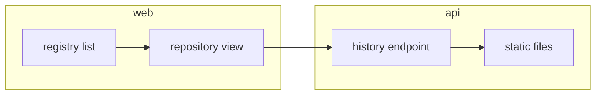

# FORMAT — the spec file contract

This file is the written contract between the files a spec-driven repository carries and the one parser that reads
them, `core/`. It documents what the parser accepts **as implemented**, not as wished; where the implementation is
still a stub, the section says so and names the task that fills it.

- **The files are the truth.** Stage, progress, drift and every number on the dashboard are derived from the files on
  every read. The app's own database never holds a copy of a spec.
- **One parser.** Only `core/` reads this format; the server, the web app and the later plugin import it
  (`bun run check:single-core`). A parser change updates this file in the same task (`core/CLAUDE.md`).
- **What the app never writes.** Nothing in a registered repository: no spec text, no master, no git object, no
  index, no lock file, not `.git/`. Spec 002's light writes are the only exceptions: the reviewed mark with its one
  `events.jsonl` line (ISC-24) and a single task checkbox (ISC-25), each guarded by a sha256 compare-and-swap and the
  lock sources below.
- **Checked.** `bun run check:format-doc` asserts one section per file kind of `core/src/files.ts` (`FILE_KINDS`), in
  that order, each naming its path and holding an example. Every example introduced by a line `From \`path\`:` is
  compared with that file and must occur in it verbatim.

## Glossary

The words this contract uses, one row per term: the Spectant term, the term an issue tracker uses for the same thing,
the German term and a one-sentence definition. Spectant keeps its own words; the common term is a pointer, never a
rename. `core/src/glossary.ts` exports the same rows as `GLOSSARY` through the browser-safe barrel, and
`core/tests/glossary.test.ts` compares each row with its line in this table verbatim, so neither side can change alone.
The app's Help page will render them from that export (a later task of the web lane).

| Spectant term | Common term | German | Definition |
|---------------|-------------|--------|------------|
| Feature | Epic | Feature | A block `### F<n>` of the master that owns claims. |
| Spec | Story | Spec | A numbered folder `specs/NNN-slug/` with a `spec.md`. |
| Claim | Acceptance criterion | Claim | One falsifiable line `- [ ] ISC-<n>:` that closes on its probe. |
| Task | Sub-task | Task | One atomic step of `tasks.md`, hanging on exactly one claim. |
| Milestone | Fix version | Meilenstein | A release named in the master's `## Milestones` block. |
| Idea | Backlog item | Idee | A story file under `specs/ideas/`, the stage before a spec. |
| Stage | Status | Stage | Where a spec stands in its workflow. |
| Workflow | Workflow | Workflow | The ordered stages a spec type runs through, from `specs/workflow.md` or the default. |
| Gate | Quality gate | Gate | A condition a transition needs; two are fixed in every workflow: review before build, and every claim closed before done. |
| Probe | Test | Probe | The command a claim closes on. |
| Actor | Assignee | Akteur | The neutral id in a file, `u:<8 hex>` for a person or `a:<kind>:<id>` for an agent. |
| Agent | Bot | Agent | A Claude Code session or sub-agent working a task, recorded as an `a:` actor. |
| Chore | Chore | Chore | The seventh spec type: `spec.md` only, review then build then done, no code review. |

## Where the files live

A repository root holds the master `ISA.md` (untracked in a public repository) and a `specs/` folder:
`specs/constitution.md`, optionally `specs/tldr.md` and `specs/tech.md`, one folder per spec `specs/NNN-slug/`, and closed specs under
`specs/archive/NNN-slug/`. A spec folder name is three digits, a hyphen and a slug (`^\d{3}-.+$`); other names are
ignored, and symbolic links are not followed. A folder without `spec.md` is not a spec: it gets a diagnostic, no row.

A ref names exactly one folder or nothing (`resolve.ts`): `002`, `002-web-console` or `web-console`, active and
archived folders alike; no match or more than one match is `not_found`, never another spec.

## The thirteen file kinds

Paths are relative to the spec folder, as `FILE_KINDS` holds them. Legend: **R** required (no spec without it),
**S** the stage table stops at this file until it exists, **S3** the same from three claims on, **G** a gate the stage
table waits on until it is fresh, **O** optional, read when present, **—** not part of the type: no stage waits on it
and the type's workflow never asks for it. A spec with an unknown or missing `spec_type` needs neither plan nor tasks.

| Kind | Path | Read as | feature | project | infra | refactor | bug | spike | chore |
|------|------|---------|---------|---------|-------|----------|-----|-------|-------|
| `spec` | `spec.md` | frontmatter, claims, sections | R | R | R | R | R | R | R |
| `plan` | `plan.md` | existence, mermaid fence, hash | S | S | S | O | O | O | — |
| `tasks` | `tasks.md` | task lines, hash | S3 | S3 | O | S3 | O | O | — |
| `context` | `context.md` | goal lock, rounds, questions | O | O | O | O | O | O | O |
| `design` | `design.md` | Markdown, rendered | O | O | O | O | O | O | — |
| `constitution` | `../constitution.md` | frontmatter, lanes | O | O | O | O | O | O | O |
| `rounds` | `rounds.jsonl` | one JSON line per round | O | O | O | O | O | O | O |
| `events` | `events.jsonl` | one JSON line per transition | O | O | O | O | O | O | O |
| `gateReviewed` | `.gates/reviewed.json` | JSON mark | G | G | G | G | G | G | G |
| `gateCodeReviewed` | `.gates/code-reviewed.json` | JSON mark | G | G | G | G | G | G | — |
| `artifacts` | `artifacts/` | directory listing | O | O | O | O | O | O | O |
| `evidence` | `.evidence/` | directory listing | O | O | O | O | O | O | O |
| `master` | `../../ISA.md` | frontmatter, claims, fog | O | O | O | O | O | O | O |

The seven types are `feature`, `project`, `infra`, `refactor`, `bug`, `spike` and `chore`. A **chore** is a small fix
that is its own small spec, never a task collected in a sidelane spec: it carries `spec.md` only and runs review →
build → done. Its claims wait on a fresh reviewed mark like every type's, and once every claim is closed it is done
without a code-reviewed mark and without an edit to `phase: complete` (row 7 of the stage table, below).
`frontmatter.ts` reads `spec_type: chore` like the other six types (spec 008, T38).

Diagrams: a `feature`, `infra` or `project` spec needs a fence whose info string is exactly `mermaid` in both
`spec.md` and `plan.md` (dashboard warning `diagrams`); a `refactor` only warns without one in `spec.md`; a complete
spec is never held to it (`diagrams.ts`).

Beside the thirteen, `FILE_KINDS` holds two repository kinds (spec 008, T37): `idea`, the story files under
`specs/ideas/`, and `workflow`, the one table `specs/workflow.md`, each documented in its section below. Neither
belongs to a spec folder, so the table above has no row for them; like `constitution` and `master` they carry
`scope: repo` and a path from the repository root (`repoFilePath`) beside the path relative to an active spec folder.

## `spec` — `spec.md`

The what: frontmatter, goal, Test Strategy, claims with stable IDs and `(after: …)` edges, decisions.

**Frontmatter** (`frontmatter.ts`). The file starts with a `---` line (a BOM is skipped) and a later `---` line
closes the block; an unclosed block is an error and the file reads as having none. Inside, one flat `key: value` per
line, key `[\w-]+`. A value in single or double quotes runs to the closing quote (`\"` unescapes in double quotes); an
unquoted value drops a trailing ` # comment`. Blank lines and `#` lines are skipped; an indented line is ignored with
a warning (nested YAML is not part of the format); a repeated key warns and the last value wins. Typed keys:

| Key | Value | Used for |
|-----|-------|----------|
| `task` | text | the row title (else the folder slug without its number) |
| `slug`, `isa_master`, `isa_feature`, `constitution`, `context_log`, `migrated_from` | text | `isa_feature`'s first word names the master block for `missing_in_spec` |
| `spec_type` | `feature`, `bug`, `refactor`, `spike`, `infra`, `project`, `chore` | the type router; anything else warns `frontmatter-spec-type` and reads as none |
| `phase` | text | `complete` decides stage `done`; otherwise a tooltip only |
| `progress` | `M/N`, M ≤ N | compared with the recount (`progress_mismatch`) |
| `started`, `updated` | ISO 8601 as written | `updated` against the TL;DR's `generated` |
| `principal_stated_goal`, `…_source`, `…_locked` | text | a goal makes `anchors_missing_at_complete` apply |
| `principal_stated_goal_signal` | number | — |
| `context_sufficient`, `interview_invoked` | `true` or `false` | — |
| `archived_reason`, `archived` | text, `YYYY-MM-DD` | the archive listing |
| `milestone` | text | matched by name against the master's `## Milestones` entries (`master`, below); a name no entry carries warns `spec-milestone-unknown` and the spec still parses; without the key the spec belongs to no milestone |
| `priority` | `P1`, `P2`, `P3` or `P4` | the urgency, shown on the dashboard row, the spec head and the breadcrumb; a missing key reads as `P3` without a diagnostic, any other value is a `frontmatter-priority` warning and the file still parses; a story's frontmatter takes the same key (Ideas, below); read from spec 008, T39 on (`SpecFrontmatter.priority`, `SpecHead.priority`), on the dashboard row from T67 (`DashboardSpecRow.priority`, the head's value) |
| `stage` | a stage of the spec type's workflow (`specs/workflow.md`, below, or the default) | the explicit stage: when present it wins over the derived stage and must equal the last `to` of `events.jsonl`; a value outside the type's workflow, or one the last event contradicts, is a `stage-mismatch` diagnostic and the derived stage applies; without the key the stage derives from the files as before and is marked derived (`stageSource`, ISC-36); spec 008, T40 reads the key as text (`SpecFrontmatter.stage`, unvalidated) and T47 applies it (`explicitStageOf` in `stage.ts`): a value that is a stage of the type's row and equals the last event's `to` replaces the stage, and the dashboard row and the spec head carry `stageSource: explicit`; the next command and its reason stay the stage table's, since they say what the files still need; `blocked` and `close-pending`, which no row lists, never apply explicitly; T48 adds the diagnostic (`stageMismatchOf` in `stage.ts`): a value outside the type's row, or one the last event's `to` contradicts (a file without any event included, since nothing enters the value), is exactly one `warning` `stage-mismatch` on `spec.md`, at the key's line, `subject` the value as written |

Every other key is kept as written (`rest`) and read by nobody.

**A transition writes `stage:`.** A `/spec` command and a drop on the board go through the same transition: it sets or
replaces the `stage:` line of `spec.md`, leaves the rest of the file byte-identical, and appends exactly one line to
`events.jsonl`, so the key and the last event agree. `planTransition` in `core/src/transition.ts` plans the move in
memory and writes nothing (spec 008, T71 for ISC-121, T72 for ISC-31); `server/src/writes.ts` writes the plan. `from` is
the spec's stage as above, explicit or derived. The move must be one the type's row lists (§ workflow, Derived), or,
under `code_review: feature`, the entry into `close-pending` in place of `code-review`; then the fixed gates apply: a
stage past `review` in the row, and either detour, needs a fresh reviewed mark; `done`, `close` and `close-pending`
need no open claim; `close-pending` needs an open sibling of the spec's main feature, and `code-review` under
`code_review: feature` (or out of `close-pending`) needs none. An accepted plan carries the new text, the last `stage:`
line of the block replaced or, without one, a `stage:` line inserted as the block's last key, each with its
neighbour's line ending, and one event `{ts, from, to, command, actor}` that passes `validateEventLine`, its `command`
the stage table's command for `from` (`/spec-review NNN` for `review → build`). A refused plan carries
`{from, to, reason, command}` and neither text nor event: the reason names what the move needs and, where one fits,
ends in the stage table's phrase (`build needs a fresh reviewed mark: the reviewed mark is stale`); the command is the
stage table's next command for the spec as it stands. Until spec 008, T49 brings `close-pending` into the stage
table's rules and the event vocabulary, a move into `close-pending` that passes every gate is still refused, since its
event line would not validate. A spec without the key derives its stage as before.

**Body.** The goal is the first prose paragraph under `## Goal` (or `## Ziel`); fences, comments and tables are
skipped. The claim section is the first of `## Features`, `## Claims`, `## Criteria`, `## ISC Criteria`,
`## IDEAL STATE CRITERIA` or `### Criteria`; it ends at the next level-two heading **or at a `---` line**. Lines
inside a fenced block are neither claims nor headings.

- A feature block opens with `### F<n>[.<m>] · <name>` (`·`, `:`, `—`, `–` or `-`, or no separator) and may carry one
  `Why:` line before its first claim. Another heading of level three or less ends the block; level four does not.
- A claim line is `- [ ] <ID>: <text>`, checked as `[x]` or `[X]`, indented for a nested leaf. The ID is
  `ISC-<n>[.<m>…]`, a domain form (`H-AVAIL`) or a short form (`C4`, `EQ-12`); the separator after it may be `:`,
  `—`, `–`, `-` or nothing. Trailing marks `⟨?: …⟩` / `⟨resolved: …⟩` are lifted off first, then one trailing
  `(after: A, B)` (comma or space separated, a final `.` allowed); code spans never count. A leading
  `[DROPPED …]` is a tombstone whose words are its note, and `[DROPPED` anywhere marks the claim dropped. After the
  tombstone, `Anti:` or `Antecedent:` sets the claim's kind. A checkbox without an ID warns and is invisible.
- `## Not yet specified` holds `- fog: <text>` lines, trailing marks lifted.
- `## Test Strategy` rows are positional: `isc | type | check | threshold | tool | anchors_to | severity`. A row whose
  first cell is `isc` or a dash rule is skipped, `\|` is a literal pipe, missing cells read as empty.
- `## Verification` holds `- <ID>: <evidence>` lines (the ID may be followed by `(…)`).
- `## Decisions` is prose: rendered, not parsed.

Progress is recounted from the boxes: closed over live claims, a tombstone leaves both. Edge checks warn on a
duplicate ID, a self edge, an unknown ID and the first cycle.

From `core/fixtures/harbor/specs/002-web-console/spec.md`:

```markdown
---
task: "Show every sync run and its failures in a small web console"
slug: 002-web-console
spec_type: feature
isa_master: ../../ISA.md
isa_feature: F2
milestone: Harbor 1.0
priority: P2
stage: build
constitution: ../constitution.md
phase: building
progress: 25/30
started: 2026-03-03T10:00:00Z
updated: 2026-03-08T16:45:00Z
context_sufficient: true
interview_invoked: false
context_log: context.md
---
```

From `core/fixtures/harbor/specs/002-web-console/spec.md`:

```markdown
## Features

### F2 · Web console
Why: a teammate who never touches the CLI can see what was mirrored, when, and what failed.

- [x] ISC-51: The registry list renders from the API with no console error.
```

From `core/fixtures/harbor/specs/002-web-console/spec.md`:

```markdown
| isc | type | check | threshold | tool | anchors_to | severity |
|-----|------|-------|-----------|------|------------|----------|
| ISC-51 | e2e | registry-list: renders | 0 console errors | `bun run e2e -- registry-list -g render` | derived: console-usable | high |
```

From `core/fixtures/harbor/specs/005-config-format-choice/spec.md`, fog lines and an antecedent claim:

```markdown
## Not yet specified

- fog: whether includes are resolved relative to the including file or to the working directory — needs one real multi-repository config
- fog: whether a comment-preserving writer is required at all — depends on whether the console ever edits the config

## Claims

- [ ] ISC-94: Antecedent: the config format for version 2 is chosen and recorded as a decision.
```

**Derived:** the row's title, type, stage and next command, the progress fraction, the takeable claims, the fog count,
the goal line, the drift and diagram gates, and the warnings `review`, `diagrams`, `closed` (every claim closed,
phase not complete) and `fog`.

## `plan` — `plan.md`

The how: approach, affected files, interfaces, risks, open points. `core/` reads only whether it exists (the stage
table), whether it carries a `mermaid` fence (the diagram rule) and its normalised hash (the reviewed mark). Its
frontmatter is not read. The Docs tab renders it as Markdown (spec 002).

From `core/fixtures/harbor/specs/002-web-console/plan.md`:

````markdown
## Approach

Serve a static Angular build from the API and read everything through one history endpoint. A separate console server would be one more process to run and secure.


````

## `tasks` — `tasks.md`

Atomic task lines, each anchored to one claim, plus the probe mapping. A line `- [ ] T<n>`, `- [x] T<n>` or
`- [X] T<n>` (indent allowed, outside code fences) is a task, checked as landed; this is the task fraction on the
dashboard and in the archive listing. `tasks.ts` (`parseTaskLines`) reads the full grammar:

`- [ ] T<n> · <claim ID> · [flags · ] <lane> — <text> [(after: T<a>, T<b>)] · <paths>`

- the head, up to the first ` — ` outside code spans, is the claim ID (every form `claims.ts` takes: `ISC-60.1`,
  `H-AVAIL`, `C4`), the flags, then the lane token;
- flags `[P]` (may share a round) and `[seam]` (the contract between two lanes; runs alone, its fan-out waits), in
  either order;
- the lane is the token as written, checked against the first column of the constitution's `## Lanes` table; a token
  outside the table is kept with a warning; `operator` is always valid, is the principal's own step and is never
  dispatched;
- `(after: …)` names tasks, not claims (`T3–T5` ranges expand), may stand anywhere in the text and is removed from it;
- the text runs to the last ` · ` outside code spans and may itself hold ` · `, inside or outside code spans;
- `<paths>` follow that last ` · `, split on `, ` outside code spans and parentheses: a code span (or a bare token with
  a `/` or `.`) is one path; a parenthesised item such as `(probe only)` is a path note, not a path; a tail with
  anything else is no path column and stays in the text;
- a struck task is a plain bullet, `- ~~T<n> · …~~ — struck <date>: <reason>`; it is no checkbox and counts in no
  fraction; the Tasks tab shows it as `struck` with its note;
- a malformed task line stays a task (the box count holds) and carries a warning; headers, prose, table rows and
  bullets without a `T<n>` are no tasks;
- `## Probe Mapping` is a table `Task | Claim | Probe`, the first cell listing one or more task IDs or ranges; `\|`
  in a cell is a pipe. Warnings: a mapped id no task line carries, a struck task mapped, a claim that differs from the
  task line's, a task without a row.

The Tasks tab's state per task is the newest `rounds.jsonl` result card of the same task (same id and text): open,
dispatched, held, question, concerns, fail, done or closed; without one the checkbox decides, and a checked box
outranks a round that left the task unfinished.

The frontmatter is not read; the reviewed hash ignores checkbox states and `~~`.

From `core/fixtures/harbor/specs/002-web-console/tasks.md`:

```markdown
- [x] T1 · ISC-51 · [seam] · api — history endpoint contract: run, repository, digest, failure · `api/src/history.contract.ts`
- [x] T2 · ISC-51 · web — registry-list: renders (ISC-51) (after: T1) · `web/src/app/registry-list/`
```

From `core/fixtures/harbor/specs/002-web-console/tasks.md`:

```markdown
- [x] T30 · ISC-77 · [P] · operator — set up the screen-reader profile on the test device · `tests/manual/screen-reader-setup.md`
- [ ] T31 · ISC-77 · operator — screen-reader pass over the sync history (ISC-77) (after: T1, T30) · `tests/manual/screen-reader.md`
```

**Derived:** the task fraction, the lanes on the spec page, the takeable set of the next round (`takeable.ts`: claim
takeable, which needs a fresh reviewed mark, task edges done, no file shared within the round, width 1 for bug, spike
and infra, else 4) and the cards of
the live frame.

## `context` — `context.md`

The context log: the goal lock, question rounds and dated decisions. A record, not an authority; nothing gates on it.
The timeline (`timeline.ts`) reads it in `##`/`###` blocks, headings inside a fence ignored:

- `## Goal — confirmed <ts>` is one decision entry with the goal lock, its body the goal.
- `## Round <n> — <title>, <ts>` opens a round; `<ts>` is the last comma-separated token and must start with a date
  (`2026-09-24` or a full ISO time). A round header without a time yields no entries.
- Each `### Q<n> · <question>` (or `### Q · …`, numbered by position) under a timed round is one decision entry,
  ref `R<round>.Q<n>`, timed by its round. A `- From: <who>` line in it is the entry's actor; `Offered:`, `Chosen:`
  and `Landed in:` lines stay in the body as written.
- Any other `##` heading (`## Still open`, `## Code review — …`) ends the round: its `###` blocks are not events.
  Prose rounds without Q blocks yield nothing. The frontmatter is not read.

From `core/fixtures/leadgen/specs/022-chat-turn-status-and-bulk-delete/context.md`:

```markdown
## Round 3 — during build, 2026-09-27T23:33:05Z

- Solo run: the parent builds the tasks itself in the main tree, serially, no dispatch and no worktrees; the lock protocol does not apply to a solo run.
- second look: off (default)

### Q1 · When should the cited row scroll into view, given that the shortlist is one column beside the docked chat below about 2300px?

- From: T1 (ISC-479), lane `web`
- Offered: as soon as the list is on screen beside the detail — at once on a wide screen, else when the chat closes (recommended) | only while it is on screen at the click | fold the chat's rail on a citation click instead (a new claim)
- Chosen: as soon as the list is on screen
- Landed in: ISC-479's Test Strategy row (refined master-first), master and spec `## Decisions` 2026-09-28
```

**Derived:** the decision entries of the timeline and the Decisions tab of the Docs area.

## `design` — `design.md`

The design pass per viewport for a UI spec: `## Mobile (390)`, `## Tablet (820)`, `## Desktop (1440)` with `### Ist`
and `### Soll`, then the cross-viewport rules. It holds no acceptance criterion. `core/` does not parse it; the Docs
tab renders it as Markdown with a table of contents (spec 002, `markdown-docs.ts`). Its frontmatter is not read.

From `core/fixtures/spectant-001/specs/001-app-skeleton/design.md`:

```markdown
---
spec: 001-app-skeleton
type: feature
design_track: app
viewports: [390, 820, 1440]
updated: 2026-09-28T12:40:00Z
---
```

## `constitution` — `../constitution.md`

The repository constitution shared by every spec: binding rules, gates, lanes, conformance baseline. The dashboard
reads `specs/constitution.md` at a fixed place (the frontmatter key `constitution:` is not used to find it). Its
frontmatter parses like a spec's; `dev_services: <port>=<label>, …` names the local services on the live indicator.
The `## Lanes` table maps path prefixes to lanes for the task grammar (spec 002, T23). The Docs tab renders the rest.

From `core/fixtures/harbor/specs/constitution.md`:

```markdown
---
repo: harbor
derived: 2026-03-02T08:00:00Z
standards_version: 1.0.0
design_track: app
viewports: [390, 820, 1440]
dev_services: 4200=Web dev, 8080=API
stack: [bun, typescript, angular]
---
```

From `core/fixtures/harbor/specs/constitution.md`:

```markdown
| Lane | Path prefixes | Context a worker loads | Lane probe |
|------|---------------|------------------------|------------|
| cli | `cli/` | `cli/CLAUDE.md` | `bun test cli/` |
| api | `api/`, `tests/` | `api/CLAUDE.md` | `bun test api/` |
| web | `web/` | `web/CLAUDE.md` | `bun run --cwd web test` |
```

## `rounds` — `rounds.jsonl`

One JSON object per line, one line per implementation round: the whole board after that round. Blank lines are
skipped; a line that is not JSON, or has no parseable `ts`, is skipped with a diagnostic.

| Field | Shape | Read by |
|-------|-------|---------|
| `v` | `1` | nobody yet (not checked) |
| `round` | number | timeline (ref, title); a line without it is no timeline entry |
| `ts` | ISO 8601 | timeline; the newest is the row's `lastRound` and makes a TL;DR stale |
| `mode`, `width` | `"agent"`, number | frames (spec 002) |
| `dispatched` | task IDs | timeline count; a task's `builder` counts as actor only when dispatched |
| `tasks[]` | `{id, claim, lane, seam, parallel, text, paths, state, reason, note?, builder?, reader?, verdict?}` | timeline counts `state: "held"`; frames read the rest |
| `claims` | `{closed, open, closed_this_round}` | timeline counts `closed_this_round` |
| `progress` | `"M/N"` | frames |
| `stop` | text, only when the round stopped early | timeline title and body |

Task states in the fixtures: `held`, `dispatched`, `question`, `concerns`, `fail`, `done`, `closed`. Lines are several
kilobytes; the examples quote one task object and one line's end.

From `core/fixtures/harbor/specs/002-web-console/rounds.jsonl`, a task of round 3:

```json
{"id":"T29","claim":"ISC-76","lane":"web","seam":false,"parallel":false,"text":"empty-state: keyboard reach and focus ring (ISC-76)","paths":["web/src/app/empty-state/"],"state":"question","reason":"claim takeable, edges closed","note":"question: should the empty state link to the sync docs or to the settings page?","builder":"Engineer"}
```

From `core/fixtures/harbor/specs/002-web-console/rounds.jsonl`, the end of round 3:

```json
"progress":"25/30","stop":"a decision only the principal can make"}
```

**Derived:** the round entries of the timeline, the row's last-round time, the scrubber frames of the round board,
and from those frames the Matrix: one row per task id that ever had a card (by lane, `operator` last), one column per
frame plus a re-cut column where tasks.md changed between two lines, each cell the card's state, empty before the
task's first card and absent (dashed) after its last.

**Derived: the re-cut** (spec 002, T18, `recut.ts`, ISC-91). A task is its id together with its text. Between two
consecutive lines, an id with the same text is the same task and carries its card, tries and note; an id with another
text is `changed`; an id gone is `struck`; a new id is `added`, also when it carries a text an old id had (a
renumbering: the old id is struck or changed, and the new id inherits no tries, state or history). Any of the three
sets the `recut` of the dispatch frame that follows (`struck` in the old line's order, `added` and `changed` in the
new one's) and puts a re-cut marker on the scrubber before it, with both round numbers. A struck task has no card from
then on; the live frame shows it `absent` with its strike note while `tasks.md` lists it struck and the last board
held it.

## `events` — `events.jsonl`

One JSON object per line, one line per recorded stage transition: `{ts, from, to, command, actor}`, every field a
string, `ts` ISO 8601. When the file exists its transitions win in the timeline; without it the timeline shows the
stage derived from the files, marked as derived (ISC-36). `from` and `to` are the workflow's stage names (below, one
vocabulary for timeline and stage: the stage table's, `close-pending` among them, and a story's `idea`, spec 008,
T62; `EVENT_STAGES` in `events.ts`); `from` is null only on the creation, the file's first line.

From `core/fixtures/harbor/specs/archive/001-manifest-sync/events.jsonl`, the whole chain of a complete spec:

```json
{"ts":"2026-03-02T09:00:00Z","from":null,"to":"plan","command":"/spec-feature manifest-sync","actor":"u:3f9c0a7d"}
{"ts":"2026-03-02T09:40:00Z","from":"plan","to":"tasks","command":"/spec-plan 001","actor":"u:3f9c0a7d"}
{"ts":"2026-03-02T10:20:00Z","from":"tasks","to":"review","command":"/spec-tasks 001","actor":"u:3f9c0a7d"}
{"ts":"2026-03-02T11:00:00Z","from":"review","to":"build","command":"/spec-review 001","actor":"u:3f9c0a7d"}
{"ts":"2026-03-05T12:10:00Z","from":"build","to":"code-review","command":"/spec-implement 001","actor":"a:claude:sess-7"}
{"ts":"2026-03-05T14:30:00Z","from":"code-review","to":"close","command":"/spec-code-review 001","actor":"u:3f9c0a7d"}
{"ts":"2026-03-05T15:00:00Z","from":"close","to":"done","command":"/spec-complete 001","actor":"u:3f9c0a7d"}
```

A single line in the schema, the transition "Mark reviewed" records (ISC-24):

```json
{"ts":"2026-03-07T15:30:00Z","from":"review","to":"build","command":"/spec-review 002","actor":"u:3f9c0a7d"}
```

**The actor grammar** (spec 008, ISC-119). Every `actor` a file of this contract carries — an `events.jsonl` line,
either gate mark, and the `session` of an activity line or a frontier lock (Activity and lock lines, below) — is a
neutral id, never a name or an e-mail address:

| Form | Pattern | Example | Names |
|------|---------|---------|-------|
| person | `u:[0-9a-f]{8}` | `u:3f9a0c7e` | a person: the first eight hex digits of sha256 over the trimmed, lower-cased git `user.email` of the repository |
| agent | `a:<kind>:<id>` | `a:claude:sess-7` | an agent session of the given kind |
| sub-agent | `a:<kind>:<id>/<task>` | `a:claude:sess-7/T12` | a sub-agent of that session working one task |

`<kind>` and `<id>` are each `[a-z0-9][a-z0-9_-]*` (lower case, so neither can hold a `:` or `/`), `<task>` is a task
id `T[0-9]+` as in `tasks.md`, and the whole value must match with nothing around it.

The person id is unsalted, so two machines with the same `user.email` agree on one person without any exchange.
`core/` derives the `u:` id from the repository's git configuration (spec 008, T59 for the derivation, T77 for reading
`user.email`): `actorIdOf` in `core/src/actor-id.ts` trims and lower-cases the address and hashes it with sha256; an
optional salt is prepended to the normalised address, and no caller passes one. The app maps an id to a display name
and its git identities in its own data directory, never in a file of the repository, and shows an id without a
mapping as the id itself. Any other value is **legacy**: it is read, marked `legacy` and never rejected. The harbor
fixture carries the new forms only (spec 008, T28); the legacy case is `lantern/`'s `specs/002-duplicate-links/events.jsonl`
(T33, actor `principal` on both lines) and the frontier-lock example below. The grammar is read by `parseActor` in
`core/src/actor.ts` (T59), which keeps the raw value and returns the form, the id (`a:<kind>:<id>` for an agent and
its sub-agent) and the task of a sub-agent.

A file that carries at least one legacy actor gets exactly one `warning` diagnostic `actor-legacy` (spec 008, T60), never
one per value: `legacyActorWarning` in `actor.ts`, shared by every reader, names the first legacy value (in the message
and as `subject`), its line when the file has lines, and how many legacy values the file holds. The events reader
(T61) runs every accepted line's `actor` through `parseActor` and carries the result on the event as `actorRef`
(`{raw, kind, id, task?, legacy}`); a legacy actor is accepted, and `parseEvents` adds the file's `actor-legacy` after
the line diagnostics. Only `event-empty` rejects an actor, and a rejected line's actor is not counted. `actorRef` is
read side only: a written line carries the five keys and nothing else (`event-extra-key`). The dashboard lists every
diagnostic of an open spec's `events.jsonl` under that file.

**Validated** (`events.ts`, T16, ISC-32). `parseEvents` reads the file line by line, skips blank lines and keeps file
order; `validateEventLine` checks one line and never throws. A line is rejected with one diagnostic (severity
`error`, its line number, the first rule it breaks) and is not an event: `event-json` (not JSON), `event-not-object`,
`event-missing-key` and `event-extra-key` (exactly the five keys), `event-type` (every value a string, `from` also
null, `to` never), `event-ts` (an ISO 8601 date-time with `Z` or `±hh:mm` on a real calendar day; a date alone is
not an event time), `event-empty` (blank `command` or `actor`), `event-stage` (`from` or `to` is neither a stage name
nor an old word below), `event-same-stage` (`from` equals `to`), `event-null-from` (a null `from` after the first
event). The valid lines are the recorded transitions; a file with no valid line counts as absent.

The older lifecycle words (ISC-24's wording, written by the old skill) are read and normalised to the stage names,
each with a `warning` diagnostic `event-alias` naming the old word, so everything downstream sees one vocabulary
(`EVENT_VOCABULARY_ALIASES`). A stage names what the spec waits for, so a word naming what just happened maps to the
stage after it. A line that the mapping alone makes `build → build` (`reviewed → implementing`) is skipped with a
`warning`, not an error. `idea`, the old word for the creation, is a stage name since spec 008, T62 and reads as the
stage `idea` without a warning, so an old `idea → specified` line is `idea → plan`.

| Old word | Stage |
|----------|-------|
| `specified` | `plan` |
| `planned` | `tasks` |
| `tasked` | `review` |
| `reviewed` | `build` |
| `implementing` | `build` |
| `code-reviewed` | `close` |
| `done` | `done` (the same word) |

**Derived transitions** (`derived-stages.ts`, T15). Without events the timeline replays the stage table over the
files, one `stage` entry per change of stage, `derived: true`, `actor: null`, `from`/`to` in the stage table's names
(the first `from` is null): the creation enters the first stage the type needs (`plan`, `tasks` or `review`) at
spec.md `created:`, else `started:`, else the earliest timed context.md header; plan.md and tasks.md each move it on
at their own `created:`, else at the context.md round titled "before the plan" or "before the tasks" (a file's
`updated:` is its last edit and never dates a transition); `review → build` at the reviewed mark's `at`;
`build → code-review` (always undated) and `code-review → close` at the code-reviewed mark's `at`; `→ done` with
`phase: complete` at `completed:`, else `updated:`; without it, a chore whose claims are all closed steps
`build → done` by the stage table's chore row, always undated (spec 008, T50). The first round changes no stage (`build` before and after) and is
its own round entry. A transition the files do not date carries `ts: ""` and `undated: true` and sorts right after the
dated transition before it, as does a date without a time that falls on that transition's day. When the caller passes
the validated events.jsonl lines, they are the stage entries (`derived: false`, with their `actor` and `command`) and
nothing is derived; without them `buildTimeline` reads the spec's own events.jsonl through `parseEvents`, so a folder
with the file shows its recorded transitions and a folder without it derives. The table above maps these names to
ISC-24's `specified → planned → tasked → reviewed` wording.

## `gateReviewed` — `.gates/reviewed.json`

The reviewed mark: `{gate: "reviewed", at, files: {"spec.md", "plan.md", "tasks.md"}}`, each file a sha256 hex of its
normalised text or `null` for a file that did not exist (an absent key reads as `null`). A missing `gate` warns and is
read from the file name; another gate name is an error. A missing `at` warns.

Normalisation (`normalizeForGate`, byte for byte the old skill's): line endings to LF, a leading frontmatter block
removed, every `- [x]` box reset to `- [ ]`, in `tasks.md` every `~~` removed, in `spec.md` the first `## Not yet
specified`, `## Decisions` and `## Verification` sections removed, trailing spaces trimmed per line, the whole trimmed.
The mark is **fresh** when all three hashes match, **stale** when any differs (the changed files are named),
**missing** without a mark.

From `core/fixtures/harbor/specs/006-partial-push/.gates/reviewed.json`:

```json
{
  "gate": "reviewed",
  "at": "2026-03-08T12:00:00Z",
  "actor": "u:3f9c0a7d",
  "files": {
    "spec.md": "08a83a1bc735b8b7a913eee076ba5eae301e66dadb19037eb07b5beb148439ec",
    "plan.md": null,
    "tasks.md": null
  }
}
```

## `gateCodeReviewed` — `.gates/code-reviewed.json`

The code-reviewed mark: `{gate: "code-reviewed", at, tree, head?, branch?, note?, root?}` plus the accepted findings,
either top-level `code` and `security` counts or nested `findings: {code, security}`. `tree` must be a git object id
(40 or 64 hex) or the mark is unreadable. It is **fresh** only when `tree` equals the tree id of the current working
tree, computed in memory as `git add -A && git write-tree` would print it without writing anything (SHA-1 object
format only); an uncomputable tree reads as stale. `root` is informational and a public fixture never carries a
machine path there.

From `core/fixtures/harbor/specs/004-retention-policies/.gates/code-reviewed.json`:

```json
{
  "gate": "code-reviewed",
  "at": "2026-03-08T11:00:00Z",
  "actor": "a:claude:sess-4",
  "tree": "0f0b75edd68fe6549744de66e4500c4f95b538bf",
  "head": "da3b7bf10406c1facaabffd3c7acd7853204a65d",
  "branch": "feature/004-retention-policies",
  "code": 0,
  "security": 0,
  "note": "one finding fixed; tree changed since"
}
```

From `core/fixtures/leadgen/specs/022-chat-turn-status-and-bulk-delete/.gates/code-reviewed.json`, the nested shape:

```json
  "findings": {
    "code": 4,
    "security": 0
  },
```

**Who recorded a mark.** Either mark may carry `actor`, the person or agent that recorded it, in the actor grammar
(`events`, above): a `u:` id for a principal's review, an `a:` id when a reviewer agent recorded it. Every harbor
mark carries it since spec 008, T28 (the examples above), and its value is read in the actor grammar by `parseActor`
(T59); `readGateMark` does not carry the key into the mark, and it plays no part in freshness.

**The feature-level mark.** Under `code_review: feature` (§ workflow) one code review, `/spec-code-review F<n>`, covers
every spec of the main feature `F<n>`, and the same code-reviewed mark goes into each target folder with one key more,
`scope: "F<n>"`, beside the fields above (spec 008, T74): `{gate, at, actor?, scope, tree, head?, branch?, code,
security, note?}`, the order `codeReviewedMarkText` in `gates.ts` writes it in. The targets are
`featureCodeReviewTargets(planning, "F<n>")`: every active spec whose main feature is `F<n>` and whose live claims are
all closed in the master (across every block it holds claims of), in folder order; an archived spec is never a
target, and an unknown feature gives none. Both functions are pure and write nothing; the caller writes the text.
That caller is the CLI, `spectant gate code-reviewed F<n> [--root DIR] [--yes]` (spec 008, T93): it refuses, writing
nothing, while any active spec of the main feature still holds an open claim (naming each with its claims), when the
targets are empty, or when the worktree tree id cannot be computed; without `--yes` it prints the plan. With `--yes` it
appends one event per target to `events.jsonl` (`from` the spec's stage, normally `code-review`, `to` `close`,
`command` `spectant gate code-reviewed F<n>`, the viewer's `u:` id or `a:spectant:app`), then computes the tree id
over the worktree as it now stands and writes the same mark, `code: 0` and `security: 0`, with that tree, `head` and
`branch`, into every target folder; with `.gates/` outside the tree, as for every mark, it reads fresh, and the
specs stand in `close` (row 10). A
mark without `scope` is a per-spec mark, as every mark before T74, and reads as before (`CodeReviewedMark.scope`
null); a `scope` that is no `F<n>` reads the same way, with one `gate-scope-invalid` warning. `scope` plays no part in
freshness: the tree id alone decides it. Harbor's spike pair 008/009 (F6) shows the targets: while 009 holds `ISC-131`
open only 008 is one, with it closed both are.

**Derived for both marks:** the gate views on the row and the spec page, the stage (`review`, `code-review`, `close`),
the `review` warning, and one gate entry per mark on the timeline (with files, head, branch and note).

## `artifacts` — `artifacts/`

Versioned task results, shown as "Results" on the Evidence tab. Listed, never parsed (`evidence.ts`, T24), recursively,
dotfiles skipped, sorted by path. Each file carries its path relative to the spec folder, its name, its size in bytes,
its media type from the extension (`md`, `json`, `har`, `png`, `jpg`, `webp`, `gif`, `avif`, `svg`, `log`, `txt`,
`html`; anything else is `application/octet-stream`), the task id when the name starts with `T<n>` followed by `-`, `_`, `.` or nothing, and
its claim:

1. a claim ID of `spec.md` that a path segment is or starts with (`ISC-61/shot.png`, `ISC-61-shot.png`; the longest
   ID wins, so `ISC-60.1-notes.txt` is ISC-60.1);
2. else the first `## Verification` line that names the file by its path relative to the spec folder or by its bare
   name, as a whole token;
3. else none: the file is ungrouped.

No modification time is listed: it moves with every checkout. A symlink is listed and flagged; one that does not
resolve inside `artifacts/` or `.evidence/` is listed as refused (size 0, a warning), never followed, and a symlinked
folder is never descended. A group folder that is itself a symlink is not listed. Serving goes through
`resolveEvidencePath` and nothing outside the two folders and `.design/` of the spec's own folder is ever served
(ISC-83, ISC-113); `.design/` is served for the Design tab's images and never listed. A symlink may not cross between
`.design/` and the other two.

From `core/fixtures/harbor/specs/002-web-console/spec.md`, two verification lines naming a result and a raw file:

```markdown
- ISC-60.2: `bun run e2e -- theme-switch -g persist` passed, 2026-03-08; routes in `artifacts/T13-routes.md`
- ISC-61: `bun run e2e -- tag-table -g narrow` passed, 2026-03-08; screenshot `.evidence/kpi-band-390.png`
```

From `core/fixtures/harbor/specs/002-web-console/artifacts/T13-routes.md`, a task result (task T13, claim ISC-60.2):

```markdown
# T13 — routes

Recorded 2026-03-06, round 2.
```

## `evidence` — `.evidence/`

Raw probe output (HAR files, screenshots, logs), shown as "Raw evidence" on the Evidence tab with thumbnails for
images. Listed exactly like `artifacts/`, with the same claim rules. A Test Strategy row may point at it as its tool
(`transcript in \`.evidence/\``). Harbor 002 holds `bun-test-r3.log` (claim ISC-72: its verification line names the
bare file name), `dashboard.har` (named by no line: ungrouped) and `kpi-band-390.png` (ISC-61), a 4 × 2 PNG the
generator builds byte by byte.

From `core/fixtures/harbor/specs/002-web-console/.evidence/bun-test-r3.log`:

```text
2026-03-08T11:18:00Z round 3 · bun test api/
api/tests/history.test.ts:
(pass) history > pages by 20
```

A requested evidence path resolves (`resolveEvidencePath`) only when all of these hold; anything else is refused:

- percent-encoding is decoded exactly once; a malformed sequence or a second layer (`%252e`) is `outside`;
- no NUL or other control character, no backslash, no leading `/`, no drive letter, no `..` segment: else `outside`;
- the first segment is `artifacts` or `.evidence`, with a file below it: else `outside` (`plan.md` is outside);
- the real path, after every symlink, lies under the real spec folder's `artifacts/` or `.evidence/`: else
  `symlink-escape` (also for a dangling link whose target would lie outside);
- it exists (`not-found`) and is a regular file (`not-a-file`).

## `master` — `../../ISA.md`

The master ISA every spec derives from, at the repository root; untracked in a public repository. It parses with the
same two readers as a spec (frontmatter and claims): its feature blocks, claims, fog lines and `progress:`. The
dashboard reads `ISA.md` at the root (the frontmatter key `isa_master:` is not used to find it). A declared
`progress:` that disagrees with the recount is one diagnostic per repository.

From `core/fixtures/harbor/ISA.md`:

```markdown
---
task: "Mirror container manifests between registries with Harbor"
slug: 20260302-harbor
project: harbor
phase: climbing
progress: 106/130
started: 2026-03-02T08:00:00Z
updated: 2026-03-09T17:30:00Z
---
```

From `core/fixtures/harbor/ISA.md`:

```markdown
### F0 · Cross-cutting
Why: what would sink Harbor whichever feature slipped — a half-written manifest, a silent failure or a leaked credential.

- [ ] ISC-1: Anti: a failed push leaves a partial manifest visible in the target registry.
```

From `core/fixtures/leadgen/ISA.md`, a tombstone with an edge:

```markdown
- [ ] ISC-342: [DROPPED — see Decisions 2026-09-24] The jar carries the Gradle version through Spring Boot's build info, `leadgen.version` defaults to it and `LEADGEN_VERSION` from the image tag still wins when set, the HTTP user agent names the running version, and no file under `backend/src` spells the version as a literal. (after: ISC-348)
```

**Milestones** (optional; `frontmatter.ts` reads a spec's `milestone:` and `milestones.ts` this block). A level-two
`## Milestones` section of the master holds one bullet per milestone:

`- <name> · <YYYY-MM-DD> · <description?>`

- the name runs to the first ` · `; a spec names the milestone by it (`milestone: Harbor 1.0`);
- the slug is the kebab-cased name, lower-cased with every run of characters other than `a`–`z` and `0`–`9` turned
  into one `-` and no `-` at either end (`Harbor 0.9` → `harbor-0-9`); it is the milestone's anchor on its page,
  `#m-<slug>`;
- then the target date, an ISO date `YYYY-MM-DD`, and after a second ` · ` an optional description running to the end
  of the line;
- a line without the date part is a `master-milestone-line` warning and is skipped;
- only a top-level bullet is a milestone line: an indented bullet is a note under the entry above and is ignored
  without a warning, and the section ends at the next heading of any level (`#` to `######`) or a `---` rule;
- a repeated name or slug is a `master-milestone-duplicate` warning and the later entry is skipped; a name the master
  lists on a skipped line warns only on the master, and a spec naming it belongs to no milestone;
- there is no `done` mark: completeness is always derived from the claims of the specs naming the milestone, active
  and archived alike. A milestone is `complete` when every such claim is closed, `late` when its target date has passed
  with a claim still open (the target day itself is not yet late), and `upcoming` otherwise; a milestone with no counted
  claim (an entry no spec names) is never `complete`, only `late` or `upcoming` by its date. An archived spec's claims
  count exactly like an active one's, so archiving alone never completes or reopens a milestone. Milestones are shown in
  target-date order, whatever their order in the block.

A master without the block has no milestone level: the app shows no Milestones page, menu entry or palette group. A
block with two entries, one target passed and one ahead.

From `core/fixtures/harbor/ISA.md`:

```markdown
## Milestones

- Harbor 0.9 · 2026-03-15 · Config through one loader, before the console ships.
- Harbor 1.0 · 2026-05-14 · First release a teammate can install.
```

**Derived:** the master fraction (the hero number), the reference for every spec's drift, and its fog lines in the
attention count. **Derived: the planning tree** (spec 003, `planning.ts`): the features from the master's blocks, each
claim with the spec folder that holds it, active or archived; and the milestones from the `## Milestones` block
together with the specs' `milestone:` keys, each with its progress, closed over total, across every feature it touches.

## `idea` — `../ideas/`, one `specs/ideas/<slug>.md` per story

A story: an idea that is shaped but not yet a spec, one file per story in `specs/ideas/`. The file is a filled `/spec`
prompt with a frontmatter block in front of it. A story has no number and no claims; it belongs to a feature block of
the master and, optionally, to one of its milestones. The kind is in `FILE_KINDS` (spec 008, T37); `ideas.ts`
(`readIdeas`, T51, T52) reads the folder, whose texts the caller passes in, and `planning.ts` (T55) places the stories
in the planning tree.

**Frontmatter** (the same reader as a spec, `frontmatter.ts`). Five typed keys:

| Key | Value | Missing |
|-----|-------|---------|
| `type` | a spec type: `feature`, `project`, `infra`, `refactor`, `bug`, `spike`, `chore` | no type, as for a spec without `spec_type:` |
| `feature` | the master feature block the story belongs to, `F<n>` | belongs to no feature |
| `milestone` | a name from the master's `## Milestones` block, as a spec's `milestone:` names it | belongs to no milestone |
| `priority` | `P1`, `P2`, `P3` or `P4`, as a spec's `priority:` (above) | reads as `P3` |
| `status` | `idea`, the only value today | — |

**Read as** (`ideas.ts`):

- only `<slug>.md` files directly in the folder are read, in file-name order; the slug is the file name without `.md`,
  and the story's path is `specs/ideas/<slug>.md`;
- the title is the first prose line under the heading that starts with `## Goal` (the prompt writes
  `## Goal (one sentence)`): the first non-empty line before the next heading that is not an HTML comment; a story
  without one is titled by its slug;
- `type` other than the seven spec types reads as no type and is one `ideas-type` warning (spec 008, T54), keyed to
  the story file with the value as written as subject; a blank or absent `type` is no type without a warning;
  `feature` and `milestone` are taken as written, trimmed;
  the frontmatter reader's own findings (`frontmatter-priority`, …) are carried, keyed to the story file;
- the rest of the file is the prompt (Type, Repo, Problem, Vision, In, Out, Done means, Guard rails, and a
  `## Shaping record` where the story was shaped in a question round); it is rendered, never parsed;
- a file in `specs/ideas/` without a frontmatter block is not a story: it is skipped with an `ideas-frontmatter`
  warning (keyed to the file, the slug as subject), so notes may sit beside the stories; a frontmatter block whose
  `status` is missing or not `idea` is not a story either (an export whose leading `---` is a thematic break, a
  draft): skipped with an `ideas-status` warning, same key and subject;
- `specs/ideas/README.md` is the index, never a story. It names every story file and the feature it belongs to, one
  table per feature block with the columns Story | Milestone | Priority | Spec; a row whose `Spec` cell names a spec
  (anything but blank or `—`) is a started story and needs no file. A story the index does not name, or a name in the
  index without a story file, is one `ideas-index` warning each, keyed to `specs/ideas/README.md` with the slug as
  subject; a missing index names nothing. A Story cell may hold the slug bare, in backticks or as a link;
- a `feature` naming no block of the master is an `unknown-feature` warning, a `milestone` the `## Milestones` block
  does not list an `unknown-milestone` warning, each on the planning tree, keyed to the story file with the name as
  subject; the story is listed under neither unknown name, but still under the other, known one, and always in the
  tree's flat `ideas` list. A milestone the block lists on a line it skips is known, as for a spec: no second warning.
  Without a master the stories are listed flat and nothing is checked against it.

**Derived: the stage `idea`** (row 1 of the stage table, below). Each story is an entry of the stage `idea`, listed in the planning tree under its
feature and under its milestone beside the specs (`ideas` on each feature and milestone, and the flat `ideas` of the
tree). Stories are counted apart from claims: a story adds no claim to any total, so no progress fraction (master,
feature or milestone) changes when a story is added, moved or removed.

**Allocation.** Starting a story (`/spec new <slug>` or the board) creates `specs/NNN-slug/` with the next free number
and removes the story file; the story's text becomes the new spec's first `spec.md` and `context.md`. The app reads a
story; it never edits one in place. `allocate.ts` plans the allocation in memory and writes nothing (spec 008, T85,
ISC-130.2):

- the number (`nextSpecNumber`) is one past the highest number taken by a folder in `specs/` or `specs/archive/`
  (`specNumbersOf`, the `NNN-slug` folders) or by a branch name or commit the caller found; 1 when none is taken. A
  gap below the highest is never reused, since a branch, a commit or an archived folder may still name that number;
- `spec.md` (`allocationOf`) is claimless: a frontmatter block with `slug: NNN-<slug>`, `spec_type` from the story's
  `type`, `isa_feature` from its `feature`, `milestone`, `priority`, `stage: plan`, `phase: scoping` and `started`,
  `updated` at the allocation time (a story key without a value is left out, a value the reader would cut is
  quoted), then `# NNN — <Slug as words>` and a `## Goal` holding the story's title;
- `context.md` carries `spec`, `created`, `updated` and `rounds: 1`, and `## Round 0 — the story, <ts>` holds the
  story's text after its frontmatter verbatim, a `## Shaping record` included;
- the creation event, the first line of `events.jsonl`, is `{ts, from: null, to: "plan", command: "/spec new <slug>",
  actor}`.

A story that belongs to the feature block F2 and names `Harbor 2.0`, a milestone the master does not list (the
`unknown-milestone` case); the index names it, while the second harbor story, `registry-webhooks`, is missing from the
index on purpose.

From `core/fixtures/harbor/specs/ideas/console-audit-log.md`:

```markdown
---
type: feature
feature: F2
milestone: Harbor 2.0
priority: P3
status: idea
---
/spec

## Type
feature

## Repo
harbor
Slug: console-audit-log

## Goal (one sentence)
Every change made in the web console is written to an audit log a teammate can read back.

## Problem
A setting changed in the console leaves no trace; when a mirror stops, nobody can say who changed what, or when.

## In
- One audit line per console write: time, actor, setting, old and new value
- An audit page in the console, newest first

## Out
- No export, no retention policy of its own

## Done means (observable)
- A console write appends exactly one audit line → bun-test
- The audit page lists the newest line first → e2e

## Guard rails
- No credential value ever reaches an audit line (F0)
```

## `workflow` — `../workflow.md`, at `specs/workflow.md`

The workflow: per spec type, the ordered stages a spec of that type runs through and how its code review is done. One
file per repository, at `specs/workflow.md`, beside the constitution; it belongs to no spec folder. Read by
`parseWorkflow` in `workflow.ts` (spec 008, T42): one row per spec type, the file's rows and the default row for every
type it leaves out, each row taken from the file checked against the fixed gates below (T43). The default rows are
built in `stage.ts` (`defaultWorkflowRow`, `DEFAULT_WORKFLOW`, re-exported by `workflow.ts`); the transitions (T45)
and the explicit stage (T47) take a workflow as their input. The dashboard and the spec page get the file through
`DashboardInput.workflow` and `SpecPageInput.workflow` (the default table when absent): it decides each spec's code
review, and so the `close-pending` row of the stage table (T49), and which stage may stand explicitly. Still pending:
the board and the transitions of live specs (later tasks of spec 008).

The file holds one Markdown table `| type | stages | code_review |`, one row per type:

- `type` is a spec type (`feature`, `project`, `infra`, `refactor`, `bug`, `spike`, `chore`);
- `stages` lists the ordered stages the type runs through, separated by ` · `, taken from `plan`, `tasks`, `review`,
  `build`, `code-review`, `close`, `done`; `blocked` and `close-pending` are detours every type has and no row lists;
- `code_review` is `spec` (one code-reviewed mark per spec, as today), `feature` (one code review for every spec of the
  spec's main feature: a spec whose claims are all closed waits in the intermediate stage `close-pending` while a sibling
  of that feature is still open, row 8 of the stage table) or `none` (no code-reviewed mark at all);
- a type the file has no row for runs its default row; without the file every type runs the default table.

The reader never rejects the file. What it cannot use is one `workflow-…` diagnostic, and the type concerned runs its
default row: `workflow-table` (no such table outside a fence, or a header without its separator row: every type runs
its default), `workflow-row` (a row without exactly three cells or with an empty stage), `workflow-type` (a type
outside the seven; the row is ignored), `workflow-code-review` (a value outside `spec | feature | none`) and
`workflow-duplicate` (a type listed twice: neither row is taken, on every row after the first, and neither is
gate-checked) and `workflow-gate` (a row that moves a fixed gate, below). Cells may carry
backticks; the rows come back in the order of the default table below, whatever order the file lists them in.

**The default** is the stage table below in its order, each type listing the stages it needs today (`TYPE_NEEDS` in
`stage.ts`: `plan.md` and `tasks.md` per the file-kind table above), with `code_review: spec` for every type and
`none` for `chore`. This is the table `core/` applies when `specs/workflow.md` is missing:

| type | stages | code_review |
|------|--------|-------------|
| feature | plan · tasks · review · build · code-review · close · done | spec |
| project | plan · tasks · review · build · code-review · close · done | spec |
| infra | plan · review · build · code-review · close · done | spec |
| refactor | tasks · review · build · code-review · close · done | spec |
| bug | review · build · code-review · close · done | spec |
| spike | review · build · code-review · close · done | spec |
| chore | review · build · done | none |

As today, `tasks` stops a spec only from three claims on; with fewer, the spec passes through it. A spec without a
`spec_type` needs neither plan nor tasks and runs `review · build · code-review · close · done` with
`code_review: spec`, as it does today.

**Two gates are fixed in every workflow:** `review` comes before `build`, and `done` comes last, reached only once
every claim is closed. A file may narrow the optional stages of a type (`plan`, `tasks`, `code-review`, `close`) or
reorder them, never move a fixed gate. `parseWorkflow` checks the one row of each type (T43): a row that omits
`review`, `build` or `done`, puts `review` after `build`, lists a stage after `done` or lists any stage twice, or
names a stage outside the seven above (a name `core/` does not know, or the detours `blocked` and `close-pending`, or
a story's `idea`), is one `workflow-gate` diagnostic on its line, the type as its subject, and the default row applies
for that type; the other rows still parse. Who may pass a fixed gate, a person or an agent, is not part of this file.

Harbor's file departs from the default in two rows: `feature` is reviewed after its plan and before its tasks, and
`spike` runs `code_review: feature`, so its spike pair 008/009 (main feature F6) is code-reviewed once.

From `core/fixtures/harbor/specs/workflow.md`:

```markdown
# Workflow — harbor

| type | stages | code_review |
|------|--------|-------------|
| feature | plan · review · tasks · build · code-review · close · done | spec |
| project | plan · tasks · review · build · code-review · close · done | spec |
| infra | plan · review · build · code-review · close · done | spec |
| refactor | tasks · review · build · code-review · close · done | spec |
| bug | review · build · code-review · close · done | spec |
| spike | review · build · code-review · close · done | feature |
| chore | review · build · done | none |
```

**Derived:** the stages each spec may stand in and, from the union over the types in table order, the columns of the
board (spec 008, T44, `boardStages` in `workflow.ts`): a story's `idea` first, then every row's stages, each placed
once at its first occurrence (a stage only a later row lists sits right before the first stage after it in that row
already placed, so `done` stays last), and the two detours `blocked` and `close-pending` always present, right after
`build`, the stage both leave from. The default table gives `idea · plan · tasks · review · build · blocked ·
close-pending · code-review · close · done`; harbor's, whose `feature` row reviews before its tasks, `idea · plan ·
review · tasks · build · blocked · close-pending · code-review · close · done`. The planning tree carries the board
(`workflow`, `stages`, `stageCounts`: the stories in `idea`, each active spec in its dashboard stage); the transitions
a spec may take (T45, `TRANSITIONS` and `allowedTransition` in `stage.ts`,
listed in § The transition table below): each stage of the type's row to its successor in the row, `build → blocked`
and `blocked → build` for every type, `build → close-pending` where the row has `code_review: feature` (T49), and
`close-pending → code-review` where the row has `code-review`; every other pair, a backward move such as
`build → review` included, is refused; and for `code_review: feature` the stage `close-pending` and the one code
review for the whole feature (T49, T74).

## The stage table

Stage and next command per spec (`stage.ts`, `STAGE_RULES`), derived from the files on every read. The rows are
tried in order and the first match wins; row 1 is a story's `idea`, the stage before its spec folder exists (§ `idea`
above), `phase:` decides row 2 and nothing else, row 7 is the chore's own `done`, and row 8 is the `close-pending`
detour of `code_review: feature` (spec 008, T22). "Closed" counts checked claims; the three-claim threshold counts
every claim line, tombstones included; "every claim closed" means none is open.
Every next command carries its reason, one phrase the matching row names in its Reason column, never free text; the
dashboard row shows it and the spec page leads its reasons with it (spec 002, ISC-79). `STAGE_RULES` holds every
column of this table as data, and `core/tests/stage.test.ts` compares each rule with its row here, verbatim, all
eleven. Row 1 is the story row (`STORY_RULE`, spec 008, T54): every story file stands in it, and `storyStep(slug)`
gives its command and reason; a spec folder is tried against rows 2 to 11 only (`SPEC_RULES`). The `close-pending`
row has its rule since T49.
Each step carries its row's number, and every surface reads its reason through `reasonOf(step)` (T58, ISC-122.3): the
dashboard row's `nextReason`, the spec head's `nextReason` and the first entry of the spec page's `next.reasons` are
that one phrase, unchanged. A step waiting in `review`, `blocked`, `close-pending`, `code-review` or `close` shows
exactly one phrase, one template of its row filled, never two joined; the further entries of `next.reasons` are the
spec page's own facts, after it.

| # | Stage | Condition | Next command | Reason |
|---|-------|-----------|--------------|--------|
| 1 | `idea` | a story file under `specs/ideas/`, no folder yet | `/spec new <slug>` | `the story is shaped but has no spec` |
| 2 | `done` | `phase: complete` | — | `phase: complete` |
| 3 | `plan` | the type needs `plan.md` and it is missing | `/spec-plan NNN` | `a {type} spec needs plan.md and it is missing` |
| 4 | `tasks` | the type needs `tasks.md`, the spec has three or more claims, and `tasks.md` is missing | `/spec-tasks NNN` | `{claims} and no tasks.md` |
| 5 | `review` | the reviewed mark is not fresh | `/spec-review NNN` | `the reviewed mark is {state}` |
| 6 | `build` | at least one claim is takeable | `/spec-implement NNN` | `{ids} {is} takeable` |
| 7 | `done` | the type is `chore` and every claim is closed | — | `every claim of the chore is closed` |
| 8 | `close-pending` | every claim is closed, the type's workflow has `code_review: feature`, and at least one other spec of the spec's main feature is still open | — | `every claim is closed and {feature} waits on {siblings}` |
| 9 | `code-review` | every claim is closed and the code-reviewed mark is not fresh | `/spec-code-review NNN` | `every claim is closed and the code-reviewed mark is {state}` |
| 10 | `close` | every claim is closed and the code-reviewed mark is fresh | `/spec-complete NNN` | `every claim is closed and code-reviewed` |
| 11 | `blocked` | anything else: open claims none of which is takeable, or no claims yet | `/spec-status NNN` | `{open}, none takeable` or `no claims yet` |

The Next command column writes `NNN` for the spec's number. A story has no number yet, so row 1 writes `<slug>`, the
story's file name without `.md`; the command allocates the number (§ `idea`, Allocation).

The placeholders of the Reason column:

- `{type}`: the spec's `type:`, e.g. `feature`.
- `{claims}`: every claim line counted, with its noun, e.g. `13 claims`.
- `{state}`: the mark's state, `missing` or `stale` (the reviewed mark in row 5, the code-reviewed mark in row 9).
- `{ids}`: the takeable claim IDs: one (`ISC-334`), two joined by "and" (`ISC-7 and ISC-9`), or the first two and the
  rest as a count (`ISC-74, ISC-75 and 2 more`); a count with its noun (`2 claims`) when the caller passes no IDs.
- `{is}`: `is` for one takeable claim, `are` for more.
- `{open}`: the open claims counted, with their noun, e.g. `3 open claims`.
- `{feature}`: the spec's main feature, the first word of its `isa_feature:` (`mainFeatureOf` in `status.ts`, as for
  `missing_in_spec`), e.g. `F2` (row 8).
- `{siblings}`: the other open specs of that feature by number: one (`spec 005`), two joined by "and" (`specs 005 and
  006`), or the first two and the rest as a count (`specs 005, 006 and 2 more`) (row 8).

In row 8 a sibling is **open** while it is active (not archived, not `phase: complete`) and holds at least one open
claim; a sibling whose claims are all closed waits in row 8 itself and does not hold the others back, so the last
sibling to close its claims moves every spec of the feature past row 8 at once. Row 8 has no next command: nothing is
to be done on the spec itself while a sibling is open. The one code review of the feature, `/spec-code-review F<n>`,
belongs to the feature-level mark (`scope: "F<n>"`, § `gateCodeReviewed`, spec 008, T74), written into every folder
`featureCodeReviewTargets` names, and appears only when the last sibling closes. The dashboard finds
the open siblings among its active spec folders (`featureSiblingsOpen` of `StageInput`, the ids in folder order) and
takes the code review from the type's workflow row (`codeReview`); a spec without a main feature has no sibling. A
spec waiting in `close-pending`, like a chore done by the chore row, carries no "every claim closed, phase not
complete" warning, since the stage table names nothing to do on it.

A claim is **takeable** when it is open, every claim in its `(after: …)` is closed or dropped, no lock holds it, and the
spec's reviewed mark is fresh; an open claim is **blocked** while an edge is unresolved (an edge to an unknown ID counts
as unresolved) and **taken** while a lock holds it.

**The review gate** (ISC-99, `status.ts` `partitionClaims`): while the reviewed mark is missing or stale, every claim
that would be takeable is **open** instead (not blocked, not taken), and the partition carries one
`status-review-gate` diagnostic naming the mark's state. The rule lives in the partition only, and every count reads
that partition: the dashboard row's `takeable` (0 before a fresh mark), the Claims tab's states and counts (the glyph
`open`), the takeable set (nothing dispatched; each such task held as `spec not reviewed — the reviewed mark is
missing` or `… is stale`, a reason no round can clear) and the live frame's waiting reasons. Blocked and taken claims
keep their state. The dashboard does not list the gate diagnostic as a file warning: the row's `review` stage and its
reason already name the mark. The dashboard lists specs in action order: `close`, `code-review`, `review`, `build`,
`blocked`, `tasks`, `plan`, `close-pending`, `done` (`close-pending` names no command, so it sits with `done`).

## The transition table

The moves a spec may take, per type, under the default workflow (`stage.ts`, `TRANSITIONS`, spec 008, T45): each stage
of the type's default row (§ `workflow` above) to its successor, then `build → blocked` and `blocked → build` for every
type, then `close-pending → code-review` where the row has `code-review`, in the order `TRANSITIONS` lists them. Every
pair the table does not list, a backward move or a skip included, is refused (`allowedTransition`). A story's `idea`
has no pair: a story becomes a spec by allocation (§ `idea`), not by a move. `core/tests/stage.test.ts` renders
`TRANSITIONS` as this table and compares it verbatim, row by row, and prints the table it expects when they differ.

| type | transitions (from → to) |
|------|-------------------------|
| feature | plan → tasks · tasks → review · review → build · build → code-review · code-review → close · close → done · build → blocked · blocked → build · close-pending → code-review |
| project | plan → tasks · tasks → review · review → build · build → code-review · code-review → close · close → done · build → blocked · blocked → build · close-pending → code-review |
| infra | plan → review · review → build · build → code-review · code-review → close · close → done · build → blocked · blocked → build · close-pending → code-review |
| refactor | tasks → review · review → build · build → code-review · code-review → close · close → done · build → blocked · blocked → build · close-pending → code-review |
| bug | review → build · build → code-review · code-review → close · close → done · build → blocked · blocked → build · close-pending → code-review |
| spike | review → build · build → code-review · code-review → close · close → done · build → blocked · blocked → build · close-pending → code-review |
| chore | review → build · build → done · build → blocked · blocked → build |

A row of `specs/workflow.md` replaces its type's default row, and the same rule runs over the file's stages
(`transitionsOf`): a row that reorders stages trades exactly the pairs it reorders, so harbor's `feature` row, reviewed
before its tasks, allows `plan → review`, `review → tasks` and `tasks → build` in place of `plan → tasks`,
`tasks → review` and `review → build`; the detours follow the same rule. A type the file leaves out, or a row the
reader rejects, keeps the pairs above.

## The drift classes

The audit of one spec against its master (`status.ts`, `driftReport`). A class is clean when empty, null or 0; any
unclean class raises the `drift` warning with `/spec-sync NNN`. Without a master the drift gate reads "not
applicable".

| Class | Unclean when |
|-------|--------------|
| `unknown_to_master` | the spec holds a claim ID the master does not |
| `state_mismatch` | a claim is open, closed or dropped in the spec and differently in the master |
| `progress_mismatch` | the spec's `progress:` is missing or disagrees with the recount |
| `closed_without_evidence` | a claim is `[x]`, not dropped, with no line under `## Verification` |
| `evidence_without_close` | a `## Verification` line names a claim that is still open |
| `missing_in_spec` | a claim of the master's `isa_feature` block is held by no spec folder, active or archived (dropped ones excepted) |
| `anchors_missing_at_complete` | at `phase: complete` with a `principal_stated_goal`: Test Strategy rows with an empty or missing `anchors_to` |

## Activity and lock lines

Read when present, never written by the app (spec 002, T20, `locks.ts`). Two sources can hold a claim:

- **LifeOS frontier locks**, lock files under the LifeOS state directory, read only when LifeOS is present; without
  LifeOS no LifeOS path is read (ISC-37).
- **`.spectant/activity.jsonl`** at the repository root, written by the plugin's hooks: one JSON object per line,
  `{ts, event: "claim" | "release", claim, session, task?, worktree?}`. A claim without a later release is open.

In both sources `session` is the actor that holds the claim, in the actor grammar (`events`, above): `a:<kind>:<id>`
for an agent session, `a:<kind>:<id>/<task>` for a sub-agent on a task (`a:claude:sess-7/T12`, with `task: "T12"`), a
`u:` id for a person who holds a claim by hand. A `session` in another form, such as the `spec-002-ISC-75` of the
frontier lock below, is legacy: read, marked `legacy`, never rejected; harbor carries the new forms only (spec 008, T28).
Every lock carries its `session` parsed as `actor` (`ClaimLock.actor`, spec 008, T63), and a legacy session raises the
`actor-legacy` warning of the `events` section once per file: once for `.spectant/activity.jsonl`, at its first legacy
claim or release line and that line's claim, and once per frontier lock file of this ISA (a lock skipped as foreign
raises none). The lock still counts. LifeOS names its sessions like `spec-002-ISC-75`, so each such frontier lock warns.

The page names the source it read (`frontier` before `activity`, else `none`); with no source it says so and a write
proceeds under the hash check alone.

From `core/fixtures/harbor/.spectant/activity.jsonl`:

```json
{"ts":"2026-03-06T09:12:00Z","event":"claim","claim":"ISC-53","task":"T4","session":"a:claude:sess-2/T4","worktree":"wt-1"}
{"ts":"2026-03-06T09:58:00Z","event":"release","claim":"ISC-53","task":"T4","session":"a:claude:sess-2/T4"}
{"ts":"2026-03-08T14:05:00Z","event":"claim","claim":"ISC-72","task":"T25","session":"a:claude:sess-2","worktree":"wt-6"}
{"ts":"2026-03-08T14:06:00Z","event":"claim","claim":"ISC-74","task":"T27","session":"a:claude:sess-2","worktree":"wt-7"}
```

A frontier lock is one file per held claim, `<state>/isa-locks/<hash>/<claim-id>.lock`, where `<state>` is the LifeOS
state directory the caller passes and `<hash>` is the first 16 hex digits of sha1 over the real path of the
repository's `ISA.md`; only that one directory is read. The file is a JSON object with `session` and `ts` required and
`isa` (the ISA path the session used) optional; a lock whose `isa` resolves to another file, whose content is not that
object, or whose `ts` is more than two hours old (LifeOS's stale TTL) is not counted and becomes a diagnostic, as do an
activity line that is not a claim or release object, a release of a claim nobody holds and a release by a session that
does not hold it. A claim held in both sources is listed once per source, activity first; the frontier entry wins.

```json
{"session":"spec-002-ISC-75","ts":"2026-03-08T15:30:00.000Z","isa":"/srv/repo/ISA.md"}
```

**Derived: the live frame** (spec 002, T21, `live.ts`), the last position on the scrubber, built in three layers. It
starts from the last result frame of `rounds.jsonl`; `tasks.md` then decides which cards exist and in which order: a
task with the same id and text keeps its card, and a box checked since that round turns it `done` (`closed` once
`spec.md` checks the claim, `operator done` in the operator lane); a new, renumbered or reworded task starts fresh as
`waiting` (or `operator open`) with the takeable set's reason; a struck task still on that board is `absent`, any other
struck task has no card. Last, every card not landed and outside the operator lane whose claim a session holds on this
spec is `running` with the lock's source, session name, `since` and elapsed time, and `stale` after 45 minutes without
a release; a claim held in both sources shows the frontier lock. Every card also names who works it (spec 008, T66,
ISC-131.1), from the actor of the lock that puts it in flight (`ClaimLock.actor`, the `session` of the activity line
or frontier lock): `agent` is the agent session `a:<kind>:<id>` (for a sub-agent its parent, the sub-agent's own id
read as an agent), `subagent` the `a:<kind>:<id>/<task>` ref when that task is the card's own (a sub-agent session
names its task itself; an agent session's task is the card its claim puts in flight). Both are parsed actors
(`{raw, kind, id, task?, legacy}`) or `null`: `null` on every card that is not `running`, and on a running card whose
lock a person (`u:`) or a legacy session holds, since neither is an agent; a sub-agent on another task of the claim
leaves `subagent` `null`. In harbor 002, T27 is worked by `a:claude:sess-2` with no sub-agent. The frame names the reading's source (`frontier`,
`activity`, `none`), lists the sessions holding locks here, and carries the Needs you cards (question, concerns, open
operator steps). The clock is the caller's: the frame's `ts` is the time it was built.

**Derived: the dashboard row's locks** (spec 002, T115, `dashboard.ts`), from the same reading and the same
per-claim selection as the live frame, so the row and the board name the same session. `taken` lists every claim of the
spec a lock holds, one entry per claim in claim-ID order, as `{id, session, since, source}` (`source` is `frontier` or
`activity`; a claim held in both shows the frontier lock); without locks it is `[]`. Each diagnostic of the reading
becomes a row warning of kind `locks` while the spec is open: on the row of the active claim it names (`ref` is that
claim), else, for an unreadable source or a line that names no claim, on every open row (`ref` is
`.spectant/activity.jsonl` when it came from there). The text leads with the source and line, e.g.
`.spectant/activity.jsonl line 1: The line is not JSON; it is skipped.`

## The archive rule

A closed spec moves to `specs/archive/NNN-slug/` and carries `archived: YYYY-MM-DD`. Its folder location is the fact:
an archived spec is listed and counted, with no stage, next command or warning; its number stays taken; its claims
still count as held for other specs' `missing_in_spec`.

From `core/fixtures/harbor/specs/archive/001-manifest-sync/spec.md`:

```markdown
phase: complete
progress: 46/46
started: 2026-03-02T09:00:00Z
updated: 2026-03-05T15:00:00Z
archived: 2026-03-05
```

## The TL;DR

`specs/tldr.md` (`tldr.ts`): frontmatter `generated:` (ISO 8601), then sections opened by `<!-- section: <key> -->`
markers; the keys are `overview`, `try`, `per-spec`, `risks`, `next`, a repeated key appends. It is **stale** when
`generated` is missing or invalid, or any active spec's `updated:` or newest round is later; **incomplete** when a key
is missing or an open spec's number is not named.

From `core/fixtures/harbor/specs/tldr.md`:

```markdown
<!-- section: next -->
Answer the empty-state question in 002, then run the code review for 004.
```

## The tech page

`specs/tech.md` (`tech.ts`, spec 023): the repository's technical documentation, written by hand or by the skill's
`/spec-doc` and read by `readTech`. It is optional and belongs to no spec folder; without it the page model has
`pages: null` and no diagnostic. Frontmatter `title:` and `lang:` (`frontmatter.ts`; a malformed block is its usual
`frontmatter-…` diagnostic on `specs/tech.md`), then sections opened by `<!-- section: <key> -->` markers, read by the
same marker reader as the TL;DR. The keys are `overview`, `stack`, `architecture` and `risks`, in that order; a
repeated key appends its parts in file order, and text before the first marker belongs to no section and is dropped.

- **Pages:** three documents rendered by `markdown-docs.ts` (headings, tables, mermaid and image figures, TOC):
  `overview` is the overview and stack sections joined, overview first, a blank line between; `architecture` and
  `risks` are one section each. Each page prefixes its anchors with `tech-<page>-`.
- **Images** are relative to `specs/` and only inside it: an absolute path, a backslash or a `..` that climbs above
  `specs/`, as written or decoded once, is a figure with `missing: true` and no ``; inside `specs/`, the caller
  answers whether the file exists (`TechInput.assetExists`).
- **Warning:** a key without its marker is one `tech-section` warning on `specs/tech.md`, the key as subject, and its
  section reads as empty; a file without any marker warns once per key. The reader never throws.
- **Specs:** beside the pages, every active spec folder with a `spec.md`, in number order: id, slug, type and phase
  from the frontmatter, the `## Goal` section, the first paragraph of plan.md's `## Approach` and the open `- fog:`
  lines (none once `phase: complete`).

Harbor carries the four sections, a stack table, a mermaid fence in `architecture` and one image,
`specs/tech/overview.png`, in `overview`; lantern has no tech.md, the `pages: null` case.

From `core/fixtures/harbor/specs/tech.md`:

```markdown
<!-- section: stack -->
## Stack

| Part | Built with | Notes |
|------|------------|-------|
| CLI | Bun, TypeScript | `harbor sync`, one binary |
| API | Bun, TypeScript | port 8080, loopback by default |
| Console | Angular | port 4200 in development |
```

## Not part of the contract

Derived pages (`review.html`, `report.html`, the old dashboard), `.i18n/`, `.vendor/` and `.design/` folders inside a
spec, and any other file not named above are not parsed by `core/`. Changing them never changes a stage, a count or a
warning. The one use of `.design/`, where `core/` only resolves paths and never reads a byte: in the Design tab, a standalone image of `design.md` under it renders without
`src`, its path in `data-spec-asset`, and the web app loads it through the evidence file route (ISC-112).

## Open questions

Behaviour the parser has that the old format never stated, and points spec 002 must decide. Nothing here changed the
parser.

- ⟨?: The claim section also ends at a `---` line, so a horizontal rule inside `## Features` silently hides every
  claim after it.⟩
- ⟨?: `[DROPPED` anywhere in a claim's text drops it, not only a leading tombstone.⟩
- ⟨?: Claim IDs are wider than `ISC-N` (`H-AVAIL`, `C4`, `EQ-12`), and the separator after the ID is optional.⟩
- ⟨?: The goal heading `## Ziel` is accepted beside `## Goal`, a German alias in an English format.⟩
- ⟨?: The reviewed hash strips only the first `## Decisions`, `## Not yet specified` and `## Verification` section of
  `spec.md`; a second one of the same name is hashed.⟩
- ⟨?: `isa_master:` and `constitution:` are never used to locate a file. For an archived folder, `specFilePath` resolves
  the `constitution` and `master` kinds one level too shallow (`specs/archive/constitution.md`, `specs/ISA.md`), and the
  harbor fixture keeps `isa_master: ../../ISA.md` in its archived spec while leadgen's says `../../../ISA.md`.⟩
- ⟨?: The task grammar above is the fixtures' convention; `tasks.ts` (T23) is still a stub, today only the boxes are
  counted. One fixture carries a struck task line (harbor 002, T34), and a task text may itself contain ` · ` or code
  spans, so "paths after the last ` · `" needs a rule outside code spans.⟩
- ⟨?: How a path in `artifacts/` or `.evidence/` names its claim (a folder per ID, or the ID anywhere in the path) is
  not fixed yet (T24).⟩
- ⟨?: The frontier lock file's shape and location are not written down in this repository (T20).⟩
- ⟨?: ISC-68.1's threshold says 11 kinds; `files.ts` has 13 (the gate marks are two kinds, and `events` joined).
  All 13 now quote a fixture file verbatim, so "one real example each" holds for every kind.⟩
- ⟨?: `rounds.jsonl` `v` is not checked, and the timeline accepts a `ts` that does not parse while the dashboard
  skips it with a diagnostic.⟩
- ⟨?: Spec 008: the default workflow lists per type only the stages `TYPE_NEEDS` makes it stop at (a `bug` never
  lists `plan`); the alternative, every type listing every stage of the stage table, would put a `plan` column on the
  board that no bug ever fills. T42 builds the default from this section.⟩
- ⟨?: Spec 008: whether a row with `code_review: none` that still lists `code-review` or `close` is a diagnostic,
  and which one. T43 settled the other half: a stage name outside the seven is `workflow-gate`; such a row parses
  today without a diagnostic.⟩
