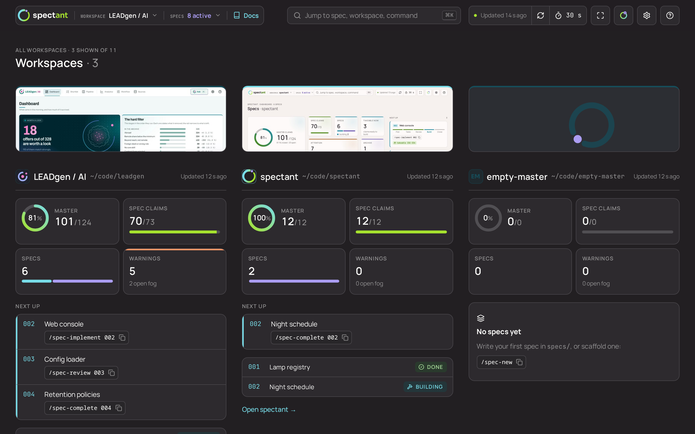
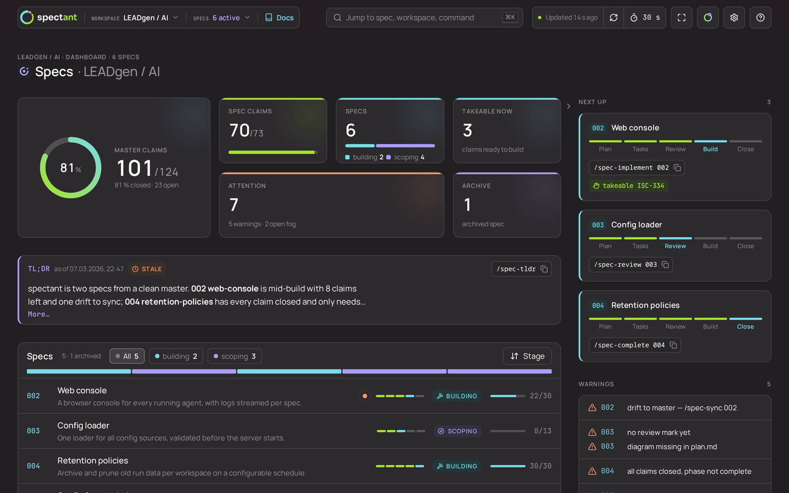
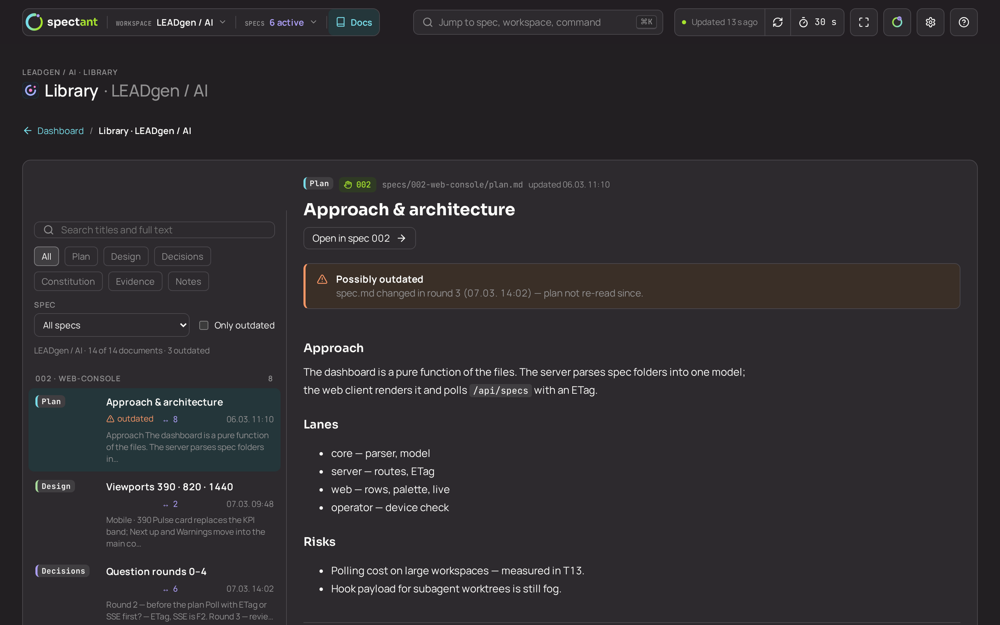
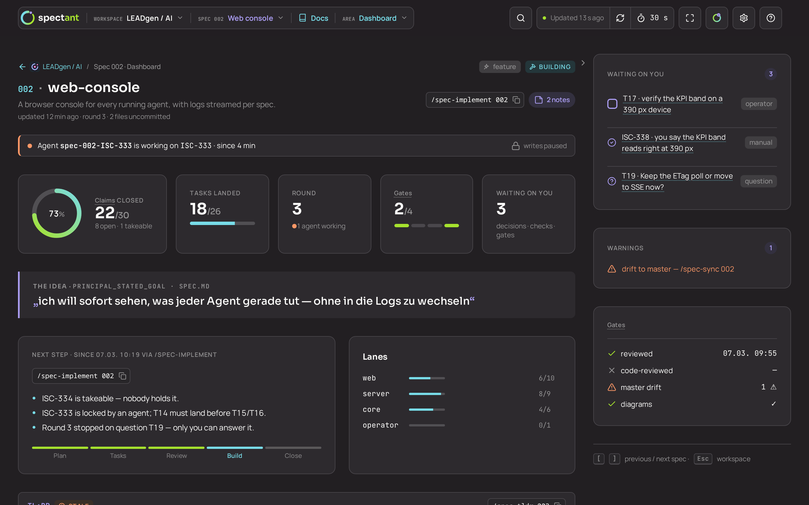
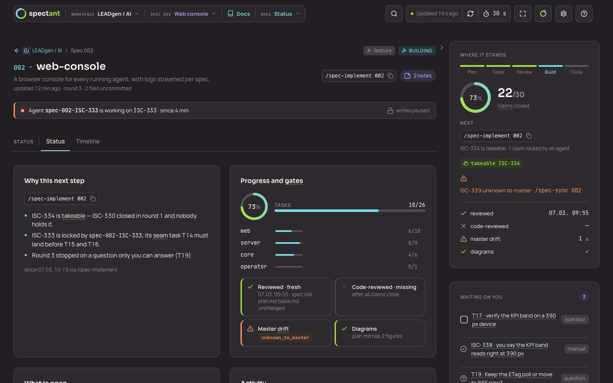
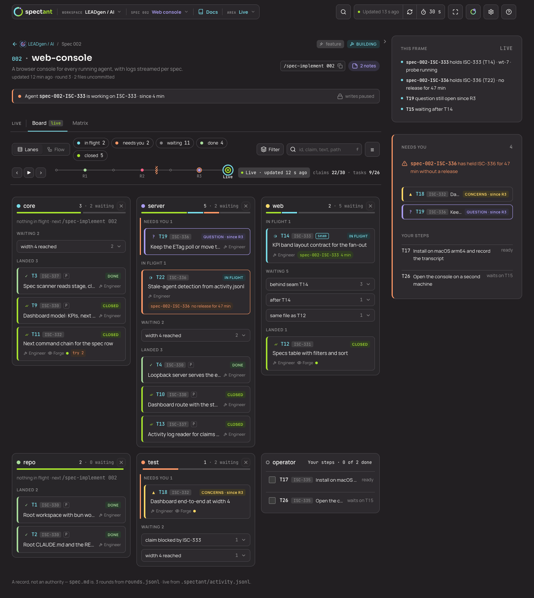
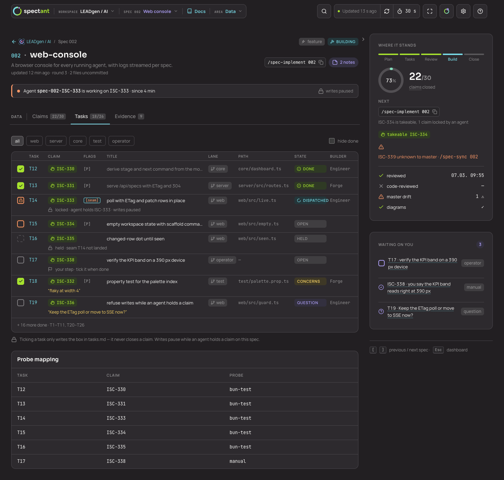
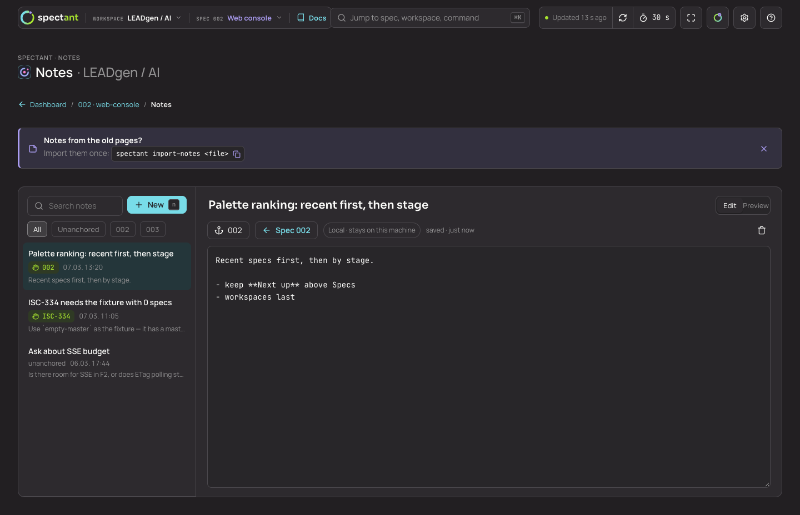

# <picture><source media="(prefers-color-scheme: dark)" srcset="docs/logo.svg"></picture> spectant

**The local spec companion for developers.** spectant is a single binary for macOS and Linux that reads the Markdown
specs in the repositories you register and shows them side by side on one dashboard in your browser, or in a
terminal's web panel. It shows where every spec stands, what comes next and what needs attention, updates in place
when a file changes, and works from the keyboard. It writes only what you set in the app, such as a stage, a review
mark or a task checkbox, and every change lands in versioned files, so git shows what changed and when. Nothing
leaves your machine.

**Work in the chat, keep the overview in the app.** spectant ships with a Spec skill for Claude Code: you shape, plan
and build specs right from the AI chat, and the skill writes plain Markdown into your repository. The app runs beside
it and shows, live, where every spec stands, what waits on you and which agent works on what.

> **Status:** pre-release, spec 001 in progress. Nothing below is released yet.

## Preview

Desktop screens of the design prototype the app is being built against (spec 002, dark theme, fixture data). The
running app does not render these pages yet.



| Workspace dashboard | Library |
|---|---|
|  |  |
| **Spec dashboard** | **Status area** |
|  |  |
| **Live board** | **Tasks** |
|  |  |
| **Notes** | |
|  | |

## Install

```sh
curl -fsSL https://github.com/<org>/spectant/releases/latest/download/install.sh | sh
```

The script picks the binary for your OS and architecture. Set `INSTALL_DIR` to choose where it goes; it never edits
your shell configuration.

## The Spec plugin for Claude Code

Spec work starts in the chat: the plugin `spectant` adds one skill, `/spec`, with eight subcommands along a spec's
life — `init`, `idea`, `new`, `plan`, `tasks`, `review`, `implement`, `done` — and the bare `/spec` for help,
status and drift. It needs [bun](https://bun.sh) and runs without the app; the app shows what the plugin writes.

```sh
claude plugin marketplace add <org>/spectant      # or a local checkout: claude plugin marketplace add ./spectant
claude plugin install spectant@spectant
```

What ships is `plugin/spectant/`: the skill and a bundled CLI, `spec-check`, that writes claims, verification lines,
events, marks and run lines through the same parser the app reads with. If another command already uses `/spec`,
the skill answers as `/spectant:spec`.

## Usage

```sh
spectant add <repo>                   # register a repository
spectant list                         # show registered repositories
spectant remove <repo>                # unregister one
spectant import-notes <file>          # import the old notes page's JSON export (a rerun skips what is there)
spectant export-notes <file>          # write every note to <file> in that same JSON shape
spectant db rollback <version> --yes  # undo newer schema migrations before running an older build
spectant                              # start the dashboard and open it in the browser
```

`spectant` listens on `127.0.0.1:7717` (or the next free port) and prints the URL. Pass `--no-browser` to skip
opening a browser, `--port N` to choose the port.

## How it works

- spectant reads the Markdown specs (`specs/`) of each registered repository. The files are the only source of truth.
- It never changes a registered repository, `.git/` included, except along eight write paths, each one an action you
  take:
  1. the reviewed mark: `specs/NNN-slug/.gates/reviewed.json` plus one line in `events.jsonl`;
  2. a task checkbox: one line of `tasks.md`;
  3. a stage transition: `stage:` in `spec.md` plus one line in `events.jsonl`, from the board or the API;
  4. a story's allocation: the new folder `specs/NNN-slug/` with `context.md`, `spec.md` and `events.jsonl`, and the
     story file `specs/ideas/<slug>.md` removed;
  5. the feature-level code-review mark: `.gates/code-reviewed.json` with `scope: F<n>` plus one line in
     `events.jsonl` per spec of the feature, written by `spectant gate code-reviewed F<n>` on the command line, never
     from the browser;
  6. the token measurement: `specs/tokens.jsonl`, one file per repository, rewritten by `spectant tokens --yes` on the
     command line, never from the browser (without `--yes` it only prints what it would write);
  7. the feature backlog: `specs/backlog.md` rewritten with the features' rank and priority, plus one line in
     `specs/backlog.events.jsonl`, when you reorder features or set a priority in the app or through the API.
  8. the run release: one `run-end` line with `outcome: released` and your `u:` id appended to
     `.spectant/activity.jsonl`, when you release a run that hangs on an item in the app; nothing in the file is
     rewritten.

  A write from the app is checked against the file you saw (a file changed since is refused and left untouched). Every
  write to a spec is refused while an agent holds an open claim on it; the backlog and the run release belong to no spec and check no claim. Every write lands in place: no temp file, no
  commit, and `.gates/` and the new spec folder are the only directories it may create.
- It keeps only a workspace registry and your settings in SQLite, in `$XDG_DATA_HOME/spectant` or `~/.spectant/`.
  Deleting that directory loses nothing a repository says.
- The server listens on loopback only; the web UI, fonts and icons are embedded in the binary.
- spectant ships with its Spec skill, a Claude Code plugin that shares the same spec parser. You start spec work
  from the AI chat with the skill; the app runs alongside as the place to see, steer and administer it. The skill is
  written for Claude Code first and is meant to work with other agents that understand skills. The plugin lands with
  its own spec.

## Development

Requires [Bun](https://bun.sh).

```sh
bun install
bun run dev      # server from source on 127.0.0.1:7718, app with live reload on http://127.0.0.1:4300
bun run verify
```

Contributor and agent working notes live in `CLAUDE.md`. The repository's own specs are planning material and stay
untracked; the format they follow is `FORMAT.md`.

## License

Apache-2.0. See `LICENSE`; third-party notices are in `THIRD_PARTY_NOTICES.md`.

## Acknowledgements

The ISA spec format descends from [danielmiessler/LifeOS](https://github.com/danielmiessler/LifeOS) (MIT).
