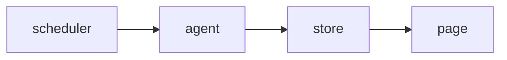

<!-- SPEC — a derived view of ../../ISA.md (feature F2, Status page). Claim IDs belong to the
     master. Never edit the master from this file. -->

# 002 — Status page

## Problem

Users ask in chat whether a service is down; there is no page to point them to.

## Goal

A public page lists every public check with its state and works without script.

## Claims

- [ ] ISC-4: The status page lists every public check with its current state.
- [ ] ISC-5: The status page renders without script at 390 px.
- [ ] ISC-6: Anti: a private check appears on the public status page.

## Test Strategy

| isc | type | check | threshold | tool | anchors_to | severity |
|-----|------|-------|-----------|------|------------|----------|
| ISC-4 | e2e | the status page lists every public check with its current state | pass | `bun run e2e -- status -g list` | literal |  |
| ISC-5 | browser | the status page renders without script at 390 px | pass | `bun run test:browser -- status` | literal |  |
| ISC-6 | bun-test | anti: a private check appears on the public status page | pass | `bun test tests/status.test.ts -t private` | literal |  |

## Decisions

- 2026-03-05: opened.

## Verification
