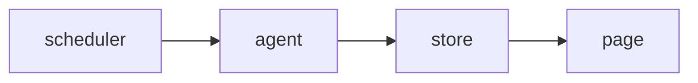

<!-- SPEC — a derived view of ../../ISA.md (feature F3, Alerting). Claim IDs belong to the
     master. Never edit the master from this file. -->

# 003 — Alert rules

## Problem

Every failed run sends a message, so one outage floods the channel and the real one is missed.

## Goal

An alert rule fires once per outage on the channel it names.

## Claims

- [ ] ISC-7: An alert rule names a check, a threshold and a channel.
- [ ] ISC-8: A rule fires once per outage, not once per failed run.
- [ ] ISC-9: A rule that names an unknown channel is refused when saved.

## Test Strategy

| isc | type | check | threshold | tool | anchors_to | severity |
|-----|------|-------|-----------|------|------------|----------|
| ISC-7 | bun-test | an alert rule names a check, a threshold and a channel | pass | `bun test tests/rules.test.ts -t shape` | literal |  |
| ISC-8 | bun-test | a rule fires once per outage, not once per failed run | pass | `bun test tests/rules.test.ts -t once` | literal |  |
| ISC-9 | bun-test | a rule that names an unknown channel is refused when saved | pass | `bun test tests/rules.test.ts -t channel` | literal |  |

## Decisions

- 2026-03-05: opened.

## Verification
