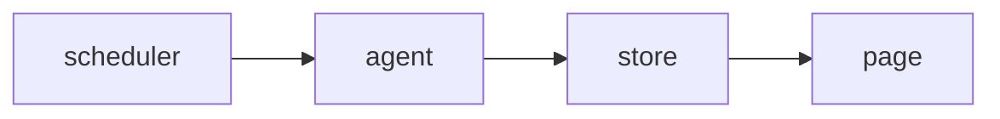

<!-- SPEC — a derived view of ../../ISA.md (feature F4, Incident notes). Claim IDs belong to the
     master. Never edit the master from this file. -->

# 004 — Incident notes

## Problem

The status page shows that a service was down but not why.

## Goal

Each outage can carry a note that shows on the status page, newest first.

## Claims

- [ ] ISC-10: An incident note is attached to the outage it describes.
- [ ] ISC-11: Incident notes show on the status page, newest first.
- [ ] ISC-12: Editing a note keeps its first publication time.

## Test Strategy

| isc | type | check | threshold | tool | anchors_to | severity |
|-----|------|-------|-----------|------|------------|----------|
| ISC-10 | bun-test | an incident note is attached to the outage it describes | pass | `bun test tests/notes.test.ts -t attach` | literal |  |
| ISC-11 | e2e | incident notes show on the status page, newest first | pass | `bun run e2e -- notes -g order` | literal |  |
| ISC-12 | bun-test | editing a note keeps its first publication time | pass | `bun test tests/notes.test.ts -t edit` | literal |  |

## Decisions

- 2026-03-06: opened.

## Verification
