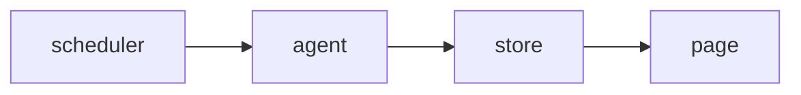

<!-- SPEC — a derived view of ../../ISA.md (feature F5, Probe agents). Claim IDs belong to the
     master. Never edit the master from this file. -->

# 005 — Probe agents

## Problem

Every check runs from one host, so a regional outage looks like a global one, or like none.

## Goal

Agents in several regions run checks and report signed results over one connection.

## Claims

- [x] ISC-13: A probe agent registers with a one-time token.
- [x] ISC-14: A registered agent reports its results over one connection.
- [ ] ISC-15: An agent that stops reporting is shown as silent within two intervals.
- [ ] ISC-16: A check can be pinned to one region's agents.
- [ ] ISC-17: Results from a revoked agent are dropped. (after: ISC-18)
- [ ] ISC-18: An agent's results are signed and rejected when the signature fails.
- [ ] ISC-19: [DROPPED — see Decisions 2026-03-07] Agents update themselves from the console.

## Test Strategy

| isc | type | check | threshold | tool | anchors_to | severity |
|-----|------|-------|-----------|------|------------|----------|
| ISC-13 | bun-test | a probe agent registers with a one-time token | pass | `bun test tests/agents.test.ts -t register` | literal |  |
| ISC-14 | bun-test | a registered agent reports its results over one connection | pass | `bun test tests/agents.test.ts -t report` | literal |  |
| ISC-15 | bun-test | an agent that stops reporting is shown as silent within two intervals | pass | `bun test tests/agents.test.ts -t silent` | literal |  |
| ISC-16 | bun-test | a check can be pinned to one region's agents | pass | `bun test tests/agents.test.ts -t region` | literal |  |
| ISC-17 | bun-test | results from a revoked agent are dropped | pass | `bun test tests/agents.test.ts -t revoked` | literal |  |
| ISC-18 | bun-test | an agent's results are signed and rejected when the signature fails | pass | `bun test tests/agents.test.ts -t signed` | literal |  |
| ISC-19 | bun-test | agents update themselves from the console | pass | `bun test tests/agents.test.ts -t update` | literal |  |

## Decisions

- 2026-03-06: opened.
- 2026-03-07: agents do not update themselves; ISC-19 is dropped and its task struck.

## Verification

- ISC-13: `bun test tests/agents.test.ts -t register` passed, 2026-03-08
- ISC-14: `bun test tests/agents.test.ts -t report` passed, 2026-03-08
