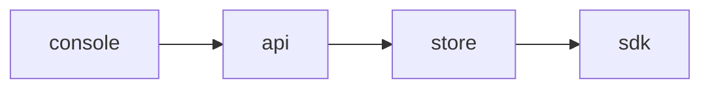

<!-- SPEC — a derived view of ../../ISA.md (feature F1). Claim IDs belong to the master. Never edit the
     master from this file. -->

# 001 — Flag targeting

## Problem

A flag is either on for everyone or off for everyone.

## Goal

A flag rule targets the users whose attributes match it.

## Claims

- [ ] ISC-1: A flag rule targets users by attribute, within one evaluation.
- [ ] ISC-2: A rule with an unknown attribute is refused when saved.
- [ ] ISC-3: Anti: a disabled rule still matches a user.

## Test Strategy

| isc | type | check | threshold | tool | anchors_to | severity |
|-----|------|-------|-----------|------|------------|----------|
| ISC-1 | bun-test | a flag rule targets users by attribute, within one evaluation | pass | `bun test tests/targeting.test.ts -t attribute` | literal |  |
| ISC-2 | bun-test | a rule with an unknown attribute is refused when saved | pass | `bun test tests/targeting.test.ts -t unknown` | literal |  |
| ISC-3 | bun-test | anti: a disabled rule still matches a user | pass | `bun test tests/targeting.test.ts -t disabled` | literal |  |

## Decisions

- 2026-03-02: opened.

## Verification
