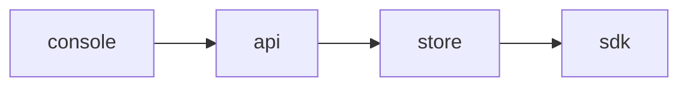

# Plan 002 — Audit trail

**Purpose:** how the claims in `spec.md` get built. The what lives there; this file holds no acceptance criterion.

## Approach

One module per concern, behind the API; the SDKs read a snapshot and never the store.

## Affected Files and Modules

| Path | Change | Claim |
|------|--------|-------|
| `api/src/audit-trail.ts` | new | ISC-4 |
| `api/src/audit-trail.ts` | new | ISC-5 |
| `api/src/audit-trail.ts` | new | ISC-6 |
