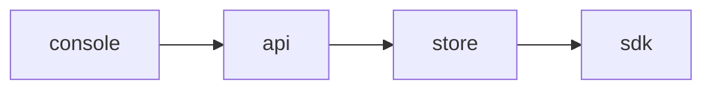

<!-- SPEC — a derived view of ../../ISA.md (feature F2). Claim IDs belong to the master. Never edit the
     master from this file. -->

# 002 — Audit trail

## Problem

Nobody can say who switched a flag on or when.

## Goal

Every flag change is recorded with its actor and time.

## Claims

- [ ] ISC-4: Every flag change is recorded with its actor and time.
- [ ] ISC-5: The audit trail lists changes newest first.
- [ ] ISC-6: Anti: a change is recorded without its actor.

## Test Strategy

| isc | type | check | threshold | tool | anchors_to | severity |
|-----|------|-------|-----------|------|------------|----------|
| ISC-4 | bun-test | every flag change is recorded with its actor and time | pass | `bun test tests/audit.test.ts -t record` | literal |  |
| ISC-5 | e2e | the audit trail lists changes newest first | pass | `bun run e2e -- audit -g order` | literal |  |
| ISC-6 | bun-test | anti: a change is recorded without its actor | pass | `bun test tests/audit.test.ts -t actor` | literal |  |

## Decisions

- 2026-03-03: opened.

## Verification
