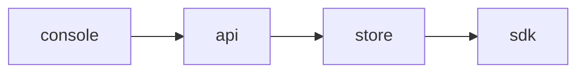

<!-- SPEC — a derived view of ../../ISA.md (feature F3). Claim IDs belong to the master. Never edit the
     master from this file. -->

# 003 — Flag expiry

## Problem

Flags stay in the code long after their rollout ended.

## Goal

A flag carries an expiry date and an expired flag is listed for clean-up.

## Claims

- [ ] ISC-7: A flag carries an optional expiry date.
- [ ] ISC-8: An expired flag is listed on the clean-up page.
- [ ] ISC-9: An expired flag keeps serving its last value.

## Test Strategy

| isc | type | check | threshold | tool | anchors_to | severity |
|-----|------|-------|-----------|------|------------|----------|
| ISC-7 | bun-test | a flag carries an optional expiry date | pass | `bun test tests/expiry.test.ts -t date` | literal |  |
| ISC-8 | e2e | an expired flag is listed on the clean-up page | pass | `bun run e2e -- expiry -g list` | literal |  |
| ISC-9 | bun-test | an expired flag keeps serving its last value | pass | `bun test tests/expiry.test.ts -t serve` | literal |  |

## Decisions

- 2026-03-01: opened.

## Verification
