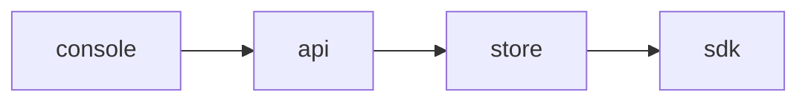

# Plan 005 — SDK rollout

**Purpose:** how the claims in `spec.md` get built. The what lives there; this file holds no acceptance criterion.

## Approach

One module per concern, behind the API; the SDKs read a snapshot and never the store.

## Affected Files and Modules

| Path | Change | Claim |
|------|--------|-------|
| `api/src/sdk-rollout.ts` | new | ISC-12 |
| `api/src/sdk-rollout.ts` | new | ISC-13 |
| `api/src/sdk-rollout.ts` | new | ISC-14 |
