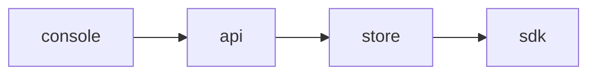

<!-- SPEC — a derived view of ../../ISA.md (feature F5). Claim IDs belong to the master. Never edit the
     master from this file. -->

# 005 — SDK rollout

## Problem

Every flag evaluation is a call to the API.

## Goal

The SDKs evaluate flags locally from one snapshot and reload it on change.

## Claims

- [x] ISC-12: The server SDK evaluates flags locally from one snapshot.
- [ ] ISC-13: The browser SDK reloads its snapshot on a change event.
- [ ] ISC-14: A rollout to the staging tenant is confirmed by hand on the staging console.

## Test Strategy

| isc | type | check | threshold | tool | anchors_to | severity |
|-----|------|-------|-----------|------|------------|----------|
| ISC-12 | bun-test | the server sdk evaluates flags locally from one snapshot | pass | `bun test tests/sdk.test.ts -t snapshot` | literal |  |
| ISC-13 | bun-test | the browser sdk reloads its snapshot on a change event | pass | `bun test tests/sdk.test.ts -t reload` | literal |  |
| ISC-14 | manual | a rollout to the staging tenant is confirmed by hand on the staging console | pass | `manual check on the staging console` | literal |  |

## Decisions

- 2026-03-02: opened.

## Verification

- ISC-12: `bun test tests/sdk.test.ts -t snapshot` passed, 2026-03-07
