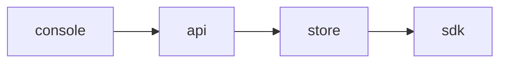

<!-- SPEC — a derived view of ../../ISA.md (feature F1). Claim IDs belong to the master. Never edit the
     master from this file. -->

# 007 — Segment builder

## Problem

Every flag repeats the same targeting rules.

## Goal

A segment is built once in the console and reused by several flags.

## Claims

- [ ] ISC-17: A segment is built from attribute rules in the console.
- [ ] ISC-18: A segment can be reused by several flags.
- [ ] ISC-19: Anti: deleting a segment in use is allowed.

## Test Strategy

| isc | type | check | threshold | tool | anchors_to | severity |
|-----|------|-------|-----------|------|------------|----------|
| ISC-17 | e2e | a segment is built from attribute rules in the console | pass | `bun run e2e -- segments -g build` | literal |  |
| ISC-18 | bun-test | a segment can be reused by several flags | pass | `bun test tests/segments.test.ts -t reuse` | literal |  |
| ISC-19 | bun-test | anti: deleting a segment in use is allowed | pass | `bun test tests/segments.test.ts -t delete` | literal |  |

## Decisions

- 2026-03-06: opened.

## Verification
