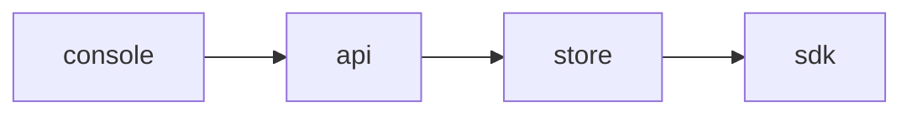

# Plan 008 — Change webhooks

**Purpose:** how the claims in `spec.md` get built. The what lives there; this file holds no acceptance criterion.

## Approach

One module per concern, behind the API; the SDKs read a snapshot and never the store.

## Affected Files and Modules

| Path | Change | Claim |
|------|--------|-------|
| `api/src/change-webhooks.ts` | new | ISC-20 |
| `api/src/change-webhooks.ts` | new | ISC-21 |
| `api/src/change-webhooks.ts` | new | ISC-22 |
