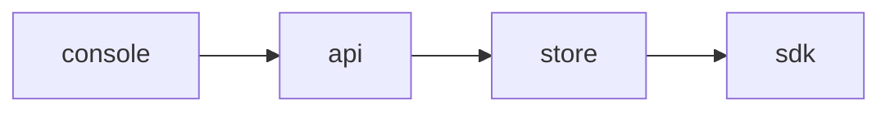

<!-- SPEC — a derived view of ../../ISA.md (feature F2). Claim IDs belong to the master. Never edit the
     master from this file. -->

# 008 — Change webhooks

## Problem

Other systems poll the API to notice a flag change.

## Goal

A flag change sends a signed webhook, retried on failure.

## Claims

- [ ] ISC-20: A flag change sends a signed webhook.
- [ ] ISC-21: A failed webhook is retried three times.
- [ ] ISC-22: Anti: a webhook carries a secret value.

## Test Strategy

| isc | type | check | threshold | tool | anchors_to | severity |
|-----|------|-------|-----------|------|------------|----------|
| ISC-20 | bun-test | a flag change sends a signed webhook | pass | `bun test tests/webhooks.test.ts -t signed` | literal |  |
| ISC-21 | bun-test | a failed webhook is retried three times | pass | `bun test tests/webhooks.test.ts -t retry` | literal |  |
| ISC-22 | bun-test | anti: a webhook carries a secret value | pass | `bun test tests/webhooks.test.ts -t secret` | literal |  |

## Decisions

- 2026-03-04: opened.

## Verification
