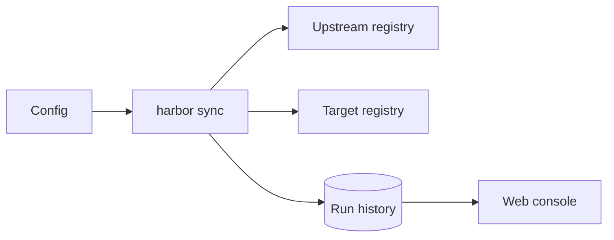

# Harbor — technical documentation

<!-- section: overview -->
## Overview

Harbor mirrors the container manifests a team depends on into the team's own registry. One command, `harbor sync`,
copies every listed manifest byte for byte, and running it again is a no-op. A small web console shows each run, and
retention policies keep the mirror bounded.

<!-- section: stack -->
## Stack

| Part | Built with | Notes |
|------|------------|-------|
| CLI | Bun, TypeScript | `harbor sync`, one binary |
| API | Bun, TypeScript | port 8080, loopback by default |
| Console | Angular | port 4200 in development |

<!-- section: architecture -->
## Architecture

The CLI reads the config, resolves each upstream manifest and pushes it whole to the target, or not at all. Every run
is recorded in the history the console reads through the API.

<!-- section: risks -->
## Risks

- The config loader rewrite touches every package at once; its parity snapshots are the only guard.
- A push interrupted mid-manifest must leave nothing behind in the target; the atomic-push probe holds it.
