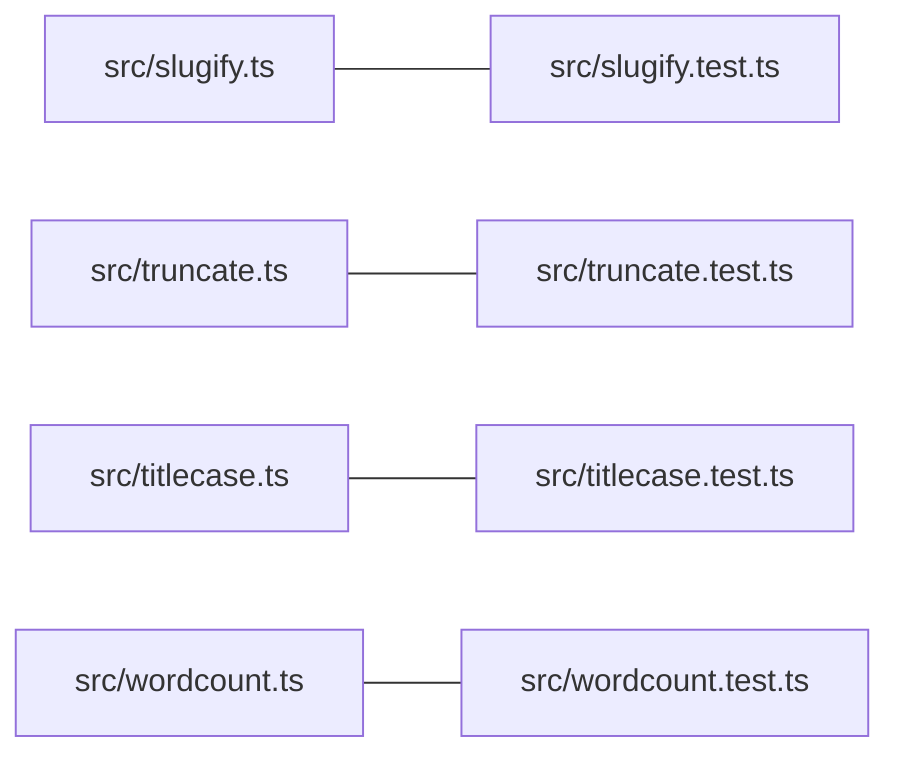

# Plan 001 — Text helpers

**Purpose:** how the claims in `spec.md` get built. The what lives there; this file holds no acceptance criterion.

## Approach

Four independent modules, one per helper, each with its own test file, built in parallel. The obvious path; no shared
utility, because the helpers are small and a shared module would serialise the tasks.

## Affected Files and Modules

| Path | Change | Claim |
|------|--------|-------|
| `src/slugify.ts`, `src/slugify.test.ts` | new | ISC-1 |
| `src/truncate.ts`, `src/truncate.test.ts` | new | ISC-2 |
| `src/titlecase.ts`, `src/titlecase.test.ts` | new | ISC-3 |
| `src/wordcount.ts`, `src/wordcount.test.ts` | new | ISC-4 |

## Risks

| Risk | Blast radius | Early warning | Mitigation |
|------|--------------|---------------|------------|
| A helper diverges from the claim wording | one screen | the test names the claim's example | tests quote the claim's examples verbatim |

## Decisions

- 2026-05-26: T1 to T4 share no code; T3 keeps its small-word list as a module constant (ISC-3), T4 its word pattern (ISC-4).
