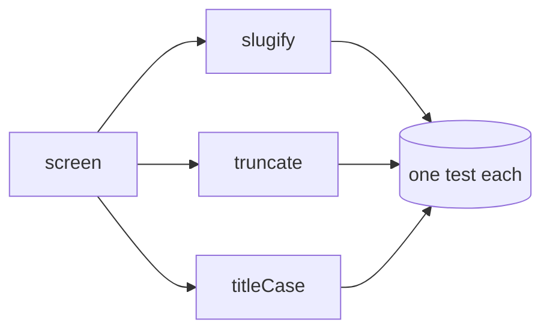

<!-- SPEC — a derived view of ../../ISA.md (feature F1). Claim IDs belong to the master: minted there first, then
     projected here. Never edit the master from this file. -->

# 001 — Text helpers

## Problem

The app shows titles, URL slugs and short previews in about a dozen places. Each screen grew its own helper: three
slug functions disagree on punctuation, two preview cutters count bytes instead of characters and one of them cuts in
the middle of a multi-byte character, and the title casing capitalises every word, so headings read "The Lord Of The
Rings". Support tickets about broken links trace back to slugs that keep a trailing hyphen or two hyphens in a row.
Nobody owns these helpers, and none of them has a test, so every fix in one screen silently diverges from the others.

## Vision

One small module per helper under `src/`, each with a test that names the cases the screens rely on. A screen imports
`slugify`, `truncate` or `titleCase` and gets the same answer as every other screen. The behaviour is written down
once, in this spec's claims, and a reader of the test file can see every rule without reading the code.

## Out of Scope

- Locale-aware casing (Turkish dotless i and the like); the app is English only today
- Transliteration of non-Latin scripts in slugs; such characters are dropped, as the claims say
- Replacing the call sites in the screens; that is a follow-up spec once the helpers exist
- Grapheme-cluster awareness for emoji sequences in `truncate`; characters are UTF-16 code points here

## Constraints

- No dependency: the helpers are a few lines each and must run in the browser and in bun
- Pure functions: no global state, no I/O, the same input gives the same output
- One file and one test file per helper under `src/`, so the three can be built in parallel
- TypeScript strict mode; every export carries a one-line doc comment naming the claim it serves

## Goal

Three text helpers (slugify, truncate, titleCase) behave as specified on every input, each proven by its own test.

## Not yet specified

- fog: Whether `truncate` should prefer to cut at a word boundary when one lies within the last few characters.
- fog: Whether `titleCase` keeps words that are already all upper case (acronyms such as `API`) as they are.

## Claims

- [ ] ISC-1: `slugify(text)` returns the text lower-cased, with every run of characters other than a-z and 0-9 replaced by one hyphen and no hyphen at either end: `slugify("Hello,  World!")` is `hello-world`.
- [ ] ISC-2: `truncate(text, max)` returns the text unchanged when it has at most `max` characters, else its first `max - 1` characters plus `…`, so the result never exceeds `max` characters.
- [ ] ISC-3: Anti: `titleCase(text)` capitalises `a`, `an`, `the`, `of`, `and` or `in` when the word stands neither first nor last.

## Test Strategy

| isc | type | check | threshold | tool | anchors_to | severity |
|-----|------|-------|-----------|------|------------|----------|
| ISC-1 | bun-test | slugify: punctuation, spaces, case | all cases equal | `bun test src/slugify.test.ts` | derived: slugs | high |
| ISC-2 | bun-test | truncate: short, exact, long | length <= max | `bun test src/truncate.test.ts` | derived: previews | high |
| ISC-3 | bun-test | titleCase: small words in the middle | 0 capitalised small words | `bun test src/titlecase.test.ts` | derived: titles | high |

## Decisions

- 2026-05-02: The three helpers live in one spec because they share the same owner and the same review.
- 2026-05-02: No helper may import another one; they stay independent so the tasks can run in parallel.
- 2026-05-03: ISC-1 drops every character outside a-z and 0-9 after lower-casing, including accented letters; transliteration is out of scope.
- 2026-05-03: T1 writes slugify with a single regular expression replace and a trim of hyphens, no loop.
- 2026-05-04: The slug of an empty string, or of a string with no letters or digits, is the empty string.
- 2026-05-04: ISC-2 counts characters as UTF-16 code units for now; the fog line on word boundaries stays open.
- 2026-05-05: T2 uses the single character `…` (U+2026), never three dots, so the result length is exact.
- 2026-05-05: truncate with max below 1 returns the empty string rather than throwing.
- 2026-05-06: ISC-3 lists exactly six small words: a, an, the, of, and, in. Others (to, for, on) are capitalised like any word.
- 2026-05-06: T3 lower-cases a small word in the middle even when the input has it capitalised ("The Lord Of The Rings" becomes "The Lord of the Rings").
- 2026-05-07: The first and the last word are always capitalised, small or not.
- 2026-05-07: Words are split on single spaces; runs of spaces are kept as they are by titleCase.
- 2026-05-08: Hyphenated words in titleCase are one word: only their first letter changes.
- 2026-05-08: Every test file uses describe blocks named after the helper, so `bun test -t` can pick one.
- 2026-05-09: The helpers export named functions only; no default export.
- 2026-05-09: Doc comments name the claim ID, so a reader of the code finds the rule in the spec.
- 2026-05-10: Performance is no concern: the inputs are titles and short previews under one kilobyte.
- 2026-05-10: The call-site migration spec will reuse these claims as its regression set.
- 2026-05-11: A reviewer asked whether slugify should keep underscores; it does not (ISC-1 names a-z and 0-9 only).
- 2026-05-11: truncate never trims whitespace; a preview that ends in a space before the ellipsis is the caller's choice.

## Verification
