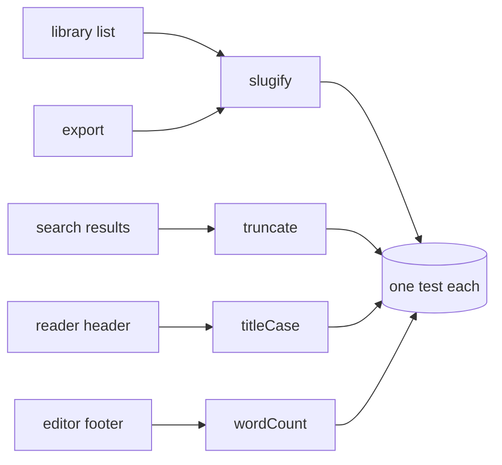

<!-- SPEC — a derived view of ../../ISA.md (feature F1). Claim IDs belong to the master: minted there first, then
     projected here. Never edit the master from this file. -->

# 001 — Text helpers

## Problem

The app shows titles, URL slugs, short previews and word counts in about a dozen places: the library list, the reader
header, the share dialog, the search results, the export file names, the notification digest and the admin audit log.
Each screen grew its own helper over three years. Three slug functions disagree on punctuation and on what happens to
accented letters; two preview cutters count bytes instead of characters, and one of them cuts in the middle of a
multi-byte character, which shows up as a replacement glyph at the end of a preview. Title casing capitalises every
word, so headings read "The Lord Of The Rings", and the word count in the editor footer counts a hyphenated word as two
words while the export counts it as one, so the two numbers never agree.

Support tickets about broken links trace back to slugs that keep a trailing hyphen or two hyphens in a row, and to
slugs that differ between the share dialog and the export because one strips digits at the start and the other does
not. A designer filed a ticket because previews in the search results end in an ellipsis even when nothing was cut.
Nobody owns these helpers, none of them has a test, and every fix in one screen silently diverges from the others. The
cost is not the code, which is a few lines each; it is the time spent finding out which of the helpers a screen uses
and why it disagrees with the next screen.

## Vision

One small module per helper under `src/`, each with a test that names every rule the screens rely on. A screen imports
`slugify`, `truncate`, `titleCase` or `wordCount` and gets the same answer as every other screen. The behaviour is
written down once, in this spec: the claims say what each helper promises, and the Decisions rows that name a claim or
its task hold the exact rules, so a builder, a reviewer and a later reader all find the same list in one place.

A reader of a test file can see every rule without reading the code, because each test case quotes the rule it proves
in its name. When a screen needs a new rule, it is added as a Decisions row naming the claim, then as a test case, then
in the code, in that order.

## Out of Scope

- Locale-aware casing (Turkish dotless i and the like); the app is English only today
- Transliteration of non-Latin scripts in slugs; such characters are dropped, as the rules say
- Replacing the call sites in the screens; that is a follow-up spec once the helpers exist
- Grapheme-cluster awareness for emoji sequences in `truncate`; the unit is the code point
- Hyphenation, justification or any layout concern; the helpers return strings and numbers only
- A configuration object per helper; every rule is fixed, and a screen that needs another rule asks for it here

## Constraints

- No dependency: the helpers are a few lines each and must run in the browser and in bun
- Pure functions: no global state, no I/O, the same input gives the same output
- One file and one test file per helper under `src/`, so the four can be built in parallel
- TypeScript strict mode; every export carries a one-line doc comment naming the claim it serves
- Every rule a test proves is quoted in the test name, so a failing test names the rule it broke
- No regular expression with the `u` flag-dependent behaviour beyond what bun and the evergreen browsers share

## Goal

Four text helpers (slugify, truncate, titleCase, wordCount) follow every rule this spec writes down, each proven by its own test.

## Not yet specified

- fog: Whether `truncate` should prefer to cut at a word boundary when one lies within the last few characters.
- fog: Whether `titleCase` keeps words that are already all upper case (acronyms such as `API`) as they are.
- fog: Whether `wordCount` should count numbers with a decimal point (`3.14`) as one word or two.

## Claims

- [ ] ISC-1: `slugify(text)` follows every slug rule of this spec's Decisions that names ISC-1 or T1, and `slugify("Hello,  World!")` is `hello-world`.
- [ ] ISC-2: `truncate(text, max)` follows every truncation rule of this spec's Decisions that names ISC-2 or T2, and its result never exceeds `max` characters.
- [ ] ISC-3: `titleCase(text)` follows every casing rule of this spec's Decisions that names ISC-3 or T3, and `titleCase("the lord of the rings")` is `The Lord of the Rings`.
- [ ] ISC-4: `wordCount(text)` follows every counting rule of this spec's Decisions that names ISC-4 or T4, and `wordCount("one  two\nthree")` is 3.

## Test Strategy

| isc | type | check | threshold | tool | anchors_to | severity |
|-----|------|-------|-----------|------|------------|----------|
| ISC-1 | bun-test | slugify: every ISC-1 rule | all cases equal | `bun test src/slugify.test.ts` | derived: slugs | high |
| ISC-2 | bun-test | truncate: every ISC-2 rule | length <= max | `bun test src/truncate.test.ts` | derived: previews | high |
| ISC-3 | bun-test | titleCase: every ISC-3 rule | all cases equal | `bun test src/titlecase.test.ts` | derived: titles | high |
| ISC-4 | bun-test | wordCount: every ISC-4 rule | all cases equal | `bun test src/wordcount.test.ts` | derived: counts | high |

## Decisions

- 2026-05-02: The four helpers live in one spec because they share the same owner and the same review.
- 2026-05-02: ISC-1 rule: lower-case the text first, then replace every run of characters outside a-z and 0-9 with one hyphen.
- 2026-05-03: No helper may import another one; they stay independent so the tasks can run in parallel.
- 2026-05-03: ISC-1 rule: accented Latin letters are dropped, not transliterated: `Café` becomes `caf`.
- 2026-05-04: Every test file uses describe blocks named after the helper, so `bun test -t` can pick one.
- 2026-05-04: T1: no hyphen at the start or the end of a slug; `--a--` becomes `a`.
- 2026-05-05: The helpers export named functions only; no default export.
- 2026-05-05: T1: digits stay, also at the start: `2024 Plans` becomes `2024-plans`.
- 2026-05-06: Doc comments name the claim ID, so a reader of the code finds the rule in the spec.
- 2026-05-06: ISC-1 rule: the slug of a string without letters or digits is the empty string.
- 2026-05-07: Performance is no concern: the inputs are titles and short previews under one kilobyte.
- 2026-05-07: T1: an underscore is not kept; `snake_case` becomes `snake-case`.
- 2026-05-08: The call-site migration spec will reuse these claims as its regression set.
- 2026-05-08: ISC-2 rule: characters are Unicode code points, not UTF-16 units; an emoji counts as one.
- 2026-05-09: The library list keeps its own sort order; sorting is not a helper of this spec.
- 2026-05-09: T2: the ellipsis is the single character `…` (U+2026) and counts as one character of `max`.
- 2026-05-10: The audit log stores raw titles; it calls no helper and stays out of scope.
- 2026-05-10: ISC-2 rule: a text of at most `max` characters is returned unchanged, without an ellipsis.
- 2026-05-11: The share dialog will switch to slugify in the migration spec, not here.
- 2026-05-11: T2: `max` below 1 returns the empty string; `max` of exactly 1 on a longer text returns `…` alone.
- 2026-05-12: A reviewer asked for a benchmark; declined, the inputs are too small to matter.
- 2026-05-12: ISC-2 rule: trailing whitespace before the ellipsis is removed: `truncate("ab cd", 4)` is `ab…`.
- 2026-05-13: The export file name adds the date itself; slugify is not asked to.
- 2026-05-13: T2: the cut never splits a surrogate pair.
- 2026-05-14: The notification digest truncates at 120 characters; that number belongs to the digest, not to truncate.
- 2026-05-14: ISC-3 rule: the small words are exactly a, an, the, of, and, in, on, to, for; others are capitalised.
- 2026-05-15: The search highlighter keeps working on raw text; it is not affected.
- 2026-05-15: T3: the first and the last word are always capitalised, small or not.
- 2026-05-16: The editor footer shows the word count of the selection when there is one; that logic stays in the editor.
- 2026-05-16: ISC-3 rule: a small word in the middle is lower-cased even when the input capitalises it.
- 2026-05-17: Old slugs in stored links are not rewritten; the router keeps a redirect table for them.
- 2026-05-17: T3: runs of spaces are kept as they are; words are split on single spaces only.
- 2026-05-18: The design system documents the ellipsis glyph; truncate follows it, nothing else does.
- 2026-05-18: ISC-3 rule: a hyphenated word is one word, only its first letter changes: `well-known` becomes `Well-known`.
- 2026-05-19: A proposal to merge the helpers into one text module was declined: four files build in parallel.
- 2026-05-19: T3: a word after a colon is capitalised even when it is a small word: `Rings: the Return` becomes `Rings: The Return`.
- 2026-05-20: Error handling: the helpers never throw on a string; a non-string is a type error at compile time.
- 2026-05-20: ISC-4 rule: words are maximal runs of letters, digits, apostrophes and hyphens.
- 2026-05-21: The team agreed to review the helpers together with the migration spec, in one sitting.
- 2026-05-21: T4: a hyphenated word counts once; `well-known` is one word.
- 2026-05-22: Snapshot tests were considered and declined: each rule gets a named case instead.
- 2026-05-22: ISC-4 rule: an apostrophe inside a word keeps it one word: `don't` is one word.
- 2026-05-23: The helpers are not exported from the package index until the migration spec lands.
- 2026-05-23: T4: punctuation alone (`--`, `...`) is no word.
- 2026-05-24: Lint rules stay as they are; no new rule for the helpers.
- 2026-05-24: ISC-4 rule: the empty string and whitespace-only strings count zero.
- 2026-05-25: The changelog entry is written by the migration spec, which is the user-visible change.
- 2026-05-25: T4: line breaks and tabs separate words like spaces.

## Verification
