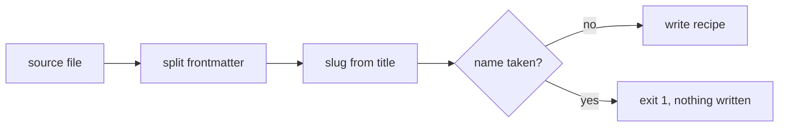

# Plan 001 — Recipe import

## Approach

A pure function in `src/import.ts` turns the source text into a file name and the file's text; the command checks the
target name and writes once. Frontmatter is passed through untouched: the function splits it off and appends it back.

## Stack Decisions

| Concern | Choice | Why |
|---------|--------|-----|
| Runtime | bun 1.3 | the repository runs on bun |
| Frontmatter | split on the first two `---` lines, no YAML library | the text must stay byte-identical |
| File write | `Bun.write` once, after the name check | an import never touches an existing recipe |

## Risks

- A recipe without a title has no file name; the command refuses it and names the missing title.
- Two recipes whose titles slug to the same name collide; the second import is refused.
