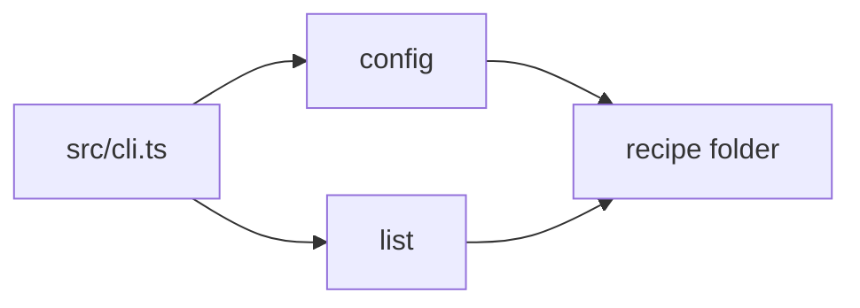

<!-- section: overview -->
## Overview

The recipe box is a command-line tool that keeps recipes as plain Markdown files in one folder. It imports a recipe
from a file, lists the ingredients of several recipes as one shopping list and reads its recipe folder from a config
file. Everything runs offline on bun.

Hand-written: the nightly export runs at 02:00 and must not be moved.

<!-- section: stack -->
## Stack

- TypeScript on bun 1.3; no runtime dependency.
- Recipes are Markdown files with YAML frontmatter; the tool never parses the frontmatter beyond the title.
- The config file is JSON.

<!-- section: architecture -->
## Architecture

One entry point, `src/cli.ts`, dispatches to one module per command. Each module is a pure function over the recipe
texts plus one write at the end.

<!-- section: risks -->
## Risks

- A recipe folder on a network drive makes every command slow; the tool assumes a local disk.
- A recipe edited by hand while a command runs may be read half-written.
